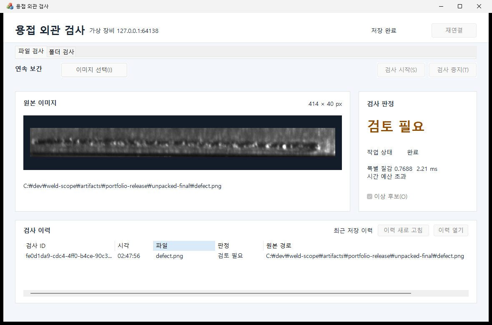

# WeldScope

WeldScope는 공개 용접 외관 PNG를 분석하는 C++ 검사 프로그램입니다. Windows MFC에서 파일이나 폴더를 선택해 검사하고, 원본과 후보 오버레이 및 MySQL 이력을 확인할 수 있습니다. 루프백 TCP 장비 요청도 같은 검사 경로를 사용합니다.

## 실행과 재현

- **폴더 검사 ZIP** — Windows 11에서 x64 패키지를 풀고 런처를 더블클릭합니다. 폴더를 한 번 선택해 검사하고 진행률과 판정별 이력을 확인할 수 있습니다. [실행 안내](docs/steps/S13-run-package.md) · [전체 GUI E2E](docs/steps/S13-folder-inspection-monitoring.md)
- **소스 빌드** — Visual Studio에서 `weld-scope.slnx`를 열고 x64 Release로 빌드합니다. x64 MFC와 같은 구성의 OpenCV가 필요합니다. 빌드가 기본 모델과 설정을 실행 파일 옆에 복사합니다. [현재 앱 빌드·실행·ZIP 생성](docs/steps/S13-folder-inspection-monitoring.md#관리자와-검수자-재현-명령)
- **평가 자료** — OPENZDM은 공식 분할을 사용합니다. 원본 취득 절차, 공용 검증 규칙, 설정 및 동결 기록에서 평가를 재현할 수 있습니다. [데이터 취득](docs/steps/S02-data-preparation.md) · [평가 기준](docs/adr/0011-algorithm-integration-evaluation.md) · [의존성과 영상 출처](docs/steps/S12-third-party-notices.md)

## 구현과 결과

- **기본 검사기** — x64 MFC 앱은 위치별 밝기·무늬를 읽는 220개 나무 모델로 검사합니다. 사진 폭에 따라 판정 경계를 연속적으로 조정하고 애매한 점수에는 정밀 분석을 최대 한 번 적용합니다. 성능과 실패 사례의 측정 범위는 OPENZDM 공개 영상입니다. [기존 앱과의 비교 및 실제 실패 사례](docs/algorithms/openzdm-false-pass-eda.md)
- **앱과 통합** — MFC 화면과 작업 수명, Winsock 기반 루프백 장비 프로토콜, MySQL C API 기반 이력 저장·재조회·재전송을 구현했습니다. 영상 연산과 PNG 처리에는 OpenCV를 사용합니다. [파일 검사](docs/steps/S09-file-inspection-integration.md) · [TCP와 MySQL](docs/steps/S10-record-device-integration.md)
- **S11 비교** — 최초 동결 주 시험에서 선택적 분석은 정상 오판을 줄였고, KO 자동 통과는 두 반복에서 754건·752건으로 기준 경로의 750건보다 많았습니다. 주 시험은 유사한 교차 분할 그룹을 제외했으며 부품 단위 독립성은 미확인입니다. 시간은 Windows 11 ARM QEMU VM의 x64 Release에서 측정했습니다. [네 경로와 두 시험 집합의 결과](docs/steps/S11-algorithm-integration-evaluation.md#시험-결과)
