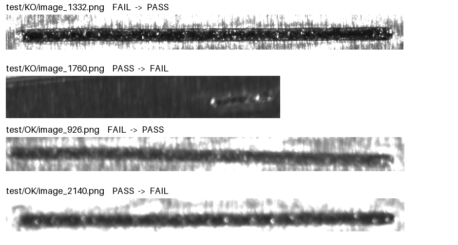
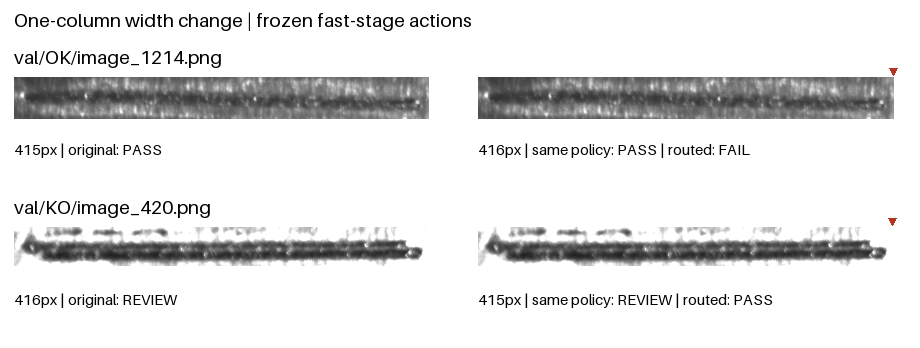

# 용접 외관 검사 알고리즘 연구와 교체 판정

이 문서는 OPENZDM 연구 결과와 MFC 반영 판단의 기준이다. `KO → PASS`는 실제 불량이 자동 통과한 경우, `OK → FAIL`은 정상이 자동 탈락한 경우다. `REVIEW`는 사람이 확인할 보류이며 정답 처리하지 않는다. 두 오류의 분모는 각각 전체 불량과 전체 정상이다.

## 버전 2 검수

**새 검사는 LightGBM 모델 하나가 사진 한 장의 판정을 결정한다.** 학습된 나무 220개와 폭별 판정선은 유지했다. 두 판정선 사이의 점수만 검토 대상으로 보낸다. 분석 시간은 기록하고 판정 계산에 사용하지 않는다. 설정 ID와 이력 호환은 [ADR 0014](../adr/0014-lightgbm-only-inspection.md)를 따른다.

교차 분할 유사 사진을 제외한 OPENZDM 시험 사진 8,104장의 CLI 실행 결과다.

| 실제 정답 | 정상 판정 | 불량 판정 | 검토 필요 | 합계 |
|---|---:|---:|---:|---:|
| 불량 | 173 (FN) | 1,253 (TP) | 143 | 1,569 |
| 정상 | 5,373 (TN) | 625 (FP) | 537 | 6,535 |

CLI 두 번의 실행에서 점수, 판정, 이유가 8,104장 모두 일치했고 처리 오류는 0건이었다. 같은 파일을 MFC 폴더 검사로 저장한 결과도 CLI와 8,104장 모두 일치했다. 검토 필요 680장의 사유는 모두 판정 기준 사이였다. 부품과 촬영 배치를 식별할 수 있는 새 생산 데이터에 대한 평가는 별도다.

최종 x64 앱에서 정상·불량·검토 필요를 각각 확인했다. 폴더 검사 검수에서 저장 확인 응답이 끊긴 뒤 재시도, 검사 중지, 재시작 후 이력 조회를 확인했다. 이전 앱으로 저장한 세 종류의 장비 요청은 최종 앱에서 같은 검사 ID와 판정으로 재전송됐다. 이전 설정 ID로 보낸 신규 요청은 거부됐다. 배포 ZIP은 공백이 포함된 영문 경로에서 실행했고, 96 DPI 축소 창과 키보드 포커스를 확인했다. 한글 경로의 ZIP 폴더에서는 이 환경의 실습용 MySQL 시작이 실패했으며, 125% 이상 확대 화면은 검수 범위에 포함되지 않았다. [검증 집계와 산출물 해시](evidence/lightgbm-v2/verification.json)

파일·폴더 UI와 CLI·TCP의 설정 파일은 [설정 안내](../../config/README.md)에서 확인할 수 있다.

## 실제 MFC 검수

아래는 밝기 기반 추가 검사와 132µs 보류가 있던 이전 빌드의 연구 및 검수 기록이다. 위 버전 2 표와 판정 규칙을 구분해 읽는다.

**포트폴리오 x64 앱의 기본 파일·폴더 검사기는 연속 보간 220개 나무 모델이다.** 일반 ZIP을 풀고 `WeldScope-Start.cmd`를 열면 런처가 전용 MySQL과 DLL을 준비한다. 장비 요청의 설정 ID는 `pooled-smooth-220-v1`, 저장되는 버전은 `openzdm-pooled-smooth-220-v1`이다. 아래 표는 이 모델을 기본 앱에 채택하기 전 같은 공개 영상으로 측정한 결과다. [실행 안내](../steps/S13-run-package.md) · [모델과 설정](../../config/pooled-smooth-220.json)

**일반 배포본 재검수.** 기존 실행 폴더에 설치한 최종 x64 Release 앱으로 같은 8,104장을 다시 검사했다. 동결 C++ 실행기의 첫 점수와 8,104장 모두 일치했다. 불량 통과는 **172/1,569(10.96%)**, 정상 오판은 **619/6,535(9.47%)**, 보류는 **751/8,104(9.27%)**, 처리 오류는 0건이었다. 정밀 호출은 670건이었다. 앞서 시작 화면 표시 수정 직전의 빌드에서는 동일 모델의 보류가 816/8,104(10.07%)로 연구 상한을 넘었다. 두 실행은 같은 사진을 검사했으며 시간 예산 때문에 보류 수가 달라질 수 있다.

일반 ZIP의 런처, 파일 검사 6회, 장비 요청 3회, 재시작 후 이력·재전송, 모델 변조·누락 차단을 확인했다. 폴더 검수에서는 저장 확인 응답을 끊은 후의 재시도, 판정 필터와 검사 중지까지 확인했다. 기존 실행 폴더의 검사 DB는 보존했고 기능 검수에는 전용 DB를 사용했다. 화면에서는 DB 연결을 확인하는 동안 모델 오류를 먼저 표시하지 않으며, 확인을 마친 뒤에는 기본 모델명과 저장 상태를 읽을 수 있다. [최종 ZIP·앱·검사 기록](evidence/openzdm-pooled-model/portfolio-release.json) · [실제 런처 화면](evidence/openzdm-pooled-model/portfolio-app.png)

| 실제 MFC 폴더 검사, 같은 공개 원본 8,104장 | S12 | 최종 220개 모델 1회 | 최종 220개 모델 2회 |
|---|---:|---:|---:|
| 불량 통과 / 1,569 | 695 (44.30%) | **169 (10.77%)** | **169 (10.77%)** |
| 정상 오판 / 6,535 | 1,024 (15.67%) | **619 (9.47%)** | **616 (9.43%)** |
| 보류 / 8,104 | 1,093 (13.49%) | **787 (9.71%)** | **797 (9.83%)** |
| 정밀 호출 / 8,104 | 792 (9.77%) | 666 (8.22%) | 659 (8.13%) |
| 처리 오류 | 0 | 0 | 0 |
| 분석시간 중앙값 / p95 | 50 / 164µs | 44 / 153µs | 42 / 145µs |

같은 사진끼리 짝지으면 불량 통과율 차이는 **−33.52%p**(이미지 단위 근사 95% 구간 −36.42~−30.63), 정상 오판율 차이는 **−6.20%p**(−7.25~−5.15)다. 불량 528장은 기존 자동 통과에서 새 자동 탈락으로 바뀌었고, **60장은 기존 자동 탈락에서 새 자동 통과로 바뀌었다.** 정상은 700장을 바로잡았고 309장을 새로 자동 탈락시켰다. 보류로 오간 경우까지 포함한 전이표도 보존했다. 현장의 부품·배치별 신뢰구간은 아직 구할 수 없다. [MySQL 원본 대조와 전이표](evidence/openzdm-pooled-model/mfc-comparison.json)

첫 회 보류율이 연구 한도 10%에 근접해 모델·설정·원본을 고정하고 새 전용 DB에서 한 차례 더 측정했다. 불량 통과 수는 169장으로 같았지만 두 회에 공통인 사진은 165장이다. 나머지 네 장씩은 보류와 통과 사이에서 바뀌었다. 두 회 모두 연구 한도 안에 들었고, 두 번째 실행에서 시간 초과 보류는 584장, 정밀 점수가 애매한 보류는 213장이었다. 실제 기계의 부하가 달라지면 보류율이 달라질 여지가 있다. [MFC 2](evidence/openzdm-pooled-model/mfc-comparison.json)



위 네 사진은 정답별로 통과↔탈락이 뒤집힌 네 종류에서 파일 해시가 가장 작은 한 장씩이다. 두 번째 사진의 오른쪽에는 밝은 점들이 보이며 기존에 놓쳤던 불량을 새 모델이 잡았다. 네 번째 사진에는 끝까지 이어지는 어두운 띠가 있지만 정답은 정상이다. 모델은 이 사진을 새로 탈락시켰다. 사진을 고르는 데 점수나 외관은 쓰지 않았다. 그림은 비율을 보존해 확대한 OPENZDM 원본에 파일명과 판정을 표시한 것이다. [OPENZDM 출처와 라이선스](https://zenodo.org/records/14025630)

두 MFC 버전 각각에서 DB에 저장된 **8,104장 전체의 첫 점수**가 같은 모델의 C++ 연구 실행기와 일치했다. 최종 모델 첫 실행에서 C++ 실행기와 MFC 간에 보류↔자동 판정으로 달라진 사진은 225장이었다. MFC 보류 787장 중 667장은 132µs 시간 초과, 120장은 정밀 점수도 애매한 경우였다. 불량 통과 169장은 전부 빠른 단계에서 통과했다. 132µs는 분석이 한도를 넘었을 때 보류하는 규칙이다. 한 번 시작한 연산을 132µs에 중단하거나 DB·화면까지 132µs 안에 끝내는 보장은 없다. [MFC / C++](evidence/openzdm-pooled-model/mfc-comparison.json)

### 파일 검사, 이력, 장비 응답

원본 정상 한 장과 불량 한 장을 파일 선택 창에서 각각 세 번 검사했다. 정상의 빠른 점수는 매번 0.010489였고, 실제 판정은 보류·통과·보류였다. 불량은 0.768843으로 세 번 모두 탈락했다. 같은 불량으로 로컬 TCP 가상 장비에서 요청 세 개를 보내자 세 번 모두 `RESULT`와 `FAIL`을 받았다. 서버에 기록된 분석은 46~65µs, 클라이언트에서 폴링해 응답을 확인하기까지는 51~82ms였다. 앱을 닫고 다시 열어 같은 요청을 보내도 검사 ID와 결과가 같았고 DB에는 한 행만 남았다. 가중치가 변조되면 새 요청을 거부했고 기존 저장 결과의 재전송은 성공했다. 검수 범위는 실제 MFC·MySQL과 루프백 TCP 가상 장비다. [파일 6회·장비 3회 원시 이력](evidence/openzdm-pooled-model/mfc-device.json)

커밋 전 같은 배포본으로 8,104장을 한 번 더 실행했다. 첫 점수, 저장된 설정 해시와 분석 단계가 모두 일치했고 이력 재열기와 TCP 재전송이 통과했다. 불량 통과 159장, 정상 오판 627장, 보류 785장(9.69%), 처리 오류 0건이었다. [커밋 전 재검수 기록](evidence/openzdm-pooled-model/portfolio-release.json)

## 연구 질문과 판정 기준

S12는 긴 용접 사진에서 주변보다 어두운 후보가 차지하는 비율로 먼저 판정한다. 불량 자국이 짧으면 전체 평균에 묻힐 수 있다. 반대로 정상 표면에 잔점이 많으면 탈락할 수 있다. 목표는 **불량 통과와 정상 오판을 함께 줄이면서 자동 검사 범위를 지키는 것**이다.

| 묻는 질문 | 비교 기준 |
|---|---|
| 영상에서 읽는 정보가 좋아졌나? | 같은 사진의 위치별 무늬를 읽는 모델과 기존 검사기를 짝지어 비교한다. 크기가 같은 정상·불량끼리도 확인한다. |
| 빠른 점수의 개선이 실제 판정으로 이어지나? | C++ 정밀 단계와 132µs 분석 예산을 켠다. 두 오류, 기존에 잡았는데 새로 놓친 불량, 보류, 정밀 호출을 함께 센다. |
| 이미 본 공식 시험에서 고른 모델인가? | 학습·경계 결정·검증에 쓰인 자료와 선택 이력을 공개한다. 공식 시험을 반복한 횟수는 독립 표본 수에 더하지 않는다. |
| 실제 교체가 가능한가? | 새 부품·촬영 배치에서 사전 허용 한도를 확인하고, 동일 모델 버전에 대한 MFC 판정·MySQL 이력·TCP 응답·재전송을 대조한다. |

## 데이터와 독립성

OPENZDM은 전기차 배터리 용접의 **외관**을 사진 한 장마다 정상·불량으로 표시한다. 참 결함의 좌표나 부품·촬영 배치 ID는 제공된 작업 자료에 없다. 학습 35,064장, 경계 결정 8,105장, 검증 8,138장, 공식 시험 9,251장의 파일 해시·라벨을 확인했고 네 집합 사이에 같은 디코딩 픽셀의 사진은 없었다. 검증에서는 직접 관찰한 72장을, 공식 시험에서는 다른 분할과 유사 그룹으로 연결되는 1,147장을 제외해 **주 시험 8,104장**을 정했다. 96개 나무의 공식 시험 보류 수를 본 뒤 48개 대조를 추가했으므로 이 시험은 현장 독립 시험과 구분해야 한다. [원본 데이터와 정답 정의](https://zenodo.org/records/14025630) · [유사 사진 제외 기준](../adr/0011-algorithm-integration-evaluation.md) · [분할 검산](evidence/openzdm-validity-audit.json)

## 동결 모델의 타당성 점검

사진을 가로 여덟 구간과 세로 띠로 나눠 각 칸의 밝기·흩어짐·가로세로 밝기 변화를 읽었다. 가로 위치를 그대로 둔 가운데 칸 모델은 같은 칸을 밝기순으로 정렬한 모델보다 검증에서 불량 통과가 225→196장, 정상 오판이 588→529장이었다. 예를 들어 어두운 점이 똑같이 세 군데 있어도 중앙 한곳에 연달아 있는지 양 끝에 나뉘어 있는지가 구분에 쓰인다. 같은 가로·세로 크기의 정상·불량 10,645쌍에서도 폭별 모델의 AUC는 **0.819**였다. 이는 불량 사진에 더 높은 점수를 준 비율로, 동점은 절반으로 센다. 짝을 만들 수 있는 사진은 3,790장이었고 한 사진이 여러 짝에 들어간다. [위치 대조와 동결 증거](evidence/openzdm-eda-spatial-policy.json) · [검산 코드](https://github.com/hsjni0110/weld-scope/blob/ce2d6f0/tools/audit_openzdm_validity.py)

**위치를 아는 것과 결함 위치를 아는 것은 다르다.** W031은 눈에 띄는 구간의 후보가 70/468픽셀(15.0%)이었지만, 사진의 전체 검사 영역으로 나누면 324/3,600(9.0%)가 돼 초기 연구 규칙에서 통과했다. 위치별 모델은 이 불량을 잡았다. W002는 정상, W005는 불량이지만 둘 다 잔점이 많아 위치별 모델도 두 장 모두 탈락시켰다. 이 예시는 라벨을 가리고 외관을 기록했던 검증 사진이다. 공식 라벨은 개별 자국의 불량 여부까지 알려주지 않는다. [실제 사진 6장](evidence/openzdm-blind-cases.png) · [관찰 원문](evidence/openzdm-blind-observations.csv)

### 폭별 모델과 단일 모델

폭 385~415픽셀은 train 불량 비율이 43.2%, 나머지 폭은 3.9%였다. 폭 구간만으로 검증 사진에 0·1점을 매겨도 AUC가 0.796이다. 폭별 모델은 각 구간에서 학습한 회귀 나무 중 첫 48개의 점수를 평균하고, 애매한 점수에는 공용 정밀 분석을 호출한다. 같은 사진과 나무 설정으로 모든 폭을 함께 학습한 단일 모델과 두 회 비교했다. 전체 검증 AUC는 폭별 0.922, 단일 0.921이었다. 폭별 모델은 정상 오판을 46·51장 줄였지만 불량 통과는 1장 감소·2장 증가했고 보류는 19·23장 늘었다. **불량을 잡으려면 반드시 두 모델이 필요하다는 근거는 약하다.** [폭별 학습 대조](https://github.com/hsjni0110/weld-scope/blob/ce2d6f0/tools/evaluate_openzdm_widths.py) · [재학습·반복 측정](evidence/openzdm-validity-audit.json)

### 한 열을 바꾼 대조

가로 384·385·415·416픽셀인 검증 사진 53장을 전부 골라 오른쪽 끝 한 열을 더하거나 뺐다. 기존 폭의 모델과 판정 경계를 고정하면 첫 단계가 달라진 사진은 4장이다. 똑같은 편집본에 원래 폭과 새 폭의 모델·경계를 적용하면 20장이 달라졌고 그중 6장은 통과와 탈락을 직접 오갔다. 53장 중 50장이 415·416픽셀이어서 전체 모집단 발생률로 볼 수 없다.



위 정상은 415→416픽셀에서 통과가 탈락으로, 아래 불량은 416→415픽셀에서 정밀 검사 대상이 자동 통과로 바뀌었다. 화살표는 편집 위치다. 원본 주 시험에서 이 네 폭의 불량 통과는 두 회 모두 236장 중 **3장**이었다. 네 폭만 완벽하게 고쳐도 **233장**이 남는다. 따라서 경계 한 곳을 다듬는 방법은 전체 유출을 해결할 주 연구 대상으로 삼기 어렵다. [사진별 대조](evidence/openzdm-validity-audit.json) · [원본 및 가공 이미지 라이선스](https://creativecommons.org/licenses/by/4.0/)

## S12와 폭별 48개 나무의 실측

| 주 시험 8,104장 | 불량 통과 / 1,569 | 정상 오판 / 6,535 | 보류 | 정밀 호출 | 분석시간 p95 |
|---|---:|---:|---:|---:|---:|
| S12 첫 회 | 756 (48.2%) | 1,058 (16.2%) | 807 | 810 | 88µs |
| 폭별 모델 첫 회 | 236 (15.0%) | 697 (10.7%) | 618 | 640 | 99µs |
| S12 두 번째 | 757 | 1,057 | 809 | 812 | 87µs |
| 폭별 모델 두 번째 | 236 | 695 | 620 | 640 | 100µs |

첫 회의 불량 통과율 차이는 −33.14%p(짝지은 이미지 단위 근사 95% 구간 −36.25~−30.03), 정상 오판율 차이는 −5.52%p(−6.61~−4.44)다. 같은 회에 S12가 **FAIL**로 잡았다가 새 모델이 **PASS**시킨 불량은 **95장**이다. 새 모델이 놓친 236장 전부가 정밀 단계에 들어가기 전에 통과했다. 폭 385~415픽셀에서는 정상 1,860장 중 571장(30.7%)이 여전히 탈락했다. 첫 두 회는 검사기 실행 순서를 뒤집었다. 사진 자체를 역순으로 읽은 별도 실행에서는 공식 9,251장 전부의 빠른 점수가 같았지만 주 시험 38장이 자동 판정과 보류 사이에서 바뀌었다. 132µs는 PNG 읽기·화면·DB를 제외한 분석 예산이다. [동결 결과](evidence/openzdm-eda-spatial-policy.json) · [역순 재실행](evidence/openzdm-validity-audit.json)

## 첫 단계에서 무엇을 바꿨나

폭 경계에 의존하지 않고 **첫 단계가 읽는 정보와 학습 방법**을 바꾼다. 같은 훈련 원본을 사용해 밝기 크기와 여러 거리에서 본 국소 무늬를 함께 읽고, 두 폭을 하나의 점수로 처리하는 후보를 비교한다. 학습용 35,064장만 가중치에, 별도 8,105장만 경계 결정에 사용한다. 기존 8,138장 검증에서 폭별 모델보다 두 오류를 함께 줄이는지, 보류 10%·정밀 호출 25%의 연구 한도를 지키는지 확인한다. 새 후보를 고른 뒤 실행 파일·모델·경계·입력을 고정해 같은 주 시험에서 재실행한다. 이 연구 한도는 공장의 허용 오류율과 별개다.

### 밝기와 국소 무늬를 함께 학습한 단일 모델

가로 64, 세로 16개 지점에서 표면을 읽어 밝기와 여러 거리에서의 밝기 차이를 계산한다. 예를 들어 밝은 바탕 한가운데의 작은 어두운 부분과, 사진 전체가 고르게 어두운 경우를 구별할 정보를 남긴다. 기존 회귀 나무는 각 나무의 점수를 평균냈다. 새 부스팅 모델에서는 앞선 나무들이 잘 구분하지 못한 사진을 다음 나무의 학습에 반영한다. 학습은 LightGBM, 실제 판독은 C++가 수행한다. 100·220·400개 나무를 검증에서 비교해 400개를 선택했다. 두 번 학습한 모델의 해시가 같았고 별도 258장의 원 학습기·C++ 판독 점수가 일치했다. [학습·선택·동결 코드](https://github.com/hsjni0110/weld-scope/blob/ce2d6f0/tools/evaluate_openzdm_boost.py)

| 같은 주 시험 8,104장, 새로 짝지은 1회 / 2회 | 불량 통과 / 1,569 | 정상 오판 / 6,535 |
|---|---:|---:|
| S12 | 759 / 758 | 1,060 / 1,060 |
| 폭별 48개 나무 | 236 / 232 | 687 / 666 |
| 단일 부스팅 400개, 공통 경계 | **177 / 181** | **498 / 538** |

폭별 모델 대비 두 오류율이 모두 줄었다. 불량 통과율 차이의 짝지은 근사 95% 구간은 첫 회 −5.57~−1.95%p, 두 번째 −5.04~−1.46%p였다. 정상 오판율 차이도 각각 −3.54~−2.24%p, −2.60~−1.32%p였다. **이 후보의 승격은 보류한다.** 첫 회 보류가 906장(11.18%)으로 연구 상한을 넘었고 두 번째는 635장(7.84%)이었다. 두 번 모두 385~415픽셀 바깥에서 놓친 불량은 212장 중 48→83장으로 늘었다. 한 숫자로 나아진 정도를 판단하면 이런 퇴행이 가려진다.

이 실패 후 후속 대조에서는 같은 특징과 같은 학습 가중치를 유지하고, 각 폭의 train 경계 결정 자료에서 점수 경계를 따로 정한다. 각 폭에서 두 오류가 각각 기존 폭별 모델 이하여야 하고, 전체 보류·정밀 호출 한도를 두 회 모두 통과해야 한다. 이 조건으로 검증을 통과한 후보만 다시 동결한다. 공개 시험을 이미 본 상태에서 추가한 후속 대조임을 결과에 반영한다.

### 최종 220개 나무와 연속 폭 경계

1. **점수를 만드는 법을 바꿨다.** 1,024개 표본 지점에서 뽑은 밝기·무늬 특징 518개를 하나의 모델이 읽는다. 두 폭 구간에 같은 나무를 쓴다. 나무는 “이 칸의 밝기 변화가 기준보다 큰가?” 같은 질문을 순서대로 묻고 각 답으로 점수를 보탠다. 낮은 최종 점수는 자동 통과 쪽이다. 점수 0.10을 불량 확률 10%로 해석할 근거는 없다. [특징 계산과 나무 입력](../../src/WeldScope.FileInspection/PooledTexture.h) · [실제 C++ 나무 판독](../../src/WeldScope.FileInspection/CompactBoostedTrees.h)
2. **폭별 실패를 선발 조건에 넣었다.** 첫 폭별 경계 후보들은 검증에서 모두 탈락했다. 다음 실험은 경계 결정 자료에서 기존 모델의 폭별 불량 통과 수의 80%를 목표로 한 번 더 경계를 계산했다. 검증 두 회에서 양쪽 폭 각각의 두 오류가 기존 공간 모델 이하여야 하고 보류 10%·정밀 25% 이하여야 한다는 조건으로 220개를 골랐다. 이 80%는 연구용 경계 선택 기준이다. [경계 선택 코드](https://github.com/hsjni0110/weld-scope/blob/ce2d6f0/tools/calibrate_openzdm_defect_priority.py) · [폭별 검산](https://github.com/hsjni0110/weld-scope/blob/ce2d6f0/tools/evaluate_openzdm_boost_widths.py)
3. **한 픽셀에서 판정이 급변하는 문제를 줄였다.** 가로 약 400픽셀을 64곳에서 읽으면 약 6픽셀마다 한 번 읽는다. 이 간격을 근거로 두 경계(384.5·415.5픽셀) 양쪽 6픽셀에서만 통과·탈락선을 직선으로 잇기로 먼저 정했다. 예를 들어 폭 415→416에서 같은 점수 0.16의 통과선은 약 0.160→0.145가 된다. 다른 폭을 시험해 유리한 숫자를 고르는 절차는 없었다. 같은 편집본 53장에서 **폭만으로** 판정이 달라진 횟수는 21→5, 직접 PASS↔FAIL은 2→0이었다. 원본과 편집본을 직접 비교해도 변화는 22→11, 직접 반전은 3→0이었다. [경계 보간 함수](../../src/WeldScope.FileInspection/InterpolatedScoreBand.h) · [53장별 결과](evidence/openzdm-pooled-model/boundary.json)

| 동일 주 시험, 검사기 실행 순서를 뒤집은 1회 / 2회 | 불량 통과 / 1,569 | 정상 오판 / 6,535 | 보류 / 8,104 | 정밀 호출 | 분석 p95 |
|---|---:|---:|---:|---:|---:|
| S12 | 755 / 753 | 1,048 / 1,060 | 847 / 814 | 813 / 813 | 91 / 88µs |
| 공간 모델 48개 | 237 / 236 | 694 / 700 | 617 / 606 | 642 / 644 | 100 / 96µs |
| 220개, 계단식 경계 | 183 / 183 | 659 / 660 | 618 / 642 | 662 / 660 | 90 / 91µs |
| **220개, 연속 경계** | **173 / 172** | **648 / 669** | **696 / 621** | **670 / 679** | **97 / 89µs** |

연속 경계는 두 회 모두 공간 모델보다 폭 안쪽과 바깥 양쪽에서 두 오류를 줄였다. 특히 바깥 불량 212장은 공간 모델이 두 회 모두 48장을 놓쳤고 최종 모델은 37장을 놓쳤다. 전체 불량 통과율 차이는 두 회 모두 −4.08%p(짝지은 이미지 기준 근사 95% 구간 −5.86~−2.30)였다. 정상 오판율 차이는 −0.70%p(−1.36~−0.04), −0.47%p(−1.12~+0.18)다. 두 번째 정상 오판 차이는 0과도 양립한다. 공간 모델이 탈락시켰던 불량을 새로 자동 통과시킨 사례가 48·46장 있었고, 반대로 바로 잡아 탈락시킨 불량은 각 88장이었다. 같은 사진을 두 번 검사했으므로 분모를 두 배로 늘릴 수 없다. [시험 전체·선정 제외 전후·폭별 표](evidence/openzdm-pooled-model/results.json) · [검증과 동결 해시](evidence/openzdm-pooled-model/freeze.json)

### 남은 오류가 생기는 단계

주 시험에서 두 회 모두 통과한 불량은 **172장**이다. 172장 모두 빠른 단계에서 자동 통과했고 정밀 검사를 한 번도 받지 않았다. 폭 385~415픽셀에서 135/1,357(9.95%), 그 밖에서 37/212(17.45%)였다. 빠른 점수 중앙값은 0.1340, 최솟값은 0.0037이다. 통과선에 아슬아슬하게 걸친 사례만 남은 것이 아니다. 반대로 두 회 모두 탈락한 정상은 **648장**이다. 612장은 두 번 다 빠른 단계, 36장은 두 번 다 정밀 단계에서 탈락했다. 폭 안쪽은 정상 533/1,860(28.66%), 바깥은 115/4,675(2.46%)였다.

두 오류 집합에서 각각 파일 해시가 가장 작은 원본을 열었다. 폭이 408인 불량 사진에는 거의 끝까지 이어지는 어두운 띠와 잔점이 보인다. 기존 S12·공간 모델은 모두 탈락시켰지만 최종 점수 0.243766은 통과선 0.244189보다 0.000423 낮았다. 폭이 409인 정상 사진에도 중앙에 어두운 띠가 보인다. 기존 두 모델은 통과시켰지만 새 점수 0.359625는 탈락선 0.334452를 넘었다. 현재 정답은 사진 전체에 한 개씩 붙어 있어 어느 자국이 결함인지, 조명 또는 생산 공정 중 무엇이 원인인지까지 특정할 수 없다. [OPENZDM](evidence/openzdm-pooled-model/mfc-cases.png)

## 외부 사진과 실제 부품·배치의 구분

Zender 연구진과 제조사가 발표한 실제 용접 사진 중, 정답을 알 수 있고 눈금·글자 표시가 없는 그림 2의 c·d·e를 판독했다. 논문 그림에서 정사각형을 잘라 저자가 기술한 128×128픽셀로 축소했다. OPENZDM 원본의 높이는 22~70픽셀이고 시야도 다르다. 원자료는 제조사 허가 대상이며 세 그림에 부품·촬영 배치 식별자는 없다. [원본 사진과 저자 설명](https://pmc.ncbi.nlm.nih.gov/articles/PMC12693759/figure/sensors-25-07301-f002/) · [가공·재현 코드](https://github.com/hsjni0110/weld-scope/blob/ce2d6f0/tools/replay_external_weld_panels.py)

| 외부 실물 사례 | 저자 정답 | 폭별 48개 나무 | 공통 경계 400개 | 최종 연속 경계 220개 |
|---|---|---|---|---|
| c, 허용되는 그을음 | 정상 | 0.115, 두 번 보류 | 0.668, 보류 / 탈락 | 0.663, 보류 / 탈락 |
| d, 용접 누락 | 불량 | 0.181, 두 번 탈락 | 0.0049, 두 번 통과 | **0.0135, 두 번 통과** |
| e, 긴 구멍 | 불량 | 0.033, 두 번 통과 | 0.025, 통과 / 보류 | **0.0362, 통과 / 시간 초과 보류** |

용접 누락 사진의 폭 128픽셀에서 최종 통과선은 약 0.061이다. 실제 점수 0.0135는 이 선보다 훨씬 낮아 정밀 검사를 건너뛰었다. 이 사례에서는 보류 구간에 들어온 사진만 더 자세히 살피는 방법으로 유출을 고칠 수 없다. [원본 식별 정보와 두 번의 실제 판독](evidence/openzdm-pooled-model/external-panels.json)

각 칸의 두 판정은 사진을 정순·역순으로 처리한 결과다. 같은 사진의 빠른 점수는 동일했다. 다른 출처에서는 불량을 확신에 가깝게 통과시킨 반례다. 세 장은 저자가 골라 발표한 그림이므로 현장 불량 통과율을 계산할 표본으로 쓸 수 없다. 다른 공개 자료 중 CSEM은 실제 부품 번호가 있지만 대상이 나사·와셔·기어이고, ZELD-e의 두 캠페인은 용접 중 적외선·저항·인장 측정이다. 현재 확보한 자료에서는 같은 외관 과제의 새 부품·촬영 배치별 허용 오류율을 판정할 수 없다. [CSEM-MISD 원자료](https://zenodo.org/records/7410513) · [ZELD-e 캠페인과 측정 대상](https://zenodo.org/records/7500184)

현장 검수에는 **사진 경로, 사진 정답, 실제 부품 ID, 촬영 배치 ID**가 함께 필요하다. 예를 들어 같은 부품을 월요일에 다섯 번 찍었다면 사진 다섯 장이 부품 다섯 개를 대표하지 않는다. 학습·경계 선택 때 본 부품과 촬영 배치를 제외한 뒤, 운영자가 사전에 정한 불량 통과율·정상 오판율·보류율 한도를 각 배치에서 확인해야 한다. 허용 한도와 측정 단위(사진·부품), 최소 표본 및 불확실성 기준도 시험 전에 고정해야 한다. 현재 MFC가 발급하는 폴더 묶음 번호는 **검사 실행 ID**다. 이 값으로 사진의 촬영 배치를 복원할 수 없다. 여러 업체의 서로 다른 결함 기준을 합쳐 하나의 현장 수치를 만드는 것도 부적절하다.

### C++와 MFC를 따라 읽는 순서

1. `PooledSmoothModel::score`는 사진을 숫자 목록으로 바꾼 뒤 학습된 나무에 전달한다. `band(width)`는 사진의 폭에 맞는 통과선과 탈락선을 돌려준다. 한 번 읽은 모델은 여러 사진이 함께 쓴다. [모델을 읽고 점수를 내는 C++ 코드](../../src/WeldScope.FileInspection/PooledSmoothModel.h)
2. `analyze_image`는 빠른 점수·소요 시간을 정책에 주고, 필요할 때만 정밀 함수를 실행한다. 코드의 `[&] { … }`는 그때 실행할 작은 함수다. 같은 점수여도 제한 시간을 넘으면 최종 결과는 보류가 될 수 있다. [공용 분석 파이프라인](../../src/WeldScope.FileInspection/AnalysisPipeline.cpp)
3. `RecordAnalysisOutcome`는 각 단계의 점수·시간과 최종 판정을 기록에 옮긴다. `InspectionHistory::Save`가 저장하고, 동일한 장비 요청이 다시 오면 `StoredResponse`가 저장했던 검사 ID와 판정을 돌려준다. 원본 파일과 설정의 해시는 어떤 사진을 어떤 모델로 검사했는지 대조하는 지문이다. [MFC의 저장과 장비 응답](../../src/WeldScope.App/IntegratedInspection.cpp)

## 재현

Windows x64 Release에서 [구현 계획의 빌드 절차](../superpowers/plans/2026-11-22-lightgbm-only.md#작업-4-최종-검수)로 CLI를 준비한다. 검증용 ZIP은 [배포 실행 안내](../steps/S13-run-package.md)를 따른다. 각 출력 폴더는 새 경로를 지정한다.

```powershell
$python = (Resolve-Path .tools/python/python.exe).Path
& $python -m tools.prepare_inspection_inputs --output artifacts/lightgbm-v2/openzdm
$cli = 'artifacts/lightgbm-v2/build/Release/weldscope_inspect.exe'
& $cli --config config/pooled-smooth-220.json --manifest artifacts/lightgbm-v2/openzdm/inputs/test-primary.json --evaluation-split test --output artifacts/lightgbm-v2/cli-check
```

이전 정책의 빌드, 학습, 동결 및 검수 도구는 [교체 전 커밋의 재현 절차](https://github.com/hsjni0110/weld-scope/blob/ce2d6f0/docs/algorithms/openzdm-false-pass-eda.md#재현)에 있다.
