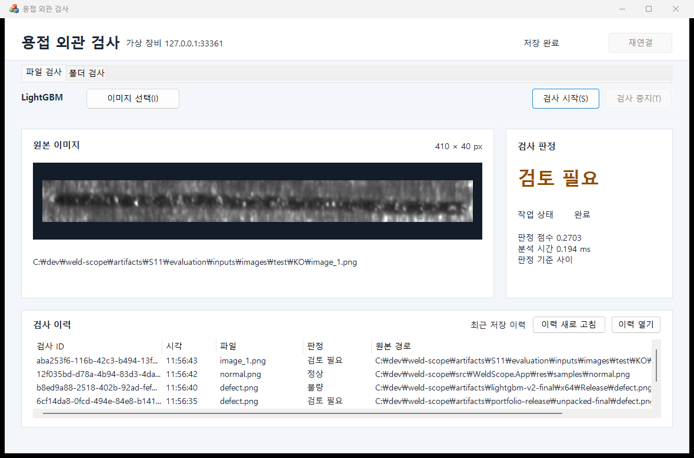
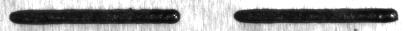

# WeldScope | 전기차 배터리 용접 검사 소프트웨어

## 0. 왜 배터리 제조 검사인가

국제에너지기구(IEA)에 따르면 2025년 세계 전기차 배터리 탑재량은 1.2TWh로, 전년보다 약 30% 늘었습니다. 여기서 탑재량은 판매된 전기차에 들어간 배터리 용량의 합입니다. 배터리 생산 규모가 커지는 흐름을 보면서, 반복되는 품질 검사를 소프트웨어로 어떻게 지원할 수 있는지에 관심을 뒀습니다. [IEA, Global EV Outlook 2026](https://www.iea.org/reports/global-ev-outlook-2026/electric-vehicle-batteries/)

프로젝트의 주제로 셀 단자와 금속 연결판을 잇는 용접부를 골랐습니다. 전류가 흐르는 접합부이고, 사진에서는 용접 자국의 끊김이나 표면 이상을 확인할 수 있습니다. 전기 저항과 접합 강도는 별도 시험으로 확인합니다. NASA의 배터리 조립체 레이저 용접 절차도 공정 승인 때 외관 검사, 전기 저항 측정, 접합부를 떼어 보는 시험을 각각 수행합니다. [NASA, 배터리 조립체 레이저 용접 절차 6.1.4절](https://www.nasa.gov/wp-content/uploads/2023/03/prc-0016-current-0.pdf)

## 1. 외관 판정을 작업 흐름으로 연결

전기차용 배터리 모듈 파일럿 생산 사례에서는 바코드로 셀을 식별하고, 장비가 남긴 용접 조건을 개별 셀에 연결했습니다. 이 사례에서 주목한 것은 나중에 문제가 생겼을 때 어느 제품에 어떤 공정이 적용됐는지 찾을 수 있다는 점입니다. WeldScope에서는 사진과 검사 결과를 연결해, 작업자가 판정 사유를 확인하고 같은 사진을 다시 열 수 있게 했습니다. [캘리포니아 에너지위원회, 전기차용 배터리 모듈 파일럿 생산라인 보고서 4.2절](https://www.energy.ca.gov/sites/default/files/2021-05/CEC-600-2020-053.pdf)

*그림 1. 사진 입력부터 검사 이력 확인까지의 흐름*

검토가 필요한 사진은 별도로 모아 볼 수 있습니다. 아래 화면의 사진은 점수가 두 기준 사이에 있어 `검토 필요`로 표시됐습니다. 오른쪽에서 사유를 확인하고, 아래 이력에서 같은 결과를 다시 열 수 있습니다.

*그림 2. 원본과 검토 사유를 함께 확인한 Windows 앱 화면*

## 2. 놓친 불량에서 시작한 개선

OPENZDM의 공개 용접 사진 61,670장에는 외관상 정상 또는 불량이 표시돼 있습니다. 그중 아래 사진은 관찰 번호 `W031`입니다. 원본은 `val/KO/image_1187.png`이고, 가운데 밝은 틈에서 어두운 용접 자국이 끊겨 있습니다. [OPENZDM 데이터셋, CC BY 4.0](https://zenodo.org/records/14025630)

*그림 3. 초기 밝기 규칙이 정상으로 통과시킨 불량 사진 W031*

초기 방식은 주변과 밝기 차이가 큰 점을 사진 전체에서 셌습니다. W031에서는 그 점이 공백 주변의 15%, 전체 검사 영역의 9%를 차지했습니다. 전체 비율로 판정하자 불량이 정상으로 통과했습니다.

그래서 새 검사기는 사진을 칸으로 나눠 밝기 변화가 어느 위치에 있는지도 읽도록 바꿨습니다. LightGBM이 칸별 밝기와 무늬를 점수 하나로 계산합니다. 점수가 정상 기준과 불량 기준 사이면 사람에게 확인을 넘깁니다.

불량을 정상으로 넘기면 확인할 접합부가 빠집니다. 정상을 불량으로 잡으면 다시 확인할 사진이 늘어납니다. 두 오류를 따로 보기 위해 Windows 앱 두 버전으로 같은 OPENZDM 시험 사진 8,104장을 검사했습니다. 불량 통과율은 실제 불량 1,569장, 정상 오판율은 실제 정상 6,535장을 기준으로 계산했습니다.

*표 1. 같은 시험 사진 8,104장의 판정 결과*

| 항목 | 밝기 규칙 | LightGBM |
|---|---:|---:|
| 불량을 정상으로 통과 | 695장 (44.30%) | 173장 (11.03%) |
| 정상을 불량으로 판정 | 1,024장 (15.67%) | 625장 (9.56%) |
| 검토 필요 | 1,093장 | 680장 |
| 처리 오류 | 0장 | 0장 |

## 3. 검사 중 장애를 다루는 소프트웨어

검사 화면은 C++/MFC로 만들었습니다. 파일과 폴더, 가상 장비 요청은 같은 판정 코드를 사용합니다. 프로젝트에서 직접 확인한 장애 상황은 두 가지입니다.

- **저장 성공 응답 유실.** MySQL이 결과를 저장한 직후 응답을 끊었습니다. 앱에서 다시 저장을 눌렀을 때 처음 검사 번호로 기존 결과를 찾아, 기록은 한 건만 남았습니다.
- **장비 응답 유실.** 같은 요청 번호가 다시 오면 저장한 검사 번호와 판정을 돌려줍니다. 앱을 재시작한 뒤 가상 장비에서 같은 요청을 보내도 같은 결과를 받는지 확인했습니다.

## 4. 공개 데이터에서 확인한 범위

다른 방식으로 촬영한 용접 누락 사진 한 장은 새 검사기에서도 정상으로 통과했습니다. 공개 데이터에는 부품 번호와 촬영 배치 정보가 없어, 조명이나 촬영 범위가 바뀔 때 오류가 늘어나는지 배치별로 확인할 수 없었습니다. 실제 라인에 적용하려면 부품과 촬영 배치를 구분해 별도로 시험하고, 검사 결과를 장비가 해당 부품에 연결하는지도 확인해야 합니다.

## 5. 시연과 기술 기록

1. Windows에서 `WeldScope-Start.cmd`를 실행합니다.
2. **파일 검사**나 **폴더 검사**에서 사진을 선택하고 **검사 시작**을 누릅니다.
3. **검토 필요** 결과를 열어 원본과 판정 사유를 확인합니다. 앱을 다시 열어 검사 이력에서 같은 결과를 조회합니다.

[Windows 배포본 실행 안내](../steps/S13-run-package.md) · [판정 알고리즘과 실험 상세](README.md)
