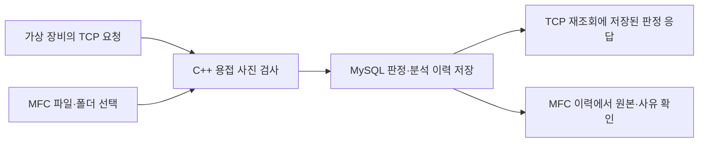

# WeldScope | 전기차 배터리 용접 검사 소프트웨어

## 0. 왜 배터리 제조 검사인가

국제에너지기구(IEA)에 따르면 2025년 세계 전기차 배터리 탑재량은 1.2TWh로, 전년보다 약 30% 늘었습니다. 여기서 탑재량은 판매된 전기차에 들어간 배터리 용량의 합입니다. 배터리 생산 규모가 커지는 흐름을 보면서, 반복되는 품질 검사를 소프트웨어로 어떻게 지원할 수 있는지에 관심을 뒀습니다. [IEA, Global EV Outlook 2026](https://www.iea.org/reports/global-ev-outlook-2026/electric-vehicle-batteries/)

프로젝트의 주제로 셀 단자와 금속 연결판을 잇는 용접부를 골랐습니다. 전류가 흐르는 접합부이고, 사진에서는 용접 자국의 끊김이나 표면 이상을 확인할 수 있습니다. 전기 저항과 접합 강도는 별도 시험으로 확인합니다. NASA의 배터리 조립체 레이저 용접 절차도 공정 승인 때 외관 검사, 전기 저항 측정, 접합부를 떼어 보는 시험을 각각 수행합니다. [NASA, 배터리 조립체 레이저 용접 절차 6.1.4절](https://www.nasa.gov/wp-content/uploads/2023/03/prc-0016-current-0.pdf)

## 1. 장비 요청부터 검사 이력까지

전기차용 배터리 모듈 파일럿 생산라인은 바코드로 셀을 식별하고 용접 조건을 개별 셀에 연결했습니다. 품질 문제를 조사할 때 어느 제품에 어떤 공정이 적용됐는지 찾기 위해서입니다. WeldScope에서는 이 문제를 검사 요청 단위로 다뤘습니다. 가상 장비의 요청 번호, 입력 사진, 판정 결과를 연결해 장비는 결과를 다시 받을 수 있고 작업자는 MFC 화면에서 원본과 판정 사유를 열 수 있습니다. [캘리포니아 에너지위원회, 전기차용 배터리 모듈 파일럿 생산라인 보고서 4.2절](https://www.energy.ca.gov/sites/default/files/2021-05/CEC-600-2020-053.pdf)



*그림 1. 장비 요청, 영상 검사, 결과 저장과 재조회*

검토가 필요한 사진은 별도로 모아 볼 수 있습니다. 아래 화면의 사진은 점수가 두 기준 사이에 있어 `검토 필요`로 표시됐습니다. 오른쪽에서 사유를 확인하고, 아래 이력에서 같은 결과를 다시 열 수 있습니다.


*그림 2. 원본과 검토 사유를 함께 확인한 Windows 앱 화면*

## 2. TCP 바이트 수신과 가상 장비 검증

가상 장비는 같은 PC의 `127.0.0.1`에 열린 C++ Winsock 서버에 접속합니다. 요청에는 사진 대신 등록된 입력 ID `weld-01`을 보냅니다. 서버는 이 ID를 등록된 PNG에 연결합니다. `\t`는 탭, `\n`은 줄바꿈입니다.

*예제 1. 요청과 응답의 형식*

```text
INSPECT\treq-001\tweld-01\tpooled-smooth-220-v2\n
STATUS\treq-001\t<검사 ID>\tIN_PROGRESS\n
RESULT\treq-001\t<같은 검사 ID>\tFAIL\n
```

새 요청을 받아들이면 작업을 등록하고 `IN_PROGRESS`를 돌려줍니다. 가상 장비는 같은 요청 ID로 반복 조회합니다. 아직 새 작업을 받을 수 없거나 DB 조회가 끝나지 않았으면 `BUSY`가 올 수 있습니다. 저장이 끝나면 위 예시처럼 `RESULT`를 받습니다.

`recv()` 한 번에 요청의 일부만 들어오거나 여러 요청이 붙어 들어올 수 있습니다. C++의 `FrameReader`는 수신한 바이트에서 `\n`을 찾습니다. 줄 끝이 없으면 받은 부분을 보관합니다. 줄이 끝나면 탭으로 나뉜 필드를 검사하고, 버퍼에 남은 바이트에서 다음 줄을 계속 읽습니다. 줄바꿈 전 본문이 256바이트를 넘거나 필드가 잘못되면 `BAD_FRAME`을 반환합니다. 응답도 `send()`가 반환한 바이트 수만큼 위치를 옮겨 끝까지 보냅니다.

C++ 단위 테스트는 요청을 두 조각으로 나누고, 뒤쪽 조각에 다음 줄과 미완성 줄을 붙여 `FrameReader`에 전달합니다. 미완성 줄이 남는지 확인합니다. 본문 256바이트를 받은 뒤 줄바꿈이 오면 한 줄을 완성하고, 대신 257번째 본문 바이트가 오면 거부하는지도 검사합니다.

Python 통합 테스트에서는 아래 함수로 실제 소켓에 접속합니다. 한 번 호출할 때 요청 한 줄을 보내고 응답 한 줄을 읽습니다. 같은 요청을 다시 보내 `IN_PROGRESS`와 `RESULT`에 담긴 검사 ID가 같은지 확인합니다.

*예제 2. Python 가상 장비가 쓰는 소켓 요청 함수*

```python
def request(port, request_id, source="weld-01", config="pooled-smooth-220-v2"):
    with socket.create_connection(("127.0.0.1", port), timeout=12) as connection:
        connection.sendall(f"INSPECT\t{request_id}\t{source}\t{config}\n".encode("ascii"))
        with connection.makefile("rb") as reply:
            return reply.readline().decode("ascii").rstrip("\n").split("\t")
```

## 3. MySQL 한 건과 재전송을 확인한 방법

MySQL의 `inspections`는 검사 ID를 기본 키로, 장비 요청 ID를 고유 키로 사용합니다. 이 행에 입력 ID, 원본 경로와 파일 지문, 설정 지문, 판정과 이유를 기록합니다. `analysis_attempts`에는 같은 검사 ID로 분석 단계, 점수, 걸린 시간을 저장합니다. C++은 두 테이블을 한 트랜잭션에서 저장합니다. 폴더 검사에서는 폴더 안의 검사 순서도 함께 저장합니다.

재요청이 오면 요청 ID로 MySQL을 먼저 조회합니다. 저장된 입력 ID와 설정 지문이 일치하면 기존 검사 ID와 판정을 반환합니다. 같은 요청 ID에 다른 설정을 보내면 `REQUEST_CONFLICT`를 돌려줍니다.

*예제 3. 앱 재시작 뒤 TCP 응답과 DB 행을 대조하는 검증 코드*

```python
# frame: 앱을 재시작하기 전에 받은 RESULT
assert request(33361, request_id, config=REGISTRATION) == frame
assert request(33361, request_id, config="selective-v1")[-1] == "REQUEST_CONFLICT"
assert query(f"SELECT COUNT(*) FROM inspections WHERE request_id='{request_id}';") == [["1"]]
```

위 검증은 기존 응답과 재전송 응답의 모든 필드를 비교한 뒤, 같은 요청 ID의 검사 행이 정확히 한 건인지 확인합니다. 별도의 폴더 검사에서는 DB 앞에 프록시를 두었습니다. 프록시가 MySQL에 `COMMIT`을 전달하고 성공 응답을 받은 직후, 앱으로 응답을 보내기 전에 연결을 끊었습니다. 앱은 `저장 확인 필요`를 표시했습니다. 다시 저장을 누른 뒤 전체 파일 경로와 지문을 DB 기록에 대조해 누락이나 중복이 없는지 확인했습니다.

## 4. 놓친 불량에서 시작한 개선

OPENZDM의 공개 용접 사진 61,670장에는 외관상 정상 또는 불량이 표시돼 있습니다. 그중 아래 사진은 관찰 번호 `W031`입니다. 원본은 `val/KO/image_1187.png`이고, 가운데 밝은 틈에서 어두운 용접 자국이 끊겨 있습니다. [OPENZDM 데이터셋, CC BY 4.0](https://zenodo.org/records/14025630)


*그림 3. 초기 밝기 규칙이 정상으로 통과시킨 불량 사진 W031*

초기 방식은 주변과 밝기 차이가 큰 점을 사진 전체에서 셌습니다. W031에서는 그 점이 공백 주변의 15%, 전체 검사 영역의 9%를 차지했습니다. 전체 비율로 판정하자 불량이 정상으로 통과했습니다.

그래서 새 검사기는 사진을 칸으로 나눠 밝기 변화가 어느 위치에 있는지도 읽도록 바꿨습니다. LightGBM이 칸별 밝기와 무늬를 점수 하나로 계산합니다. 점수가 정상 기준과 불량 기준 사이면 사람에게 확인을 넘깁니다.

불량을 정상으로 넘기면 확인할 접합부가 빠집니다. 정상을 불량으로 잡으면 다시 확인할 사진이 늘어납니다. 두 오류를 따로 보기 위해 Windows 앱 두 버전으로 같은 OPENZDM 시험 사진 8,104장을 검사했습니다. 불량 통과율은 실제 불량 1,569장, 정상 오판율은 실제 정상 6,535장을 기준으로 계산했습니다.

*표 1. 같은 시험 사진 8,104장의 판정 결과*

| 항목 | 밝기 규칙 | LightGBM |
|---|---:|---:|
| 불량을 정상으로 통과 | 695장 (44.30%) | 173장 (11.03%) |
| 정상을 불량으로 판정 | 1,024장 (15.67%) | 625장 (9.56%) |
| 검토 필요 | 1,093장 | 680장 |
| 처리 오류 | 0장 | 0장 |

## 5. 검증 범위와 생산라인 적용 조건

장비 통신은 같은 PC의 가상 장비, 저장은 실제 MySQL에서 검증했습니다. 생산라인에서는 앞 부품의 응답이 늦게 도착하는 동안 다음 부품이 들어올 수 있습니다. 장비가 늦게 도착한 결과도 원래 부품에 연결하는지 확인해야 합니다.

공개 데이터에는 부품 번호와 촬영 배치 정보가 없습니다. 다른 방식으로 촬영한 용접 누락 사진 한 장은 새 검사기에서도 정상으로 통과했습니다. 조명이나 촬영 범위가 달라질 때 오류가 얼마나 달라지는지는 부품과 촬영 배치를 구분한 별도 시험이 필요합니다.

## 6. 시연과 기술 기록

1. Windows에서 `WeldScope-Start.cmd`를 실행합니다.
2. **파일 검사**나 **폴더 검사**에서 사진을 선택하고 **검사 시작**을 누릅니다.
3. **검토 필요** 결과를 열어 원본과 판정 사유를 확인합니다. 앱을 다시 열어 검사 이력에서 같은 결과를 조회합니다.

[Windows 배포본 실행 안내](../steps/S13-run-package.md) · [판정 알고리즘과 실험 상세](README.md)

[TCP 수신 코드](../../src/WeldScope.Device/LoopbackServer.cpp) · [메시지 경계 테스트](../../src/WeldScope.Device/ProtocolTests.cpp) · [가상 장비 소켓 코드](../../tools/mfc_test_support.py) · [앱 재시작 후 재전송 검증](../../tools/verify_portfolio_mfc.py) · [저장 응답 유실 검증](../../tools/verify_folder_e2e.py) · [MySQL 저장 코드](../../src/WeldScope.Storage/InspectionHistory.cpp)
