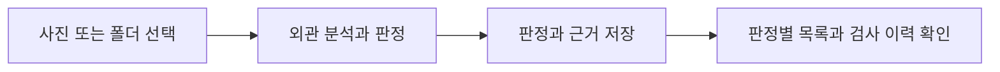
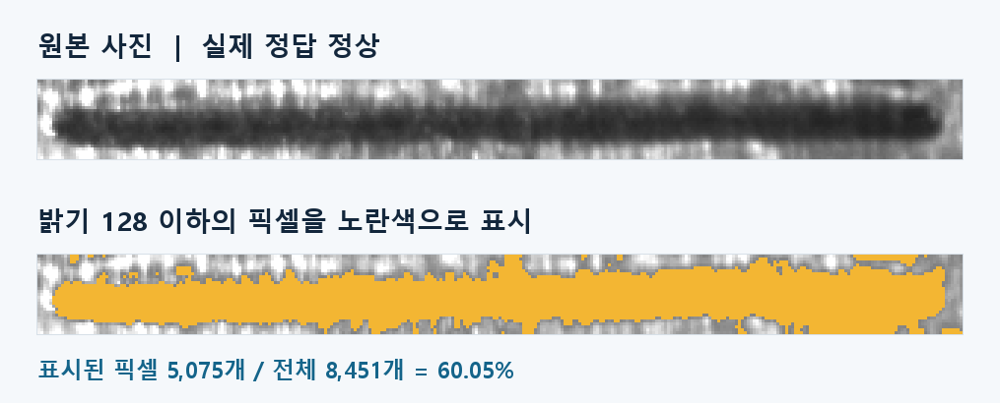
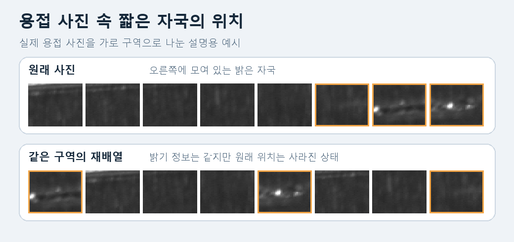
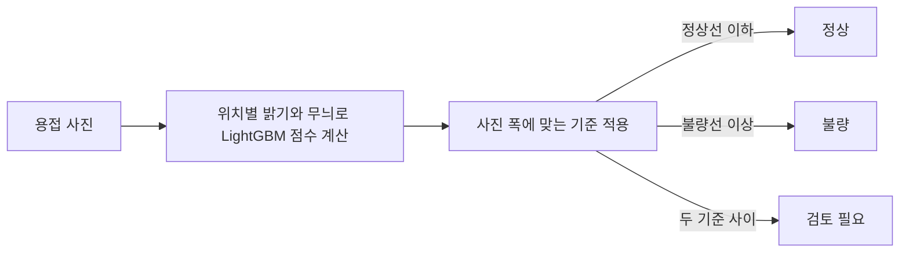
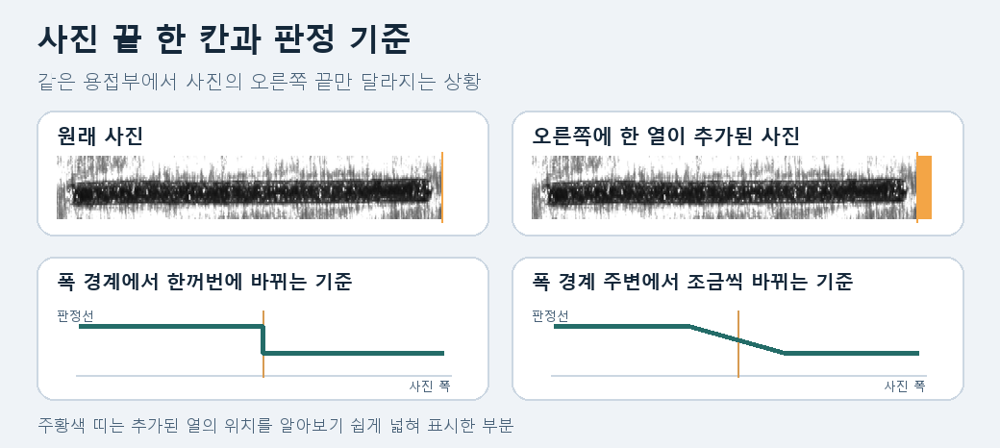
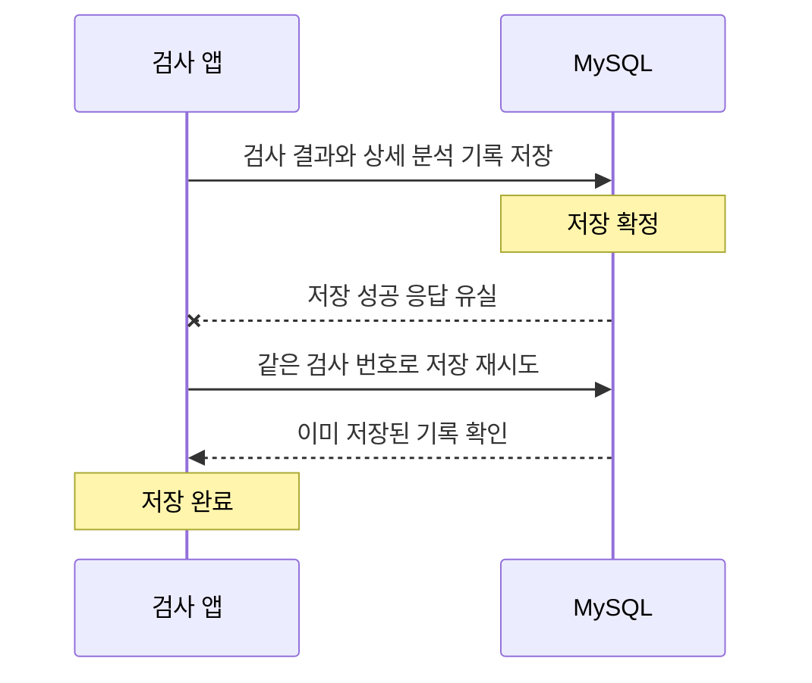

# 용접 외관 검사 기술 포트폴리오

## 배터리 용접 외관 검사의 필요성

용접 외관 검사의 목적은 **추가로 확인할 접합부의 선별**입니다. 전기차 배터리에서 셀 단자와 금속 연결판을 잇는 용접부로 전류가 흐릅니다. 자국이 끊기거나 균열이 보이는 곳은 외관 검사에서 표시하고, 전기 저항과 접합 강도는 별도 시험으로 확인합니다.

<strong>배터리 용접 외관 검사 소프트웨어(WeldScope)</strong>는 Windows에서 사진 한 장이나 폴더를 검사하고 점수와 판정 이유를 저장합니다. 불량을 정상으로 넘기면 확인할 접합부가 빠집니다. 정상 사진을 불량으로 잡으면 다시 볼 사진이 늘어납니다. 두 오류는 따로 집계했습니다.

*사진 입력부터 검사 이력 확인까지의 흐름*

## OPENZDM 용접 사진과 데이터 선택 근거

사진 단위로 판정을 비교할 수 있는 **OPENZDM 전기차 배터리 용접 사진 61,670장**을 사용했습니다. 각 PNG 사진에는 외관상 정상(OK)이나 불량(KO)이 표시돼 있어 같은 사진과 정답으로 여러 방식을 비교할 수 있습니다.

*그림 1. OPENZDM 학습 사진의 정상 및 불량 예시*

| 실제 파일에서 확인한 특징 | 검사 설계에 반영한 점 |
|---|---|
| 가로로 긴 용접부 (가로 48~651픽셀, 세로 22~70픽셀) | 짧은 자국이 사진 전체의 점수에서 희석되는지 확인 (위치별 무늬 비교, 폭 구간별 오류 집계) |
| 정상 49,880장, 불량 11,790장 | 정상이 많은 자료에서는 전체 정확도가 높아도 불량을 놓칠 수 있음 (정상 오판과 불량 통과를 따로 집계) |
| 사진 한 장에 정답 한 개 (결함 위치, 부품 번호, 촬영 배치 정보 미제공) | 사진 단위 판정 성능 비교 (결함 위치나 새 생산 배치에서의 오류율을 검증하려면 별도 자료 필요) |

공개 원본은 학습용 43,169장, 검증용 9,250장, 시험용 9,251장으로 나뉩니다. 시험 사진이 학습이나 검증에 쓰인 사진과 비슷하면 시험 성능이 높아 보일 수 있습니다. 알고리즘 비교용 시험에서는 다른 분할의 사진과 시각적으로 유사한 그룹에 속한 시험 사진 1,147장을 빼고 **8,104장**을 비교했습니다.

## 검사 알고리즘의 버전별 변화

| 버전 | 판정 방식 |
|---|---|
| 버전 1 | 사진 전체의 밝기 규칙에서 주변 밝기 비교로 개선. 점수가 애매한 사진은 밝기 규칙으로 추가 분석 |
| 버전 2 | LightGBM 점수를 사진 폭별 기준과 비교. 점수가 기준 사이면 사람에게 전달 |

## 버전 1. 밝기 규칙 기반 검사

### 사진 전체의 밝기 규칙

첫 기준은 **어두운 픽셀이 사진의 절반 이상이면 불량**입니다. 흑백 밝기를 0(검정)부터 255(흰색)까지 읽고, 128 이하인 픽셀을 셌습니다.

$$
\text{어두운 픽셀의 비율}
= \frac{\text{밝기 128 이하인 픽셀 수}}{\text{전체 픽셀 수}}
= \frac{5{,}075}{8{,}451}
\approx 60\%
$$

*그림 2. 정상 용접 사진의 원본과 밝기 기준 표시*

그림 2는 정상 사진입니다. 노란색으로 표시된 어두운 부분이 절반을 넘어 불량으로 판정됐습니다. 바탕까지 어두운 사진에 같은 기준을 적용한 결과입니다.

### 주변 밝기 비교와 추가 검사

**국소 대비 검사**는 검사할 픽셀과 왼쪽 4개, 오른쪽 4개를 합친 가로 9개의 평균 밝기를 구합니다. 가운데 픽셀과 평균의 밝기 차이가 12보다 크면 그 가운데 픽셀을 표시합니다.

*그림 3. 가운데 픽셀과 좌우 4개씩의 밝기 비교 예시*

$$
\text{밝기 차이} = |90 - 110| = 20 > 12
\qquad
\text{빠른 점수} = \frac{\text{표시된 픽셀 수}}{\text{전체 픽셀 수}}
$$

이전 배포 앱은 첫 점수가 약 0.266 이하면 정상, 약 0.308 이상이면 불량으로 판정했습니다. 그 사이에 있고 시간이 남으면 **밝기 기반 추가 검사**를 했습니다. 가로 31개 픽셀의 평균과도 비교한 뒤 두 범위에서 표시한 점을 합쳤습니다. 표시된 점의 비율과 그중 가로로 3개 이상 이어진 점의 비율을 각각 전체 사진을 기준으로 구해 평균을 냈습니다. 당시의 ‘정밀 점수’는 이 추가 검사에서 계산한 값입니다.

$$
\text{정밀 점수}
= \frac{\text{표시된 픽셀의 비율} + \text{가로로 이어진 픽셀의 비율}}{2}
= \frac{0.40 + 0.30}{2}
= 0.35
$$

정밀 점수가 0이면 정상, 약 0.550 이상이면 불량이었습니다. 예시의 0.35처럼 두 기준 사이에 있거나, 분석 시간이 합산 132마이크로초(0.132밀리초)를 넘으면 검토 대상으로 남겼습니다.

| 같은 사진의 초기 시험 | 전역 밝기 임계값 | 국소 대비 기반 선택적 검사 |
|---|---:|---:|
| 정상 오판율 | 74.63% | **16.19%** |
| 놓친 불량 | 750장 | 754장 |

주변 밝기 비교로 정상 오판은 줄었지만 놓친 불량은 4장 늘었습니다. 놓친 사진 한 장에서 표시된 점은 자국 주변의 15%, 사진 전체의 9%였습니다. 짧은 자국이 전체 평균에 묻힌 사례입니다.

### 추가 분석 실험의 시간 기준

132마이크로초는 **밝기 기반 추가 검사의 비교 조건**입니다. 검증 사진 8,210장에 두 분석을 모두 실행한 뒤, 약 95%의 사진이 처리를 마친 시간(p95)을 마이크로초 단위로 올렸습니다. 가장 느린 몇 장이 기준을 결정하는 것을 피하려고 최대값 대신 이 값을 고정했습니다. 실험에서는 이를 초과한 사진을 ‘검토 필요’로 집계했습니다.

## 버전 2. 위치별 특징을 학습하는 LightGBM 검사

**위치별 밝기와 무늬를 학습한 LightGBM 모델**로 판정 방식을 교체했습니다. 버전 1은 이상해 보이는 점을 세어 사진 전체의 비율로 요약했습니다. 버전 2는 밝은 점이 용접부 한쪽에 모여 있는지, 사진 전체에 흩어져 있는지까지 점수에 반영합니다.

### 용접 자국의 위치와 밝기 정보

그림 4의 위쪽은 실제 용접 사진입니다. 오른쪽 자국이 포함된 구역을 그대로 두면 자국이 한곳에 이어져 보입니다. 아래쪽은 같은 구역을 재배열한 예시입니다. 밝기 정보는 그대로인데 자국의 원래 위치와 연결이 사라집니다.

*그림 4. 구역 재배열에 따른 용접 자국의 위치 정보 손실*

| 위치 비교 실험 | 밝기순 재배열 | 원래 위치 유지 |
|---|---:|---:|
| 놓친 불량 | 225장 | 196장 |
| 정상 오판 | 588장 | 529장 |

두 모델에 같은 구역 정보를 주고 순서만 바꿨을 때, 원래 위치를 남긴 쪽에서 두 오류가 모두 줄었습니다. 별도의 위치 기반 후보가 놓친 불량 236장도 추적했습니다. 모두 첫 점수에서 정상으로 통과해 추가 분석까지 가지 않았습니다. 처음부터 위치와 무늬를 읽는 점수로 바꾼 이유입니다.

### LightGBM 판정 명세

**사진 한 장에 점수 하나**입니다. 가로 64곳과 세로 16곳을 조합한 1,024개 지점에서 밝기와 주변 무늬를 읽습니다. 결정 나무는 ‘이 구역이 주변보다 일정 값 이상 어두운가’ 같은 질문으로 사진을 나눕니다. LightGBM은 앞선 나무들의 오차를 줄이는 방향으로 새 나무를 학습합니다. 앱은 학습된 나무 220개를 C++로 실행합니다.

**검토 필요 기준은 두 판정선 사이의 점수**입니다. 해당 사진은 사람이 원본을 확인합니다. 분석 시간은 별도로 기록하고, 장비의 응답 기한 초과는 통신 상태로 다룹니다.

### 보조 개선. 폭별 오류 점검과 판정선 조정

| 개선 사항 | 적용 근거 |
|---|---|
| 폭 구간별 오류 확인 | 나무 400개 후보는 전체 오류를 줄였지만, 가로 385~415픽셀 바깥의 불량 212장에서는 놓친 건수가 48장에서 83장으로 증가. 보류율도 11.18%로 당시 기준 10% 초과 |
| 통합 모델과 폭별 판정선 | 폭별로 모델을 따로 학습한 경우는 두 실행에서 놓친 불량이 통합 모델보다 1장 감소하거나 2장 증가. 폭 구간별 오류와 검토 건수를 함께 보고 나무 220개를 선택하고, 두 판정선만 폭에 맞춰 조정 |
| 폭 경계의 연속 보간 | 경계를 한 픽셀 넘을 때 기준이 갑자기 바뀌는 문제. 경계 주변에서 판정선을 직선으로 연결 |

사진 폭은 가로 픽셀 수입니다. 공개 시험 사진의 385~415픽셀 구간에서는 약 43%가 불량이었고, 그 밖에서는 약 4%였습니다. 이 차이는 사진을 나눠 오류를 확인할 근거입니다. 버전 2에서는 같은 모델이 모든 사진의 점수를 계산합니다.

*그림 5. 사진 끝 한 열이 달라졌을 때의 판정선 변화*

편집 사진 53장의 모델 점수를 고정하고 폭에 해당하는 판정선만 바꿨습니다. 판정선을 완만하게 연결하자 폭에 따라 판정이 바뀐 사진은 **21장에서 5장**, 정상과 불량이 바로 뒤집힌 사진은 **2장에서 0장**으로 줄었습니다.

### 다른 촬영 조건에서 확인한 한계

다른 방식으로 촬영한 실제 용접 누락 사진에서 나무 220개 모델의 점수는 약 0.014였습니다. 이 사진의 정상선은 약 0.061이어서 정상으로 판정됐습니다. 정상선보다 점수가 훨씬 낮은 불량은 애매한 사진만 사람에게 넘기는 방식으로 잡기 어렵습니다.

### 새 부품과 촬영 배치의 검증 조건

사진 폭에 맞춘 판정 기준은 공개 자료에서 관찰한 차이를 반영합니다. 현장에서 카메라나 자르는 범위가 바뀌면 같은 용접부도 사진 폭과 밝기가 달라질 수 있습니다. 새 부품과 촬영 배치를 통째로 분리한 평가와, 같은 부품을 다른 조명이나 촬영 설정으로 찍은 사진의 비교가 필요합니다.

초기 현장 시험에서는 기존 검사 결과로 장비를 제어하고 앱 판정은 비교 기록에만 남기는 방식이 적합합니다. 배치마다 불량 통과율과 정상 오판율, 검토 건수를 따로 집계해야 특정 부품이나 촬영 조건에서 오류가 몰리는지 볼 수 있습니다. 자동 판정 적용에 필요한 기준은 품질 담당자가 정한 오류 한도와 작업자가 실제로 검토할 수 있는 건수입니다.

## 검사 결과 저장과 장비 응답

저장과 응답 사이에 연결이 끊기면, 결과가 남아 있어도 받는 쪽은 알 수 없습니다. MySQL에서 앱으로 가는 저장 확인과 앱에서 장비로 가는 응답을 각각 시험했습니다.

### 저장 확인 응답이 끊겼을 때의 복구

MySQL은 검사 결과, 상세 분석 기록, 폴더 안의 검사 순서를 한 번에 확정합니다. 이 저장 단위가 트랜잭션입니다. 저장이 확정되는 순간과 앱이 성공 응답을 받는 순간 사이에도 연결이 끊길 수 있습니다.

저장이 확정된 직후 성공 응답을 끊어 보니 화면에는 **저장 확인 필요**가 떴고 MySQL에는 결과가 남았습니다. 여기서 새 검사 번호를 만들면 이미 끝난 검사를 다시 저장하게 됩니다. **저장 재시도**를 눌렀을 때 앱이 처음 검사 번호로 기존 기록을 찾았고, 데이터베이스에도 한 건만 남았습니다.

*그림 6. 저장 확인 필요 상태와 재시도 버튼*

현장에서는 판정이 난 뒤 저장을 확정하기 전에 검사 PC가 꺼질 수도 있습니다. 이때는 같은 검사 번호로 조회해도 완료 기록이 없을 수 있습니다. 재부팅 후 검사를 이어 가려면 접수한 작업과 원본 위치가 남아 있어야 합니다. 재검사에 쓰는 사진의 파일 지문과 모델 버전, 판정 설정도 접수 당시 기록과 대조할 수 있어야 합니다. 복구 검수에서 중요한 것은 저장 직전과 직후에 종료되더라도 같은 작업이 두 번 저장되거나 목록에서 빠지지 않는 것입니다.

### 장비 재전송과 부품별 판정 전달

검사 결과를 저장했어도 응답을 보내는 도중에 연결이 끊길 수 있습니다. 장비는 저장 여부를 알 수 없으므로 재전송할 때 처음 붙인 요청 번호를 그대로 보냅니다. 앱은 이미 저장한 결과가 있으면 같은 검사 번호와 판정을 돌려줍니다. 같은 요청 번호에 다른 사진이나 검사 설정이 들어오면 요청 충돌로 처리합니다.

TCP는 받은 데이터를 순서대로 전달합니다. 한 번 읽었을 때 요청 절반만 들어 있거나 요청 두 건이 붙어 있을 수 있습니다. 앱은 요청 끝에 붙인 줄바꿈을 만날 때까지 받은 내용을 모아 한 건씩 읽습니다. 같은 PC에서 가상 장비로 결과를 저장한 뒤 응답을 받는 것과, 앱을 다시 열어 같은 요청에 같은 결과를 받는 것을 확인했습니다.

실제 장비에서는 앞 부품의 결과를 재전송하는 사이에 다음 부품이 판정 위치에 들어올 수 있습니다. 요청 번호로 같은 결과를 되돌려 주는 것에 더해, 장비가 그 결과를 어느 부품에 적용할지도 확인해야 합니다. 이를 위해서는 판정과 함께 촬영 번호와 부품 번호를 보내고 장비가 그 번호를 확인하는 절차가 필요합니다.

장비 연동에서는 촬영부터 장비가 결과를 확인할 때까지 걸린 시간과 기한 초과 건수를 기준으로 응답을 평가합니다. 연결 복구 후 응답이 중복되거나 대기열이 꽉 차도 앞 부품의 판정이 다음 부품에 적용되지 않아야 합니다. 응답 기한이 지나거나 판정이 보류된 부품을 어디로 보낼지는 실제 장비의 동작과 작업 절차에 따라 정합니다.

## 폴더 검사와 이력 확인

**폴더 검사에서 완료는 저장 확인까지**입니다. 앱은 하위 폴더까지 사진을 한 장씩 검사하고, 저장이 확인된 사진만 완료 건수에 넣습니다. 화면은 검사·저장과 별도로 동작해 작업 중 목록을 바꾸거나 검사를 중지할 수 있습니다.

정상 목록을 누르고 바로 불량 목록을 누르면 앞서 요청한 정상 목록이 더 늦게 도착할 수 있습니다. 앱은 목록 조회마다 번호를 붙여 조건과 번호가 모두 현재 선택과 일치하는 결과만 표시합니다. 결과 행을 열면 원본 사진과 판정 이유를 함께 볼 수 있습니다.

그림 7은 이전 국소 대비 방식의 앱에서 사진 네 장을 검사한 화면입니다. 네 장의 저장이 끝난 뒤 ‘정상’을 선택해 해당 결과 한 건만 열었습니다.

*그림 7. 폴더 검사에서 정상 판정만 표시한 결과 목록*

이전 국소 대비 방식의 앱으로 공개 자료 **61,670장**을 폴더 단위로 검사했습니다. 건수가 같아도 사진 한 장이 빠지고 다른 사진이 두 번 저장될 수 있습니다. 그래서 파일의 폴더 내 위치와 파일 내용에서 얻은 지문(SHA-256)을 원본 목록과 한 건씩 맞춰 봤습니다. 누락, 중복, 파일 내용 불일치는 모두 0건이었습니다. 현재 앱에서는 저장 재시도, 검사 중지, 판정별 목록과 재시작 후 이력을 별도로 확인했습니다.

검수에 쓴 폴더의 사진은 검사 전에 준비돼 있었습니다. 카메라가 공유 폴더에 계속 사진을 쓰는 현장이라면, 복사 중인 파일을 열거나 목록을 읽은 뒤 추가된 사진을 놓칠 수 있습니다. 배치의 완료 여부를 판단하려면 촬영 쪽에서 복사가 끝난 시점에 검사 대상 목록을 확정해야 합니다. 그 목록과 저장 기록을 대조하면 중지 후 이어 검사할 파일과 배치 종료 뒤 도착한 파일도 구분할 수 있습니다.

## 사용 기술과 선택 근거

| 영역 | 사용 기술 | 선택 근거 |
|---|---|---|
| 영상 처리 | OpenCV 4 | 판정 방식 외의 조건 통일 (PNG 읽기, 흑백 변환, 밝기 계산) |
| 모델 학습 | LightGBM | 위치별 밝기와 무늬의 조합 학습 (전체 밝기가 비슷한 사진의 구분) |
| 실행과 검증 | C++17, CMake | 연구 도구와 배포 앱의 판정 코드 공유, 연구 도구와 테스트의 빌드 재현 |
| Windows 화면 | MFC, Visual Studio | 기존 Windows 창과 C++ 프로젝트의 재사용 |
| 검사 이력 | MySQL | 판정과 분석 기록의 일괄 저장, 같은 요청의 중복 저장 방지 |
| 가상 장비 통신 | TCP, Winsock | Windows 앱과 가상 장비 사이의 순서 있는 전송, 연결 끊김과 재전송 검증 |
| 실험 자동화 | Python | 시험 파일의 동일성 확인, 사진별 판정 비교 자동화 |

## 시연 순서

1. Windows에서 VC++ x64 런타임과 MySQL Community 8.4.13을 준비합니다. 배포 ZIP을 풀고 MySQL 설치 위치를 `WELDSCOPE_MYSQL_HOME`에 지정한 뒤 `WeldScope-Start.cmd`를 엽니다.
2. **파일 검사 → 이미지 선택 → 검사 시작**을 누릅니다. 원본 사진과 점수, 판정 이유를 확인합니다.
3. **폴더 검사 → 폴더 선택 → 검사 시작**을 누릅니다. 완료 수를 확인한 다음 원하는 판정만 골라 봅니다.
4. 앱을 다시 열고 **검사 이력**에서 앞선 실행을 조회합니다.

## 영상 출처

OPENZDM 전기차 배터리 용접 외관 사진의 자료 식별자는 DOI 10.5281/zenodo.14025630이며, 이용 조건은 CC BY 4.0입니다. 그림 2는 정상 학습 사진 `train/OK/image_10513.png`를 확대하고 밝기 기준에 걸린 픽셀에 색을 입힌 이미지입니다. 그림 3의 밝기 값은 계산 예시입니다. 그림 4와 5는 OPENZDM 시험용 불량 사진 `test/KO/image_1760.png`와 `test/KO/image_1332.png`를 각각 바탕으로 만든 설명 그림입니다.
