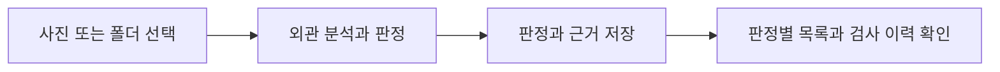
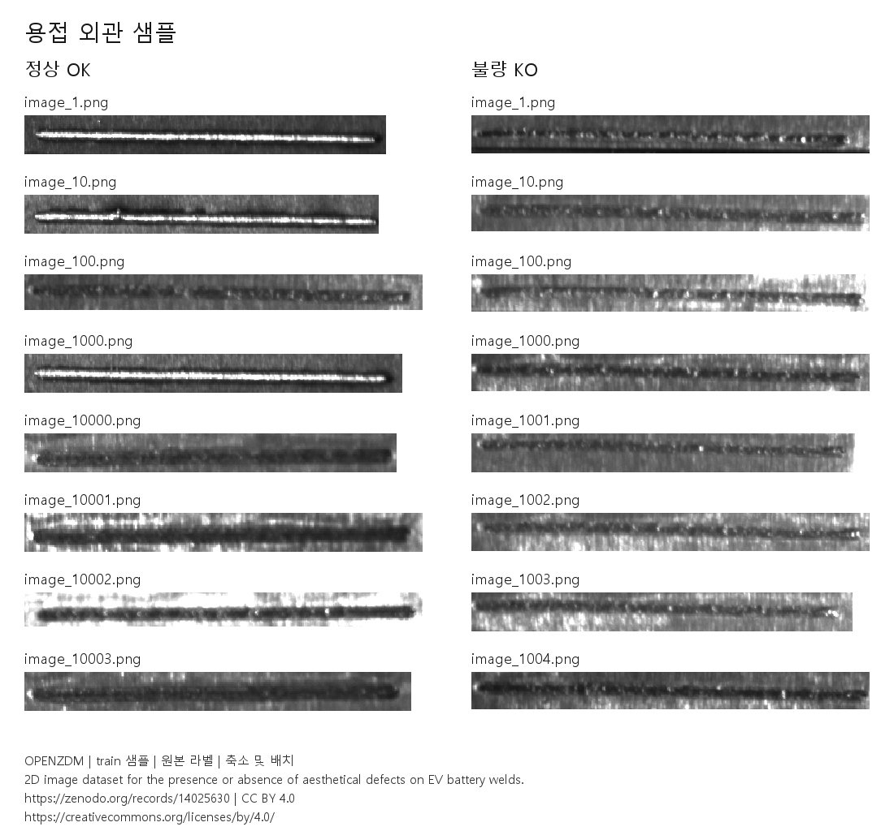
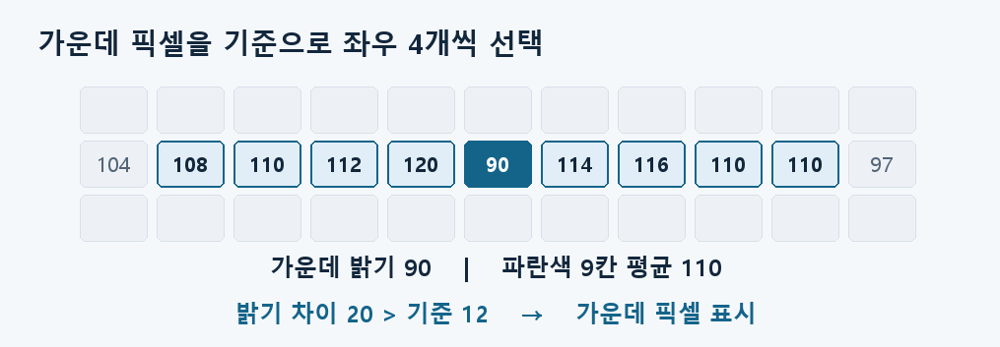
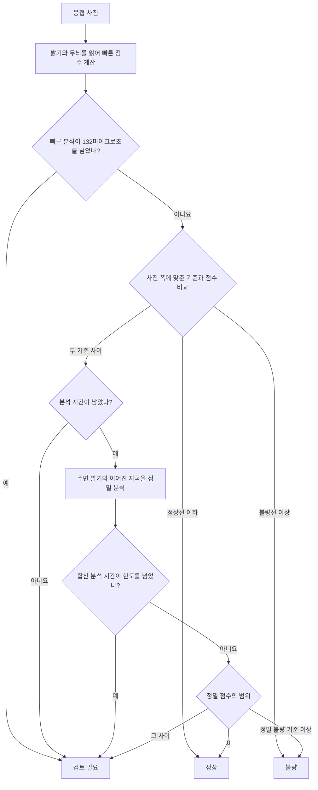
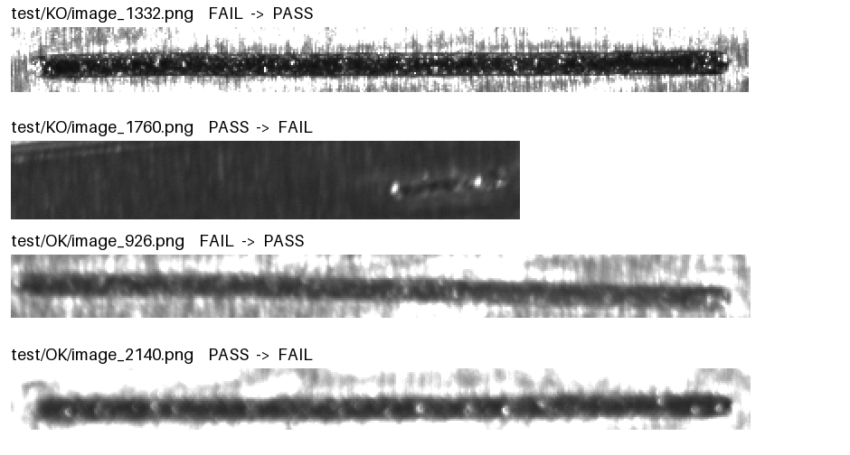
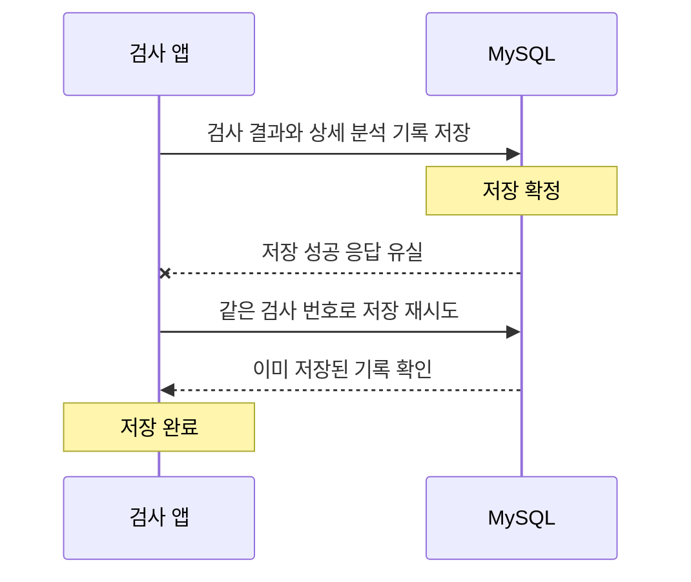

# 용접 외관 검사 기술 포트폴리오

## 배터리 용접 외관 검사의 필요성

전기차 배터리에서는 셀 단자와 금속 연결판을 이은 용접부로 전류가 흐릅니다. 접합이 부실하면 전기 저항이 커질 수 있습니다. 용접 자국이 끊기거나 표면에 균열이 보이면 외관 검사에서 해당 용접부를 추가 확인 대상으로 표시합니다. 전기 저항과 접합 강도는 별도 시험으로 확인합니다.

작업자는 용접 자국을 눈으로 확인하고, 규칙 기반 검사에서는 카메라 영상으로 자국의 폭이나 윤곽을 계산합니다. 저는 촬영이 끝난 사진을 분류하는 작업에 초점을 맞췄습니다. 이 단계에서 불량을 정상으로 통과시키면 추가로 살펴봐야 할 용접부가 검토 목록에서 빠집니다. 정상을 불량으로 표시하면 재검토할 사진이 늘어납니다. 둘 다 오판이지만 검토 업무에 미치는 영향이 달라 두 경우를 따로 세었습니다.

<strong>배터리 용접 외관 검사 소프트웨어(WeldScope)</strong>를 개발했습니다. Windows 앱에서 사진 한 장이나 폴더를 검사하면 결과를 **정상, 불량, 검토 필요**로 나눕니다. 검토자는 불량과 검토 필요 사진부터 열어 보고, 이전 판정은 저장된 점수와 이유를 다시 확인할 수 있습니다.

*사진 입력부터 검사 이력 확인까지의 흐름*

같은 공개 시험 사진 8,104장을 Windows 앱으로 검사했을 때 **놓친 불량은 695장에서 172장으로**, **잘못 탈락시킨 정상 사진은 1,024장에서 619장으로** 줄었습니다. 검사 결과가 저장된 직후 응답이 끊겨도 기록을 다시 찾을 수 있는지, 폴더에서 사진이 빠지거나 두 번 저장되지 않는지도 확인했습니다.

## OPENZDM 용접 사진과 데이터 선택 근거

OPENZDM 공개 자료에는 전기차 배터리 용접부를 찍은 2차원 PNG 사진 61,670장이 있습니다. 사진마다 외관상 정상은 OK, 불량은 KO로 표시돼 있습니다. 앱도 사진 한 장마다 판정을 내리므로 원본 사진과 정답을 그대로 두고 판정 방식만 바꿔 어느 사진에서 오류가 줄었는지 확인할 수 있었습니다.

*그림 1. OPENZDM 학습 사진의 정상 및 불량 예시*

| 실제 파일에서 확인한 특징 | 검사 설계에 반영한 점 |
|---|---|
| 가로로 긴 용접부 (가로 48~651픽셀, 세로 22~70픽셀) | 짧은 자국이 사진 전체의 점수에서 희석되는지 확인 (위치별 무늬 비교, 폭 구간별 오류 집계) |
| 정상 49,880장, 불량 11,790장 | 정상이 많은 자료에서는 전체 정확도가 높아도 불량을 놓칠 수 있음 (정상 오판과 불량 통과를 따로 집계) |
| 사진 한 장에 정답 한 개 (결함 위치, 부품 번호, 촬영 배치 정보 미제공) | 사진 단위 판정 성능 비교 (결함 위치나 새 생산 배치에서의 오류율을 검증하려면 별도 자료 필요) |

공개 원본은 학습용 43,169장, 검증용 9,250장, 시험용 9,251장으로 나뉩니다. 시험 사진이 학습이나 검증에 쓰인 사진과 비슷하면 시험 성능이 높아 보일 수 있습니다. 최종 앱 비교에서는 다른 분할의 사진과 시각적으로 유사한 그룹에 속한 시험 사진 1,147장을 빼고 **8,104장**을 비교했습니다.

## 1. 알고리즘 개선 과정

### 밝기 규칙의 한계

처음에는 사진을 흑백으로 바꾸고, 사진을 이루는 점(픽셀)의 밝기를 0(검정)부터 255(흰색)까지 읽었습니다. 밝기가 128 이하인 점이 사진의 50% 이상이면 불량으로 판정했습니다. 사진 전체에 같은 밝기 기준을 적용하는 **전역 밝기 임계값 기반 검사**입니다.

$$
\text{어두운 픽셀의 비율}
= \frac{\text{밝기 128 이하인 픽셀 수}}{\text{전체 픽셀 수}}
= \frac{5{,}075}{8{,}451}
\approx 60\%
$$

*그림 2. 정상 용접 사진의 원본과 밝기 기준 표시*

그림 2의 정답은 정상입니다. 노란색은 밝기 기준에 걸린 곳인데, 이 사진에서는 정상 용접부를 포함해 전체의 절반을 넘습니다. 어둡다는 이유로 불량으로 분류된 사례입니다. 다음 실험에서는 사진마다 바탕 밝기가 달라도 자국의 경계를 읽을 수 있도록 한 픽셀과 바로 주변의 밝기를 비교했습니다.

**국소 대비 검사**는 검사할 픽셀과 왼쪽 4개, 오른쪽 4개를 합친 가로 9개의 평균 밝기를 구합니다. 가운데 픽셀과 평균의 밝기 차이가 12보다 크면 그 가운데 픽셀을 표시합니다.

*그림 3. 가운데 픽셀과 좌우 4개씩의 밝기 비교 예시*

$$
\text{밝기 차이} = |90 - 110| = 20 > 12
\qquad
\text{빠른 점수} = \frac{\text{표시된 픽셀 수}}{\text{전체 픽셀 수}}
$$

이전 배포 앱은 빠른 점수가 약 0.266 이하면 정상, 약 0.308 이상이면 불량으로 판정했습니다. 그 사이에 있고 시간이 남으면 **정밀 분석**을 한 번 더 했습니다. 가로 31개 픽셀의 평균과도 비교한 뒤 두 범위에서 표시한 점을 합쳤습니다. 표시된 점의 비율과 그중 가로로 3개 이상 이어진 점의 비율을 각각 전체 사진을 기준으로 구해 평균을 냈습니다.

$$
\text{정밀 점수}
= \frac{\text{표시된 픽셀의 비율} + \text{가로로 이어진 픽셀의 비율}}{2}
= \frac{0.40 + 0.30}{2}
= 0.35
$$

정밀 점수가 0이면 정상, 약 0.550 이상이면 불량이었습니다. 예시의 0.35처럼 두 기준 사이에 있거나, 분석 시간이 합산 132마이크로초(0.132밀리초)를 넘으면 검토 대상으로 남겼습니다.

| 같은 사진의 초기 시험 | 전역 밝기 임계값 | 국소 대비 기반 선택적 검사 |
|---|---:|---:|
| 정상 오판율 | 74.63% | **16.19%** |
| 놓친 불량 | 750장 | 754장 |

처음에는 주변 밝기까지 비교하면 두 오류가 함께 줄 것으로 봤습니다. 정상 오판율은 16.19%까지 내려갔고 놓친 불량은 4장 늘었습니다. 놓친 사진 한 장을 확대해 보니 표시된 점이 자국 주변에서는 15%를 차지했고 전체 검사 영역에서는 9%에 그쳤습니다. 자국 주변에 모인 표시를 전체 점수에 넣는 순간 짧은 자국의 영향이 작아졌습니다. 다음 실험에서는 사진을 칸으로 나눠 어느 칸에 표시가 모이는지 확인했습니다.

### 위치 정보의 효과와 폭 구간별 오류

어두운 점 세 개가 가운데에 붙어 있든 양끝에 흩어져 있든 전체 점수는 같을 수 있습니다. 위치가 판정에 도움이 되는지 보려고 사진을 여러 칸으로 나눈 뒤, 같은 칸을 원래 순서대로 둔 경우와 밝기순으로 재배열한 경우를 비교했습니다. 이후에는 놓친 불량이 빠른 분석을 거쳐 어디까지 갔는지 사진별 기록을 따라갔습니다.

| 문제 상황 | 비교/관찰 | 다음 선택 |
|---|---|---|
| 위치 정보 소실 (자국 수가 같아도 배치가 다름) | 위치 유지 시 두 오류 감소 (놓친 불량 **225장 → 196장**, 정상 오판 **588장 → 529장**) | 빠른 점수에 위치별 밝기와 무늬 반영 |
| 정밀 분석 전 불량 통과 | 놓친 불량 전부 빠른 단계에서 통과 (후속 위치 기반 모델의 **236장**) | 첫 단계의 점수부터 개선 |
| 폭 구간별 불량 비율 차이 (385~415픽셀 약 **43%**, 그 밖 약 **4%**) | 별도 모델의 효과가 실행마다 다름 (통합 모델 대비 놓친 불량 **1장 감소 / 2장 증가**) | 모든 폭을 함께 학습하고 폭 구간별 오류 비교 |

놓친 불량 236장이 모두 첫 단계에서 통과했다면 정밀 분석을 개선해도 그 사진에는 적용되지 않습니다. 그래서 첫 점수의 입력에 위치별 밝기와 무늬를 넣었습니다. 폭마다 모델을 나눴을 때의 효과는 두 실행에서 방향이 달라, 모든 폭의 사진을 모아 **LightGBM**으로 학습했습니다. LightGBM의 그래디언트 부스팅 결정 나무(GBDT)는 “이 구역의 밝기 차이가 기준보다 큰가?” 같은 질문으로 사진을 나눕니다. 앞선 나무들이 낸 오차를 줄이는 방향으로 다음 나무를 학습하므로 여러 구역의 밝기와 무늬를 함께 고려할 수 있습니다.

나무 400개에 공통 판정 기준을 적용한 후보는 전체 오류를 줄였습니다. 가로 385~415픽셀 바깥의 불량 212장만 따로 세니 **놓친 사진이 48장에서 83장으로 늘었습니다.** 첫 실행에서 검토 필요로 남은 비율도 11.18%로 연구 기준인 10%를 넘었습니다. 이후에는 전체 오류가 줄더라도 어느 폭 구간에서든 불량 통과나 정상 오판이 늘면 후보에서 뺐습니다. 두 폭 구간의 오류와 검토 필요 비율, 정밀 분석 횟수 조건을 함께 충족한 모델은 **결정 나무 220개**였습니다. 모든 폭에 같은 나무를 쓰고, 그 점수를 정상이나 불량으로 해석하는 기준을 폭에 맞췄습니다.

### 사진 폭에 따른 판정 기준 조정

폭이 경계를 한 픽셀 넘으면 사진이 거의 같아도 판정 기준은 크게 바뀝니다. 사진 편집으로 모델 점수까지 바뀌면 어느 쪽이 판정을 바꿨는지 알기 어렵습니다. 그래서 같은 편집 사진 53장의 모델 점수를 고정하고 편집 전후의 폭에 해당하는 기준만 번갈아 적용했습니다. 경계에서 기준을 한 번에 바꾸었을 때 21장의 판정이 달라졌고, 그중 2장은 정상에서 불량으로, 또는 불량에서 정상으로 바로 바뀌었습니다.

경계 주변에서 두 기준을 직선으로 이어 폭에 따라 조금씩 바꾸었습니다. 앱 화면에는 **연속 보간**으로 표시됩니다. 같은 사진으로 다시 비교하니 폭에 따라 판정이 달라진 경우는 **21장에서 5장으로**, 정상과 불량이 바로 뒤집힌 경우는 **2장에서 0장으로** 줄었습니다.

정상선은 바로 정상으로 분류할 수 있는 가장 높은 점수입니다. 같은 빠른 점수 0.15라도 폭이 415픽셀이면 정상선 이하이고, 416픽셀이면 정상선을 넘습니다. 두 번째 경우는 불량 기준에도 못 미치므로 시간이 남으면 정밀 분석으로 넘깁니다.

| 사진의 가로 폭 | 정상선 | 빠른 점수 0.15의 구간 |
|---|---:|---|
| 414픽셀 | 약 0.175 | 정상 |
| 415픽셀 | 약 0.160 | 정상 |
| 416픽셀 | 약 0.145 | 정밀 분석 대상 |
| 417픽셀 | 약 0.129 | 정밀 분석 대상 |

### 분석 시간 한도의 산정

용접 사진이 연달아 들어오면 한 장의 정밀 분석에 쓴 시간만큼 뒤 사진의 검사도 밀립니다. 짧은 자국처럼 첫 점수로 분류하기 어려운 사진에만 정밀 분석을 시도하고, 합산 시간이 한도를 넘긴 결과는 검토 필요로 남겼습니다. 시간 한도는 기존 방식으로 두 분석을 모두 실행하는 데 걸린 시간을 기준으로 잡았습니다.

| 산정 단계 | 기준 |
|---|---|
| **측정 대상** | 공개 용접 검증 사진 8,210장마다 기존의 빠른 분석과 정밀 분석을 모두 측정 |
| **132마이크로초의 근거** | 두 분석 시간의 합을 짧은 순서로 정렬해 95번째 백분위수(p95)를 마이크로초 단위로 올림. 검증 사진의 약 95%에서 두 분석을 마칠 수 있었던 시간 |
| **두 방식의 비교 조건** | 이전 국소 대비 방식과 현재 LightGBM 방식 모두 빠른 분석과 정밀 분석을 합쳐 132마이크로초를 넘으면 검토 필요로 처리. 두 방식을 같은 시간 제약 아래에서 비교 |

첫 분석에 50마이크로초가 들었고 점수가 두 기준 사이에 있으면 정밀 분석에 남은 시간은 82마이크로초입니다. 앱은 분석이 끝난 뒤 합산 시간을 확인합니다. 한도를 넘은 경우에는 점수가 계산됐어도 판정을 보류합니다.

그림 4의 실제 화면에서는 분석에 2.21밀리초가 걸렸습니다. 오른쪽에 ‘검토 필요’와 ‘시간 예산 초과’가 표시됐고, 아래 이력에도 같은 판정이 저장됐습니다.

*그림 4. 분석 시간 한도 초과에 따른 판정 보류와 저장 이력*

132마이크로초는 사진 한 장의 분석에 배정한 시간입니다. 생산라인에서는 촬영한 사진을 읽고 이력을 저장한 뒤 장비에 판정을 보내는 시간도 듭니다. 부품이 들어오는 간격과 장비가 판정을 받아야 하는 시점을 측정해야 그중 분석에 얼마를 쓸 수 있는지 정할 수 있습니다.

### 배포 앱의 판정 흐름

배포 앱은 사진에서 가로 64곳과 세로 16곳을 조합한 1,024개 지점의 밝기와 주변 무늬를 읽습니다. 모델 학습은 LightGBM에서 하고, 검사 PC에서는 앱에 포함한 C++ 코드가 학습된 결정 나무 220개를 읽어 점수를 계산합니다.

정밀 분석은 빠른 점수가 정상과 불량 기준 사이에 있고 시간이 남았을 때만 실행합니다. 앞에서 사용한 주변 밝기 비교로 표시된 점과 이어진 자국을 다시 봅니다.

### 알고리즘 비교와 오류 해석

Windows 앱에서 공개 용접 사진 **8,104장**을 두 방식에 똑같이 넣었습니다. 두 방식에 같은 정밀 분석과 132마이크로초의 시간 한도를 적용해, 첫 점수와 폭별 판정 기준을 바꿨을 때 판정이 어떻게 달라지는지 확인했습니다.

| 비교 대상 | 빠른 점수 | 최종 판정 규칙 |
|---|---|---|
| **국소 대비 기반 선택적 검사** | 가로 9픽셀의 평균 밝기와 비교해 찾은 후보의 비율 | 고정된 두 기준으로 정상과 불량을 판정하고, 그 사이에서는 가로 9픽셀과 31픽셀을 쓰는 다중 범위 정밀 분석 |
| **폭별 임계값을 적용한 LightGBM 기반 선택적 검사** | 밝기와 무늬를 입력으로 학습한 결정 나무 220개의 점수 | 사진 폭에 따라 두 기준을 조정하고, 그 사이에서는 같은 다중 범위 정밀 분석 |

실제 정답과 앱 판정을 대조한 혼동 행렬(confusion matrix)입니다. 불량을 양성(positive), 정상을 음성(negative)으로 두었습니다. 검토 필요는 판정 보류(abstention)로 집계했습니다. 불량 통과가 줄었더라도 그만큼 보류가 늘었다면 사람이 맡을 검토량은 줄지 않기 때문입니다.

| 비교 대상 | 실제 정답 | 불량 판정 | 정상 판정 | 판정 보류 | 합계 |
|---|---|---:|---:|---:|---:|
| 국소 대비 | 불량 | 583 (TP) | 695 (FN) | 291 | 1,569 |
| 국소 대비 | 정상 | 1,024 (FP) | 4,709 (TN) | 802 | 6,535 |
| LightGBM | 불량 | **1,239 (TP)** | **172 (FN)** | 158 | 1,569 |
| LightGBM | 정상 | **619 (FP)** | **5,323 (TN)** | 593 | 6,535 |

TP는 제대로 잡은 불량, TN은 제대로 통과시킨 정상입니다. FN은 정상으로 통과한 불량, FP는 불량으로 탈락한 정상입니다.

*그림 5. 같은 시험 사진에서의 불량 자동 통과율과 정상 자동 탈락률 비교*

| 지표와 계산 기준 | 국소 대비 | LightGBM |
|---|---:|---:|
| 불량 자동 통과 비율 (FN ÷ 실제 불량 전체) | 44.30% | **10.96%** |
| 정상 자동 탈락 비율 (FP ÷ 실제 정상 전체) | 15.67% | **9.47%** |
| 자동 판정률 (Coverage, 자동 판정 수 ÷ 전체) | 86.51% | **90.73%** |
| 자동 판정 중 오판율 (Selective risk, (FP + FN) ÷ 자동 판정 수) | 24.52% | **10.76%** |

불량 자동 통과 비율은 44.30%에서 10.96%로 내려갔습니다. 정상 자동 탈락도 줄었고, 사람이 확인할 사진은 **1,093장에서 751장으로** 줄었습니다. 자동 판정률이 약 4.22%p 높아진 상태에서도 자동 판정 중 오판율은 24.52%에서 10.76%로 내려갔습니다.

사진별로 대조하면 개선과 함께 새로 생긴 오류도 보입니다. 그림 6의 두 번째 사진은 오른쪽에 짧은 자국과 밝은 점이 보이는 불량입니다. 이전 앱은 통과시켰고 새 앱은 불량으로 판정했습니다. 첫 번째 사진에서는 반대 결과가 나왔습니다. 네 장은 별도의 앱 비교 실행에서 판정이 바뀐 네 가지 유형별로 한 장씩 뽑은 예입니다. 그림의 PASS는 정상 판정, FAIL은 불량 판정입니다.

*그림 6. 모델 교체 후 판정이 바뀐 실제 용접 사진 네 장*

이 결과는 빠른 점수와 폭별 판정 기준을 함께 바꾼 결과입니다. 앞선 한 픽셀 실험에서는 점수를 고정했기 때문에 판정 기준만 바꿨을 때의 효과를 볼 수 있었습니다. 앱을 반복 실행했을 때는 첫 점수가 같아도 분석에 걸린 시간이 달라 일부 사진이 자동 판정과 검토 필요 사이에서 바뀌었습니다.

다른 방식으로 촬영한 실제 용접 누락 사진 한 장은 두 번 모두 정상으로 통과했습니다. 빠른 점수가 약 0.014로 정상선 약 0.061보다 낮아 정밀 분석까지 가지 않았습니다. 앞서 놓친 불량 236장에서 봤던 경로가 최종 모델에도 남아 있었습니다. 이 사례처럼 정상선보다 점수가 훨씬 낮은 사진은 경계 부근의 보류 범위만 넓혀도 여전히 통과할 수 있습니다.

### 새 부품과 촬영 배치의 검증 조건

사진 폭에 맞춘 판정 기준은 공개 자료에서 관찰한 차이를 반영합니다. 현장에서 카메라나 자르는 범위가 바뀌면 같은 용접부도 사진 폭과 밝기가 달라질 수 있습니다. 새 부품과 촬영 배치를 통째로 시험용으로 남겨 두고, 같은 부품을 다른 조명이나 촬영 설정으로 찍었을 때 판정이 어떻게 바뀌는지 먼저 확인하겠습니다.

초기 현장 시험에서는 기존 검사 결과로 장비를 제어하고 앱 판정은 비교 기록에만 남기는 방식이 적합합니다. 배치마다 불량 통과율과 정상 오판율, 검토 건수를 따로 집계해야 특정 부품이나 촬영 조건에서 오류가 몰리는지 볼 수 있습니다. 자동 판정 적용 여부는 품질 담당자와 미리 합의한 오류 한도와 작업자가 실제로 검토할 수 있는 건수로 판단할 계획입니다.

## 2. 검사 결과 저장과 장비 응답

시간을 초과해 보류한 사진도 나중에 확인할 수 있어야 합니다. 저장과 장비 연동을 시험하면서 두 가지 상황을 따로 재현했습니다. 데이터베이스에는 결과가 남았는데 앱이 저장 확인을 받지 못한 경우, 그리고 앱에 결과가 있어도 장비가 응답을 받지 못한 경우입니다.

### 저장 확인 응답이 끊겼을 때의 복구

MySQL은 검사 결과, 상세 분석 기록, 폴더 안의 검사 순서를 한 번에 확정합니다. 이 저장 단위가 트랜잭션입니다. 저장이 확정되는 순간과 앱이 성공 응답을 받는 순간 사이에도 연결이 끊길 수 있습니다.

저장이 확정된 직후 성공 응답을 끊어 보니 화면에는 **저장 확인 필요**가 떴고 MySQL에는 결과가 남았습니다. 여기서 새 검사 번호를 만들면 이미 끝난 검사를 다시 저장하게 됩니다. **저장 재시도**를 눌렀을 때 앱이 처음 검사 번호로 기존 기록을 찾았고, 데이터베이스에도 한 건만 남았습니다.

*그림 7. 저장 확인 필요 상태와 재시도 버튼*

현장에서는 판정이 난 뒤 저장을 확정하기 전에 검사 PC가 꺼질 수도 있습니다. 이때는 같은 검사 번호로 조회해도 완료 기록이 없을 수 있습니다. 재부팅 후 어디서부터 이어 갈지 정할 수 있도록, 접수한 작업과 원본 위치를 재시작 뒤에도 읽을 수 있는 작업 목록에 남기는 방안을 검토하겠습니다. 재검사에 쓰는 사진이 원래와 같은지는 파일 지문으로 확인하고, 모델 버전과 판정 설정도 접수 당시 기록과 대조할 수 있어야 합니다. 저장 전과 저장 직후에 각각 프로세스를 종료해 복구했을 때, 같은 작업이 중복 저장되거나 목록에서 사라지는지 확인하겠습니다.

### 장비 재전송과 부품별 판정 전달

검사 결과를 저장했어도 응답을 보내는 도중에 연결이 끊길 수 있습니다. 장비는 저장 여부를 알 수 없으므로 재전송할 때 처음 붙인 요청 번호를 그대로 보냅니다. 앱은 이미 저장한 결과가 있으면 같은 검사 번호와 판정을 돌려줍니다. 같은 요청 번호에 다른 사진이나 검사 설정이 들어오면 요청 충돌로 처리합니다.

TCP는 받은 데이터를 순서대로 전달합니다. 한 번 읽었을 때 요청 절반만 들어 있거나 요청 두 건이 붙어 있을 수 있습니다. 앱은 요청 끝에 붙인 줄바꿈을 만날 때까지 받은 내용을 모아 한 건씩 읽습니다. 같은 PC에서 가상 장비로 결과를 저장한 뒤 응답을 받는 것과, 앱을 다시 열어 같은 요청에 같은 결과를 받는 것을 확인했습니다.

실제 장비에서는 앞 부품의 결과를 재전송하는 사이에 다음 부품이 판정 위치에 들어올 수 있습니다. 요청 번호로 같은 결과를 되돌려 주는 것에 더해, 장비가 그 결과를 어느 부품에 적용할지도 확인해야 합니다. 후속 연동에서는 촬영 번호와 부품 번호를 결과에 함께 전달하고, 장비가 받은 번호를 확인하도록 협의하겠습니다.

검수에서는 촬영부터 장비가 결과를 확인할 때까지 걸린 시간과 응답 기한을 넘긴 건수를 기록할 계획입니다. 연결 복구 후 중복 응답이나 대기열 포화를 재현해도 앞 부품의 판정이 다음 부품에 적용되지 않아야 합니다. 응답 기한이 지나거나 판정이 보류된 부품을 어디로 보낼지는 실제 장비의 동작과 작업 절차에 맞춰 정해야 합니다.

## 3. 폴더 검사와 이력 확인

앱은 하위 폴더까지 사진을 한 장씩 검사합니다. 판정까지 끝났더라도 저장이 확인돼야 완료 건수에 넣고 다음 사진으로 넘어갑니다. 그래야 완료 표시를 보고 확인한 결과를 앱을 다시 연 뒤에도 이력에서 찾을 수 있습니다. 검사와 저장은 화면과 별도로 실행해 처리 중에도 판정 목록을 바꾸거나 검사를 중지할 수 있습니다.

정상 목록을 누르고 바로 불량 목록을 누르면 앞서 요청한 정상 목록이 더 늦게 도착할 수 있습니다. 앱은 목록 조회마다 번호를 붙여 조건과 번호가 모두 현재 선택과 일치하는 결과만 표시합니다. 결과 행을 열면 원본 사진과 판정 이유를 함께 볼 수 있습니다.

그림 8은 이전 국소 대비 방식의 앱에서 사진 네 장을 검사한 화면입니다. 네 장의 저장이 끝난 뒤 ‘정상’을 선택해 해당 결과 한 건만 열었습니다.

*그림 8. 폴더 검사에서 정상 판정만 표시한 결과 목록*

이전 국소 대비 방식의 앱으로 공개 자료 **61,670장**을 폴더 단위로 검사했습니다. 건수가 같아도 사진 한 장이 빠지고 다른 사진이 두 번 저장될 수 있습니다. 그래서 파일의 폴더 내 위치와 파일 내용에서 얻은 지문(SHA-256)을 원본 목록과 한 건씩 맞춰 봤습니다. 누락, 중복, 파일 내용 불일치는 모두 0건이었습니다. 현재 앱에서는 저장 재시도, 검사 중지, 판정별 목록과 재시작 후 이력을 별도로 확인했습니다.

검수에 쓴 폴더의 사진은 검사 전에 준비돼 있었습니다. 카메라가 공유 폴더에 계속 사진을 쓰는 현장이라면 목록을 읽는 도중 새 파일이 생기거나, 복사가 끝나기 전에 앱이 사진을 열 수 있습니다. 작업자가 보는 ‘완료’도 그때 어떤 파일이 검사 대상이었는지 알아야 의미가 있습니다. 배치 단위로 운영한다면 촬영 쪽에서 복사가 끝난 뒤 완료 표시와 파일 목록을 넘기고, 앱은 그 목록을 기준으로 검사하는 방식부터 보완하겠습니다. 중지 후에는 저장이 확인된 파일을 건너뛰고 남은 파일만 처리하도록 설계한 뒤, 복사 중인 파일과 배치 종료 후 도착한 파일까지 넣어 완료 수와 실제 저장 목록을 대조할 계획입니다.

## 사용 기술과 선택 근거

| 영역 | 사용 기술 | 선택 근거 |
|---|---|---|
| 영상 처리 | OpenCV 4 | 판정 방식 외의 조건 통일 (PNG 읽기, 흑백 변환, 밝기 계산) |
| 모델 학습 | LightGBM | 위치별 밝기와 무늬의 조합 학습 (전체 밝기가 비슷한 사진의 구분) |
| 실행과 검증 | C++17, CMake | 연구 도구와 배포 앱의 판정 코드 공유, 연구 도구와 테스트의 빌드 재현 |
| Windows 화면 | MFC, Visual Studio | 기존 Windows 창과 C++ 프로젝트의 재사용 |
| 검사 이력 | MySQL | 판정과 분석 기록의 일괄 저장, 같은 요청의 중복 저장 방지 |
| 가상 장비 통신 | TCP, Winsock | Windows 앱과 가상 장비 사이의 순서 있는 전송, 연결 끊김과 재전송 검증 |
| 실험 자동화 | Python | 시험 파일의 동일성 확인, 사진별 판정 비교 자동화 |

## 시연 순서

1. Windows에서 VC++ x64 런타임과 MySQL Community 8.4.13을 준비합니다. 배포 ZIP을 풀고 MySQL 설치 위치를 `WELDSCOPE_MYSQL_HOME`에 지정한 뒤 `WeldScope-Start.cmd`를 엽니다.
2. **파일 검사 → 이미지 선택 → 검사 시작**을 누릅니다. 원본 사진과 점수, 판정 이유를 확인합니다.
3. **폴더 검사 → 폴더 선택 → 검사 시작**을 누릅니다. 완료 수를 확인한 다음 원하는 판정만 골라 봅니다.
4. 앱을 다시 열고 **검사 이력**에서 앞선 실행을 조회합니다.

## 영상 출처

OPENZDM 전기차 배터리 용접 외관 사진의 자료 식별자는 DOI 10.5281/zenodo.14025630이며, 이용 조건은 CC BY 4.0입니다. 그림 2는 정상 학습 사진 `train/OK/image_10513.png`를 확대하고 밝기 기준에 걸린 픽셀에 색을 입힌 이미지입니다. 그림 3의 밝기 값은 계산 예시입니다.
