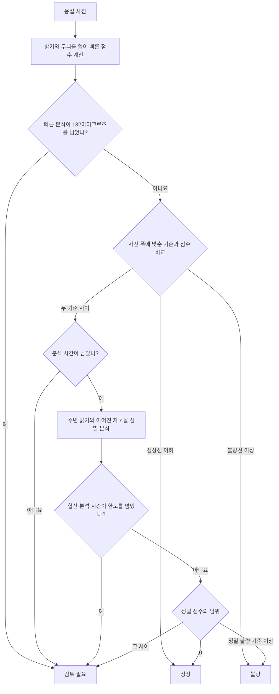
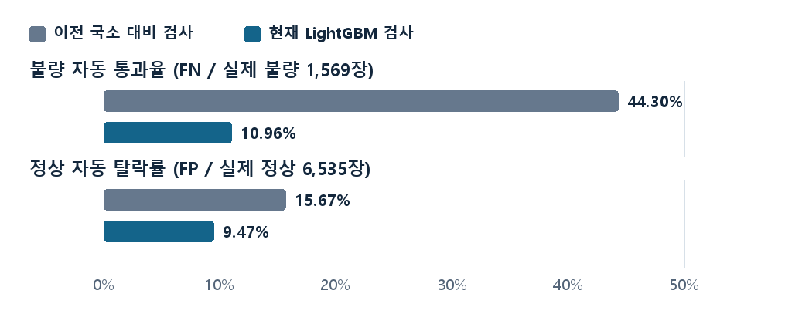
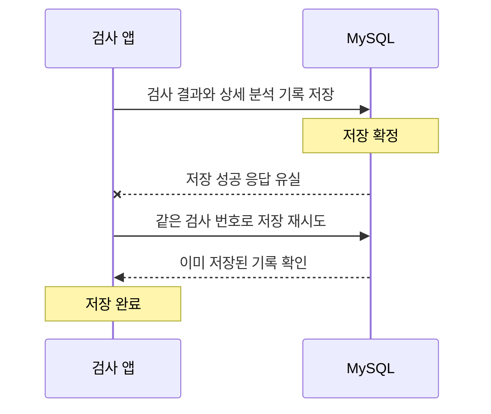
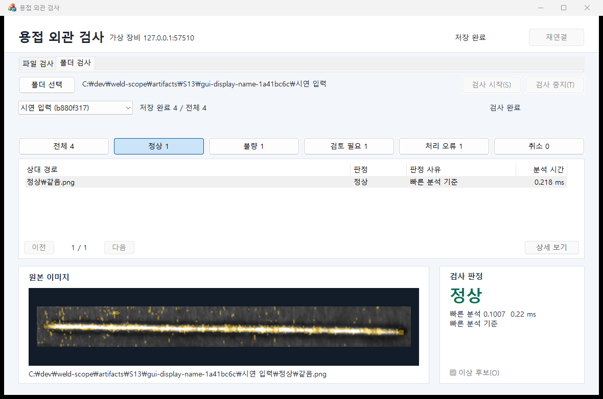

# 용접 외관 검사 기술 포트폴리오

<strong>배터리 용접 외관 검사 소프트웨어(WeldScope)</strong>를 개발했습니다. Windows에서 사진 한 장이나 폴더 전체를 검사하고, 검사 결과와 판정 이유를 나중에 다시 확인할 수 있도록 저장했습니다.

같은 공개 용접 사진 8,104장을 기존 방식과 현재 방식으로 검사했습니다. 현재 방식은 **놓친 불량을 695장에서 172장으로**, **잘못 탈락시킨 정상 사진을 1,024장에서 619장으로** 줄였습니다.

*그림 1. 분석 시간 초과에 따른 판정 보류*

## 사용 기술과 선택 근거

| 영역 | 사용 기술 | 선택 근거 |
|---|---|---|
| **영상 처리** | **OpenCV 4** | 알고리즘 간 동일한 영상 처리 조건 (PNG 읽기, 흑백 변환, 밝기 계산) |
| **모델 학습** | **LightGBM** | 단일 밝기 비율로 구별하기 어려운 위치별 밝기와 무늬의 조합 학습 |
| **실행과 검증** | **C++17, CMake** | 연구 도구와 배포 앱의 판정 코드 공유, 연구 도구와 테스트의 빌드 재현 |
| **Windows 화면** | **MFC, Visual Studio** | 기존 Windows 창과 C++ 프로젝트의 재사용 |
| **검사 이력** | **MySQL** | 판정과 분석 기록의 일괄 저장, 같은 요청의 중복 저장 방지 |
| **가상 장비 통신** | **TCP, Winsock** | 실제 장비 없이 Windows에서 요청과 응답, 연결 끊김과 재전송 검증 |
| **실험 자동화** | **Python** | 시험 파일의 동일성 확인과 사진별 판정 비교의 자동화 |

## 1. 알고리즘 개선 과정

### 밝기 규칙의 한계

첫 기준 방법은 **전역 밝기 임계값 기반 검사**입니다. 사진 전체에서 밝기 기준을 넘지 않는 점의 비율로 판정했습니다. 픽셀은 사진을 이루는 작은 점입니다. 사진을 흑백으로 바꾸고 밝기를 0(검정)부터 255(흰색)까지 읽었습니다. 밝기가 128 이하인 점을 세어 전체 픽셀 수로 나눈 뒤, 그 비율이 50% 이상이면 불량으로 판정했습니다.

$$
\text{어두운 픽셀의 비율}
= \frac{\text{밝기 128 이하인 픽셀 수}}{\text{전체 픽셀 수}}
= \frac{5{,}075}{8{,}451}
\approx 60\%
$$

*그림 2. 정상 용접 사진의 원본과 밝기 기준 표시*

그림 2에서 노란색 영역은 첫 방식이 어둡다고 판단한 부분입니다. 밝기 기준에 걸린 픽셀이 전체의 50%를 넘어 정상 사진이 불량으로 분류됐습니다. 다음 방식에서는 사진 전체의 밝기보다 **한 픽셀이 바로 주변보다 얼마나 밝거나 어두운지**를 살폈습니다.

검사할 픽셀을 하나 고르고, **그 픽셀의 왼쪽 4개와 오른쪽 4개**를 더해 가로 9개의 평균 밝기를 구합니다. 바로 위아래에 있는 픽셀은 이 평균에 들어가지 않습니다. 검사할 픽셀과 평균의 밝기 차이가 12보다 크면 가운데 픽셀을 표시합니다. 이 방법이 **국소 대비 검사**입니다.

*그림 3. 가운데 픽셀과 좌우 4개씩의 밝기 비교 예시*

$$
\text{밝기 차이} = |90 - 110| = 20 > 12
\qquad
\text{빠른 점수} = \frac{\text{표시된 픽셀 수}}{\text{전체 픽셀 수}}
$$

이전 배포 앱은 빠른 점수가 약 0.266 이하면 정상, 약 0.308 이상이면 불량으로 판정했습니다. 그 사이에 있고 시간이 남으면 **정밀 분석**을 한 번 더 했습니다. 가로 31개 픽셀의 평균과도 비교한 뒤 두 범위에서 표시한 점을 합쳤습니다. 표시된 점의 비율과 그중 가로로 3개 이상 이어진 점의 비율을 각각 전체 사진을 기준으로 구해 평균을 냈습니다.

$$
\text{정밀 점수}
= \frac{\text{표시된 픽셀의 비율} + \text{가로로 이어진 픽셀의 비율}}{2}
= \frac{0.40 + 0.30}{2}
= 0.35
$$

정밀 점수가 0이면 정상, 약 0.550 이상이면 불량이었습니다. 예시의 0.35처럼 두 기준 사이에 있거나, 분석 시간이 합산 132마이크로초(0.132밀리초)를 넘으면 검토 대상으로 남겼습니다.

| 같은 사진의 초기 시험 | 전역 밝기 임계값 | 국소 대비 기반 선택적 검사 |
|---|---:|---:|
| 정상 오판율 | 74.63% | **16.19%** |
| 놓친 불량 | 750장 | 754장 |

주변 밝기와 비교하면 정상 사진의 오판은 줄지만, 짧은 불량 자국은 전체 픽셀 수로 나눌 때 영향이 작아집니다. 실제 불량 사진 한 장에서 표시된 점은 자국 주변의 15%였지만 전체 검사 영역의 9%에 그쳤습니다. 다음 실험에서는 사진을 칸으로 나눠 **표시된 점이 어디에 모여 있는지**까지 확인했습니다.

### 위치 정보의 효과와 폭 구간별 오류

어두운 점 세 개가 가운데에 붙은 사진과 양끝에 흩어진 사진은 점 개수가 같습니다. 위치가 구별에 도움이 되는지 확인하기 위해 사진을 여러 칸으로 나눠 **칸을 원래 위치에 둔 경우**와 **같은 칸을 밝기순으로 재배열한 경우**를 비교했습니다. 이후 시험에서는 어디에서 불량을 놓쳤는지 기록을 단계별로 확인했습니다.

| 문제 상황 | 비교/관찰 | 다음 선택 |
|---|---|---|
| 위치 정보 소실 (자국 수가 같아도 배치가 다름) | 위치 유지 시 두 오류 감소 (놓친 불량 **225장 → 196장**, 정상 오판 **588장 → 529장**) | 빠른 점수에 위치별 밝기와 무늬 반영 |
| 정밀 분석 전 불량 통과 | 놓친 불량 전부 빠른 단계에서 통과 (후속 위치 기반 모델의 **236장**) | 첫 단계의 점수부터 개선 |
| 폭 구간별 불량 비율 차이 (385~415픽셀 약 **43%**, 그 밖 약 **4%**) | 별도 모델의 효과가 실행마다 다름 (통합 모델 대비 놓친 불량 **1장 감소 / 2장 증가**) | 모든 폭을 함께 학습하고 폭 구간별 오류 비교 |

다음에는 모든 폭을 함께 학습한 **LightGBM**을 사용했습니다. LightGBM은 **그래디언트 부스팅 결정 나무(GBDT)**의 구현입니다. 결정 나무 하나는 “이 구역의 밝기 차이가 일정 값보다 큰가?”처럼 답에 따라 다음 질문으로 이어집니다. 앞선 나무들의 예측에서 생긴 오차를 줄이도록 새 나무를 차례로 학습합니다. 이렇게 밝기나 무늬 한 가지로 판단하기 어려운 사진에서 여러 단서를 함께 쓸 수 있습니다.

나무 400개에 모든 폭에서 같은 판정 기준을 적용했을 때 전체 오류는 줄었습니다. 그러나 가로 385~415픽셀 바깥에 있는 불량 212장 중 **놓친 사진은 48장에서 83장으로 늘었습니다.** 첫 실행의 검토 필요 비율도 11.18%로 연구 기준인 10%를 넘었습니다. 이후에는 전체 합계와 함께 **폭 구간마다 놓친 불량과 정상 오판**을 확인했습니다. 그 결과 두 폭 구간에서 두 오류를 모두 확인하고 검토 필요 비율과 정밀 분석 횟수 기준을 충족한 **결정 나무 220개**를 골랐습니다. 이 모델은 모든 폭에서 같은 나무를 쓰고 점수를 해석하는 기준을 폭에 맞춰 조정합니다.

### 사진 폭에 따른 판정 기준 조정

220개 나무를 고른 뒤에도 폭 구간을 한 픽셀 넘는 순간 판정 기준이 크게 바뀌었습니다. 그 영향을 확인하기 위해 **같은 편집 사진 53장의 모델 점수를 고정**하고, 편집 전후의 폭에 해당하는 기준만 번갈아 적용했습니다. 폭에 따라 기준을 한 번에 바꾸자 21장의 판정이 달라졌고, 그중 2장은 정상과 불량 사이에서 바로 뒤집혔습니다.

경계 주변에서 두 기준을 직선으로 이어 폭에 따라 조금씩 바꿨습니다. 앱 화면에서는 이 계산을 **연속 보간**이라고 부릅니다. 같은 조건에서 판정이 달라진 사진은 **21장에서 5장으로**, 정상과 불량 사이에서 바로 뒤집힌 사진은 **2장에서 0장으로** 줄었습니다.

아래 표는 빠른 점수를 **0.15**로 고정한 예입니다. **정상선**은 바로 정상으로 분류할 수 있는 가장 높은 점수입니다. 415픽셀에서는 0.15가 정상선보다 낮아 통과하지만, 416픽셀에서는 정상선을 넘습니다. 불량 기준에도 못 미치므로 시간이 남으면 정밀 분석으로 넘어갑니다.

| 사진의 가로 폭 | 정상선 | 빠른 점수 0.15의 구간 |
|---|---:|---|
| 414픽셀 | 약 0.175 | 정상 |
| 415픽셀 | 약 0.160 | 정상 |
| 416픽셀 | 약 0.145 | 정밀 분석 대상 |
| 417픽셀 | 약 0.129 | 정밀 분석 대상 |

### 분석 시간 한도의 산정

용접 사진을 연속으로 검사할 때는 **불량이 자동 통과할 위험**과 **정밀 분석에 오래 걸려 뒤의 검사까지 밀리는 문제**를 함께 봐야 합니다. 짧은 자국처럼 첫 점수만으로 판단하기 어려운 사진에 추가 분석 시간을 쓰고, 그 시간 안에도 판정을 끝내기 어려우면 **검토 필요**로 남기는 방식으로 설계했습니다.

| 산정 단계 | 기준 |
|---|---|
| **측정 대상** | 공개 용접 검증 사진 8,210장마다 기존의 빠른 분석과 정밀 분석을 모두 측정 |
| **132마이크로초의 근거** | 두 분석 시간의 합을 짧은 순서로 정렬해 95번째 백분위수(p95)를 마이크로초 단위로 올림. 검증 사진의 약 95%에서 두 분석을 마칠 수 있었던 시간 |
| **두 방식의 비교 조건** | 이전 국소 대비 방식과 현재 LightGBM 방식 모두 빠른 분석과 정밀 분석을 합쳐 132마이크로초를 넘으면 검토 필요로 처리. 두 방식을 같은 시간 제약 아래에서 비교 |

예를 들어 첫 분석에 50마이크로초가 들었고 점수가 두 판정 기준 사이에 있으면, 남은 82마이크로초를 기준으로 정밀 분석 결과를 평가합니다. 앱은 분석이 끝난 뒤 합산 시간을 확인해 한도를 넘으면 검토 대상으로 남깁니다.

132마이크로초는 **검증 환경에서 정한 사진 한 장의 합산 분석 한도**입니다. 이미지 읽기, 이력 저장, 장비 응답 시간은 별도로 걸립니다. 실제 생산라인에 적용하려면 부품이 들어오는 간격과 장비가 판정을 받아야 하는 시점을 측정하고, 전체 시간을 기준으로 분석에 배정할 시간을 다시 정해야 합니다.

### 현재 판정 흐름과 검증 결과

현재 배포 앱은 사진에서 가로 64곳과 세로 16곳을 조합한 1,024개 지점의 밝기와 주변 무늬를 읽습니다. 앱은 LightGBM으로 학습한 결정 나무 220개의 기준과 점수를 C++로 읽어 빠른 점수를 계산합니다. 앱을 실행하는 PC에서는 LightGBM을 따로 설치할 필요가 없습니다.

아래 그림은 사진을 읽고 점수를 계산하는 데 성공한 뒤의 흐름입니다. 시간이 남고 빠른 점수가 두 기준 사이에 있을 때는 앞서 설명한 주변 밝기 비교로 한 번 더 확인합니다.

### 알고리즘 비교와 오류 해석

빠른 점수를 바꾸면 **불량을 더 많이 잡으면서 정상도 덜 탈락시킬 수 있는지** 확인했습니다. 두 방식은 같은 공개 용접 사진 **8,104장**을 검사했고, 분석 시간 한도는 모두 132마이크로초였습니다. 비교한 방식은 아래 두 가지입니다.

| 비교 대상 | 빠른 점수 | 최종 판정 규칙 |
|---|---|---|
| **국소 대비 기반 선택적 검사** | 가로 9픽셀의 평균 밝기와 비교해 찾은 후보의 비율 | 고정된 두 기준으로 정상과 불량을 판정하고, 그 사이에서는 가로 9픽셀과 31픽셀을 쓰는 다중 범위 정밀 분석 |
| **폭별 임계값을 적용한 LightGBM 기반 선택적 검사** | 밝기와 무늬를 입력으로 학습한 결정 나무 220개의 점수 | 사진 폭에 따라 두 기준을 조정하고, 그 사이에서는 같은 다중 범위 정밀 분석 |

**불량을 양성(positive), 정상을 음성(negative)**으로 놓고 실제 정답과 앱의 판정을 대조한 **혼동 행렬(confusion matrix)**입니다. 앱이 ‘검토 필요’로 남긴 사진은 **판정 보류(abstention)** 열에 따로 집계했습니다. 이렇게 하면 사람이 확인해야 할 사진까지 포함해 두 방식이 어떻게 달라졌는지 볼 수 있습니다.

| 비교 대상 | 실제 정답 | 불량 판정 | 정상 판정 | 판정 보류 | 합계 |
|---|---|---:|---:|---:|---:|
| 국소 대비 | 불량 | 583 (TP) | 695 (FN) | 291 | 1,569 |
| 국소 대비 | 정상 | 1,024 (FP) | 4,709 (TN) | 802 | 6,535 |
| LightGBM | 불량 | **1,239 (TP)** | **172 (FN)** | 158 | 1,569 |
| LightGBM | 정상 | **619 (FP)** | **5,323 (TN)** | 593 | 6,535 |

**TP**는 불량을 제대로 잡은 경우, **TN**은 정상을 제대로 통과시킨 경우입니다. **FN**은 불량을 정상으로 통과시킨 경우, **FP**는 정상을 불량으로 탈락시킨 경우입니다.

*그림 4. 같은 시험 사진에서의 불량 자동 통과율과 정상 자동 탈락률 비교*

| 지표와 계산 기준 | 국소 대비 | LightGBM |
|---|---:|---:|
| 불량 자동 통과 비율 (FN ÷ 실제 불량 전체) | 44.30% | **10.96%** |
| 정상 자동 탈락 비율 (FP ÷ 실제 정상 전체) | 15.67% | **9.47%** |
| 자동 판정률 (Coverage, 자동 판정 수 ÷ 전체) | 86.51% | **90.73%** |
| 자동 판정 중 오판율 (Selective risk, (FP + FN) ÷ 자동 판정 수) | 24.52% | **10.76%** |

**이 비교에서 가장 큰 변화는 불량의 자동 통과가 줄었다는 점입니다.** 실제 불량 1,569장 중 놓친 사진은 695장에서 172장으로 줄었고, 제대로 잡은 사진은 583장에서 1,239장으로 늘었습니다. 정상 오판도 줄었으며, 자동 판정률은 약 4.22%p 높아졌습니다. 검토 대상으로 넘긴 사진도 전체 1,093장에서 751장으로 줄었습니다. 같은 사진에서 **앱이 직접 판단한 범위가 넓어지면서 그 범위의 오류는 줄었습니다.**

이번 표의 차이에는 **빠른 점수 계산과 폭별 판정 기준**의 변경이 함께 반영됩니다. 폭 한 픽셀 실험에서 점수를 고정한 이유는 판정 기준 조정 자체의 효과를 따로 보기 위해서였습니다. 반복 실행에서는 첫 점수가 같아도 실제 소요 시간이 달라져 일부 결과가 자동 판정과 검토 필요 사이에서 바뀌었습니다.

다른 촬영 방식으로 얻은 실제 용접 누락 사진은 두 번 모두 정상으로 통과했습니다. 이 사진의 빠른 점수는 약 0.014였고 정상선은 약 0.061이어서 정밀 분석에 들어가지 않았습니다. 공개 사진으로 이 실패 경로까지는 확인했지만, 실제 부품과 촬영 배치를 구분할 정보가 없어 새로운 생산 배치에서의 오류율은 확인할 수 없었습니다.

## 2. 검사 결과 저장과 장비 재전송

### 같은 검사 요청의 결과 재사용

장비가 결과를 받기 전에 연결이 끊기면, 그 검사 결과가 저장됐는지 장비 쪽에서는 알 수 없습니다. 그래서 장비가 재시도할 때는 처음 붙인 **요청 번호**를 그대로 보냅니다. 앱에 결과가 이미 저장돼 있으면 같은 검사 번호와 판정을 돌려줍니다. 장비가 요청 번호는 그대로 두고 사진이나 검사 설정을 바꿔 보내면 앱은 두 요청이 충돌했다고 응답합니다.

통신에는 데이터를 순서대로 보내는 **TCP**를 사용했습니다. 네트워크에서는 요청 한 줄이 두 조각으로 들어오거나 두 줄이 한꺼번에 들어올 수 있습니다. 앱은 줄바꿈이 들어올 때까지 내용을 모아 요청 한 건으로 읽습니다. 장비 역할을 맡은 테스트 프로그램과 앱을 같은 PC에서 실행해, 결과 저장 뒤 응답을 받고 앱을 다시 열어도 같은 결과를 돌려받는지 확인했습니다.

### 저장 확인 응답이 끊겼을 때의 복구

검사 결과, 상세 분석 기록, 폴더 안의 검사 순서는 MySQL에 한 묶음으로 저장합니다. 이 묶음을 **트랜잭션**이라고 합니다. 저장을 확정한 직후 앱으로 가는 성공 응답이 끊기면, 데이터베이스에는 결과가 있는데 화면에는 저장 확인이 필요한 상태가 남습니다.

실제 검수에서는 데이터베이스가 저장을 확정한 뒤 성공 응답만 끊었습니다. 앱이 **저장 확인 필요**를 표시하는지 보고, **저장 재시도**를 눌렀습니다. 앱은 처음 검사 번호로 기존 기록을 확인했고, 데이터베이스에 같은 검사가 한 건만 남았습니다.

*그림 5. 저장 성공 응답 유실 후 재시도 화면*

## 3. 폴더 검사와 이력 확인

폴더를 고르면 앱이 하위 폴더까지 검사합니다. 여러 장이 처리되는 동안 어떤 사진이 끝났는지 알 수 있도록 **저장이 확인된 사진 수**를 완료 건수로 표시합니다. 사진은 한 장씩 검사하고 저장이 확인된 뒤 다음으로 넘어갑니다. 오래 걸리는 검사와 저장은 별도로 실행해 그동안 화면에서 판정을 골라 보거나 검사를 중지할 수 있습니다.

검사 중에 정상 목록에서 불량 목록으로 빠르게 바꾸면, 먼저 요청한 정상 목록이 뒤늦게 도착할 수 있습니다. 앱은 조회할 때마다 번호를 붙이고 가장 최근에 고른 조건과 번호가 같은 결과만 화면에 표시합니다. 결과 행을 열면 원본 사진과 판정 이유를 볼 수 있습니다.

*그림 6. 폴더 검사에서 정상 판정만 표시한 결과 목록*

이전 국소 대비 방식을 사용하던 앱으로 공개 자료 **61,670장**의 폴더 검사 기능을 검수했습니다. 저장 건수와 함께 폴더 안의 파일 위치와 파일 내용에서 계산한 지문(SHA-256)을 원본 목록과 한 건씩 비교했습니다. **누락, 중복, 파일 내용 불일치는 모두 0건**이었습니다. 현재 앱에서도 별도로 저장 재시도, 검사 중지, 판정별 목록, 재시작 후 이력을 확인했습니다.

## 시연 순서

1. Windows에서 VC++ x64 런타임과 MySQL Community 8.4.13을 준비합니다. 배포 ZIP을 풀고 MySQL 설치 위치를 `WELDSCOPE_MYSQL_HOME`에 지정한 뒤 `WeldScope-Start.cmd`를 엽니다.
2. **파일 검사 → 이미지 선택 → 검사 시작**을 누릅니다. 원본 사진과 점수, 판정 이유를 확인합니다.
3. **폴더 검사 → 폴더 선택 → 검사 시작**을 누릅니다. 완료 수를 확인한 다음 원하는 판정만 골라 봅니다.
4. 앱을 다시 열고 **검사 이력**에서 앞선 실행을 조회합니다.

## 영상 출처

OPENZDM의 전기차 배터리 용접 외관 공개 사진을 사용했습니다. 자료 식별자는 DOI 10.5281/zenodo.14025630이며 이용 조건은 CC BY 4.0입니다. 그림 2는 학습 자료의 정상 사진 `train/OK/image_10513.png`를 확대하고 밝기 기준에 해당하는 픽셀을 덧그린 것입니다. 그림 3의 밝기 값은 계산 방법을 보여 주기 위한 예시입니다.
