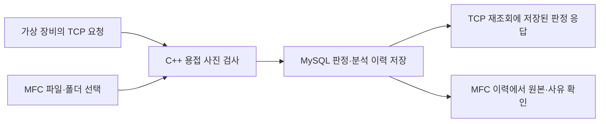
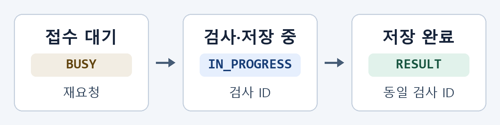
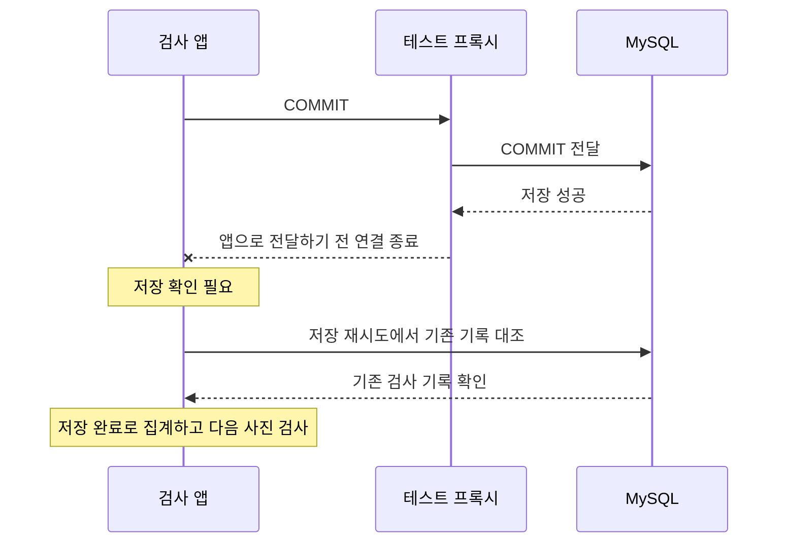

# WeldScope | 전기차 배터리 용접 외관 검사

## 0. 배터리 용접부에서 사진으로 확인할 수 있는 것

### 배터리 용접 외관 검사 자동화

2025년 판매된 전기차에 탑재된 배터리 용량은 총 1.2TWh로, 전년보다 약 30% 늘었습니다. 생산 규모가 커지는 흐름을 보면서 반복되는 품질 검사를 소프트웨어가 어디까지 맡을 수 있을지 궁금했습니다. 셀 단자와 금속 연결판을 잇는 용접부를 대상으로 골랐습니다. 짧게 끊긴 자국을 놓치면 재검해야 할 부품이 통과하고, 정상 표면의 밝은 점을 불량으로 잡으면 재검 대상이 늘어납니다. 사진에서 어떤 단서를 써야 두 오류를 함께 줄일 수 있는지 확인했습니다. [IEA, Global EV Outlook 2026](https://www.iea.org/reports/global-ev-outlook-2026/electric-vehicle-batteries/)

### 외관 검사와 공정 승인 시험

용접 자국이 사진에서 이어져 보여도 접합부의 전기 저항과 박리 강도는 별도 시험에서 얻는 값입니다. NASA의 배터리 조립체 레이저 용접 절차에서도 공정 승인 시 외관 검사, 전기 저항 측정, 박리 시험을 각각 수행합니다. WeldScope의 `PASS`는 사진에 나타난 용접 외관에 대한 판정입니다. [NASA, 배터리 조립체 레이저 용접 절차 6.1.4절](https://www.nasa.gov/wp-content/uploads/2023/03/prc-0016-current-0.pdf)

## 1. 검사 추적성

### 소프트웨어 워크플로우

같은 사진의 판정이 모델 교체 전후에 달라졌다면 품질 담당자는 어느 설정에서 나온 판정인지부터 확인해야 합니다. 결과 코드만 기록하면 같은 원본을 판정했는지, 당시 어떤 설정을 썼는지 확인할 수 없습니다. 배터리 모듈 파일럿 생산라인이 셀 바코드에 용접 조건을 연결한 것처럼, WeldScope는 검사 ID에 원본과 판정 설정을 연결했습니다. 가상 장비 응답과 MFC 이력에서 같은 검사 ID를 확인할 수 있습니다. [캘리포니아 에너지위원회, 전기차용 배터리 모듈 파일럿 생산라인 보고서 4.2절](https://www.energy.ca.gov/sites/default/files/2021-05/CEC-600-2020-053.pdf)



- **가상 장비의 TCP 요청** — 실제 장비 도입 전에 검사 요청·응답 규약 검증
- **MFC 파일·폴더 선택** — 작업자가 개별 사진을 확인하거나 촬영분을 일괄 검사할 때 사용
- **C++ 용접 사진 검사** — 장비 요청과 수동 검사에 동일한 판정 기준 적용
- **MySQL 판정·분석 이력 저장** — 판정 당시의 원본, 검사 설정, 판단 근거 추적
- **TCP 결과 재조회** — 응답이 유실돼도 재검사 없이 기존 판정 회수
- **MFC 이력 조회** — 작업자가 보류 건의 원본과 판정 사유를 확인해 재검토

### 보류 판정 및 검사 이력 재조회

여러 사진을 일괄 검사한 뒤 보류 건을 검토할 때, 결과 목록에서 원본을 직접 찾아야 하면 비슷한 용접 사진을 잘못 열 수 있습니다. 보류 행에 연결된 원본과 판정 사유를 함께 표시했습니다. 아래 사진은 정상선과 불량선 사이의 점수로 보류됐으며 저장 이력에서도 같은 사진과 결과를 열 수 있습니다.


## 2. TCP 메시지 프레이밍과 가상 장비 검증

### TCP 바이트 스트림의 프레임 재조립

생산라인에서 촬영을 마친 부품은 검사 결과가 있어야 다음 공정으로 보낼지 결정할 수 있습니다. TCP는 바이트 스트림이므로 장비의 `send()`와 서버의 `recv()` 호출 경계는 일치한다고 가정할 수 없습니다. 요청 ID 중간에서 끊긴 수신 데이터를 곧바로 파싱하면 정상 요청에도 오류를 보냅니다. 한 번 읽은 버퍼에서 첫 요청만 꺼내고 나머지를 버리면 뒤에 이어진 부품의 요청은 접수되지 않습니다. 장비는 판정을 기다리다 응답 기한을 넘길 수 있고, 미판정 부품을 대기시키거나 수동 확인으로 보내야 합니다.

`FrameReader::Consume`은 새로 받은 바이트에서 LF(`0x0A`)를 찾습니다. 기존 바이트와 LF 앞의 바이트를 합쳐 256바이트를 넘으면 `TooLong`을 반환합니다. 허용 범위 안에서는 새 바이트를 `pending_`에 추가합니다. LF가 없으면 `NeedMore`를 반환해 다음 `recv()`를 기다립니다. LF가 있으면 LF 1바이트를 소비하고 누적한 본문을 `frame`으로 옮겨 `Complete`를 반환합니다. LF 뒤의 바이트는 `bytes`에 남아 같은 수신 루프에서 다시 처리됩니다. [FrameReader 구현](../../src/WeldScope.Device/Protocol.cpp#L26)

```cpp
FrameStatus FrameReader::Consume(std::string_view& bytes, std::string& frame) {
    const auto newline = bytes.find('\n');
    const auto part = bytes.substr(0, newline);
    if (part.size() > maxFrameBytes - pending_.size()) return FrameStatus::TooLong;

    pending_.append(part);
    bytes.remove_prefix(part.size());
    if (newline == std::string_view::npos) return FrameStatus::NeedMore;

    bytes.remove_prefix(1);
    frame.swap(pending_);
    pending_.clear();
    return FrameStatus::Complete;
}
```

`Complete`를 받은 서버는 `ParseRequest`로 `INSPECT` 명령과 탭으로 구분된 요청 ID·입력 ID·설정 ID를 검사합니다. LF를 제외한 본문이 256바이트를 넘거나 필드 검증에 실패하면 `BAD_FRAME`을 보내고 연결 처리를 끝냅니다. 응답을 보낼 때는 `send()`가 반환한 바이트 수만큼 전송 버퍼의 앞부분을 건너뜁니다. [TCP 수신 및 전송 코드](../../src/WeldScope.Device/LoopbackServer.cpp)

단위 테스트는 먼저 `INSPECT\treq-`를 넘기고 `NeedMore`를 확인합니다. 다음 입력 `001\tweld-01\tbaseline-v1\nsecond\nthi`에서 LF로 끝난 두 본문을 각각 꺼내고, 끝의 `thi`는 `rd\n`이 도착할 때까지 보관하는지 확인합니다. 별도 길이 테스트에서는 본문 256바이트 뒤 LF를 받으면 `Complete`, LF 없이 257번째 본문 바이트를 받으면 `TooLong`을 기대합니다. [메시지 경계 테스트](../../src/WeldScope.Device/ProtocolTests.cpp)

### 루프백 TCP 통합 테스트와 검사 상태 전이

부품을 분기하려면 장비가 접수 응답과 최종 판정을 구분할 수 있어야 합니다. 접수 응답을 완료 신호로 쓰면 판정이 저장되기도 전에 부품이 다음 공정으로 이동할 수 있습니다. Python 가상 장비로 루프백 소켓에 접속해 등록된 PNG를 `weld-01`로 요청한 뒤, 실제 MFC 앱과 MySQL을 거쳐 어떤 응답이 돌아오는지 확인했습니다.



장비는 `BUSY`가 오거나 검사가 진행 중이면 같은 요청 ID로 재조회합니다. 저장이 끝나면 접수 때와 같은 검사 ID로 `RESULT`를 받습니다.

`request`는 호출마다 소켓을 열어 LF로 끝나는 ASCII 요청을 보냅니다. 응답은 LF까지 읽고 탭을 기준으로 필드를 분리합니다. [가상 장비 소켓 코드](../../tools/mfc_test_support.py#L181)

```python
def request(port, request_id, source="weld-01", config="pooled-smooth-220-v2"):
    with socket.create_connection(("127.0.0.1", port), timeout=12) as connection:
        connection.sendall(f"INSPECT\t{request_id}\t{source}\t{config}\n".encode("ascii"))
        with connection.makefile("rb") as reply:
            return reply.readline().decode("ascii").rstrip("\n").split("\t")
```

`completed_request`는 같은 요청을 보내 최초 `STATUS`의 상태가 `IN_PROGRESS`인지 확인한 뒤 `RESULT`가 올 때까지 조회합니다. 두 응답의 세 번째 필드인 검사 ID를 비교합니다. 통합 테스트는 그 ID로 DB에 저장된 원본 지문, 설정 지문, 판정도 대조했습니다. [상태 전이 검증](../../tools/mfc_test_support.py#L252) · [MFC 통합 테스트](../../tools/verify_portfolio_mfc.py)

```python
def completed_request(request_id, config_id, port=33361):
    start = time.perf_counter()
    first = wait_until(lambda: request(port, request_id, config=config_id), lambda response: response[-1] != "BUSY")
    assert first[0] == "STATUS" and first[-1] == "IN_PROGRESS", first
    result = wait_until(lambda: request(port, request_id, config=config_id), lambda response: response[0] == "RESULT")
    assert result[2] == first[2], result
    return result, (time.perf_counter() - start) * 1000
```

## 3. 멱등성이 필요한 이유

### 요청 ID 기반 중복 처리 방지

검사 결과를 저장한 직후 연결이 끊기면 장비는 저장 여부를 알 수 없어 같은 요청을 재전송할 수 있습니다. 이를 새 검사로 처리하면 같은 부품의 불량 한 건이 품질 집계에 두 번 잡힙니다. 요청 ID만 대조하는 경우에는 번호를 잘못 재사용한 요청에 이전 사진의 판정이 돌아갈 수 있습니다. 같은 요청은 최초 검사 ID와 판정으로 응답하고, 입력이나 설정이 다른 재요청은 충돌로 처리했습니다.

MySQL의 `inspections`는 검사 ID를 기본 키로, 장비 요청 ID를 고유 키로 사용합니다. 이 행에 입력 ID, 원본 경로와 파일 지문, 설정 지문, 판정과 이유를 남깁니다. 같은 검사 ID의 `analysis_attempts`에는 분석 단계, 점수, 걸린 시간이 들어갑니다. C++은 두 테이블의 기록과 폴더 내 검사 순서까지 하나의 트랜잭션에서 저장합니다. 진행 중인 작업은 앱에서 같은 요청 ID로 찾고, 완료된 요청은 MySQL 이력에서 찾습니다. 저장된 입력 ID와 설정 지문이 맞으면 기존 결과를 반환합니다. 같은 번호로 다른 입력이나 설정을 보낸 경우 응답은 `REQUEST_CONFLICT`입니다. [MySQL 저장 코드](../../src/WeldScope.Storage/InspectionHistory.cpp)

### 프로세스 재시작 후 멱등성 검증

검사 PC가 재시작되기 전에 확정한 판정을 장비가 재시작 후에 조회할 수도 있습니다. 이때 메모리에 있던 작업 정보가 사라지므로 MySQL에서 기존 결과를 찾아야 합니다. 최초 `RESULT`를 기록한 뒤 앱을 다시 열어 같은 요청을 보냈습니다. 응답의 모든 필드가 일치했고, 같은 요청 ID로 설정만 바꿔 보내자 충돌 응답이 왔습니다. DB의 검사 행은 처음과 같이 한 건이었습니다.

아래 테스트의 `frame`은 앱을 재시작하기 전에 받은 최종 응답입니다. [재시작 후 멱등성 테스트](../../tools/verify_portfolio_mfc.py#L114)

```python
assert request(33361, request_id, config=REGISTRATION) == frame
assert request(33361, request_id, config="selective-v1")[-1] == "REQUEST_CONFLICT"
assert query(f"SELECT COUNT(*) FROM inspections WHERE request_id='{request_id}';") == [["1"]]
```

### 커밋 응답 유실과 트랜잭션 재시도

폴더 검사에서 저장 확인 전에 화면의 완료 건수를 올리면, 실제 저장에 실패했을 때 완료 목록과 DB 이력이 어긋납니다. 커밋은 성공했는데 응답만 끊긴 경우에는 새 검사로 저장하면서 같은 사진을 배치에 두 번 넣을 수 있습니다. 앱은 같은 검사 ID로 재시도합니다. 중복 키가 발견되면 기존 검사 내용과 배치 소속 및 순서가 모두 일치할 때만 저장된 결과로 받아들입니다.

이 동작을 검증하려고 DB 앞에 프록시를 두고, MySQL이 `COMMIT` 성공 응답을 보낸 직후 앱으로 전달하기 전에 연결을 끊었습니다.



화면에 `저장 확인 필요`가 뜬 뒤 재시도 버튼을 눌렀습니다. 완료 건수만 같으면 한 장이 빠지고 다른 한 장이 두 번 들어간 경우를 놓칠 수 있습니다. 그래서 검수 스크립트는 DB의 배치 행을 검사 순서로 읽고, 중복 경로가 없는지와 각 경로의 SHA-256이 입력 목록과 일치하는지 확인했습니다. 네 파일의 경로와 지문이 모두 일치했고 누락과 중복은 없었습니다. [저장 응답 유실 검증](../../tools/verify_folder_e2e.py) · [폴더 검사 검증 기록](evidence/verification.json)

## 4. 알고리즘 개선 과정

### 버전 1 | 국소 대비 기반 선택적 검사

공개 OPENZDM에는 정상과 불량으로 라벨링된 배터리 용접 외관 사진 61,670장이 있습니다. 버전 1은 국소 대비가 큰 픽셀의 전체 비율로 1차 판정하고, 경계에 걸린 사진에 정밀 분석을 적용했습니다. 용접 띠 일부가 끊겨도 나머지 영역이 정상 사진과 비슷하면 전체 비율의 변화는 작습니다. 1차 점수가 정상 범위에 들어간 사진은 정밀 분석 대상에서도 빠집니다. [OPENZDM 데이터셋, CC BY 4.0](https://zenodo.org/records/14025630)

검증 사진 `val/KO/image_1187.png`는 관찰 기록에서 `W031`로 표시한 사진입니다. 가운데 밝은 틈에서 어두운 용접 띠가 끊깁니다. 끊김 주변에서는 밝기 차이가 큰 픽셀이 70/468(15.0%)이었는데, 전체 검사 영역으로 범위를 넓히니 324/3,600(9.0%)였습니다. 초기 규칙에서 이 사진은 FN으로 분류됐습니다. 여기서 전체 비율이 같아도 변화가 어느 위치에 모였는지에 따라 판정이 달라져야 한다는 가설을 세웠습니다.


### 버전 2 | 위치별 특징 기반 LightGBM 단일 판정

밝은 점이 여러 곳에 흩어진 사진과 용접 띠의 한 구간에 모인 사진은 칸별 밝기 분포가 비슷할 수 있습니다. 칸의 위치를 보존하면 이 차이를 판정에 쓸 수 있는지 확인했습니다. 칸별 밝기와 밝기 변화량을 구한 뒤, 같은 값을 사진 속 위치 순서로 놓은 모델과 밝기순으로 재배열한 모델을 비교했습니다. 칸의 순서를 보존했을 때 검증 세트에서 FN은 225장에서 196장, FP는 588장에서 529장으로 줄었습니다. 이 결과를 바탕으로 최종 모델은 중앙 검사 영역을 4×8칸으로 나누고 위치 순서를 유지한 특징을 LightGBM에 입력합니다. 정상선과 불량선 사이의 점수는 바로 `검토 필요`로 보냅니다. [LightGBM 판정 명세](../algorithms/openzdm-false-pass-eda.md#lightgbm-판정-명세)

사진 폭에 따라 두 판정선을 조정할 때도 새 문제가 생겼습니다. 기준을 한 번에 바꾸면 점수가 똑같이 0.20인 사진이 폭 415픽셀에서는 정상, 416픽셀에서는 불량이 됩니다. 폭 경계 부근에서 판정선을 선형 보간하자 두 경우 모두 검토 필요가 됐습니다. 경계에 걸친 사진 53장에서도 점수를 고정하고 폭만 한 픽셀 바꿔 비교했습니다. 정상과 불량이 바로 뒤집힌 사례는 2장에서 0장으로 줄었습니다. [폭 경계 실험과 실제 MFC 검수](../algorithms/openzdm-false-pass-eda.md)

### 동일 시험 세트의 분류 성능 평가

FN은 자동 통과한 불량의 규모를, FP와 보류 건수는 작업자가 다시 확인해야 할 물량을 가늠하는 데 썼습니다. 다른 분할의 사진과 시각적으로 유사한 1,147장을 공식 시험 세트에서 제외했습니다. 남은 8,104장(불량 1,569장, 정상 6,535장)을 두 Windows 앱에서 각각 폴더 검사했습니다. 외관 불량을 양성으로 두고, `REVIEW`는 실제 라벨별로 따로 집계했습니다. FN 비율과 FP 비율의 분모에는 각각 검토로 넘어간 사진도 포함됩니다.

| 판정 지표 | 버전 1 국소 대비 | 버전 2 LightGBM |
|---|---:|---:|
| TP (불량 → FAIL) | 583 | 1,253 |
| TN (정상 → PASS) | 4,709 | 5,373 |
| FP (정상 → FAIL) | 1,024 / 6,535 (15.67%) | 625 / 6,535 (9.56%) |
| FN (불량 → PASS) | 695 / 1,569 (44.30%) | 173 / 1,569 (11.03%) |
| REVIEW (실제 불량) | 291 | 143 |
| REVIEW (실제 정상) | 802 | 537 |
| 처리 오류 | 0 | 0 |

버전 2에서는 FN이 522장, FP가 399장 줄었습니다. 검토 대상도 1,093장에서 680장으로 줄었고, 버전 2의 680장은 모두 점수가 두 판정선 사이였습니다. 버전 2를 CLI에서 두 번 실행했을 때 8,104장의 점수와 판정이 일치했고, MFC 폴더 검사 판정도 CLI와 일치했습니다. [버전 1 MFC 집계](../algorithms/evidence/openzdm-pooled-model/mfc-comparison.json) · [버전 2 MFC·CLI 집계](../algorithms/evidence/lightgbm-v2/verification.json)

## 5. 생산라인 적용 전에 남은 검증

### 지연 응답의 부품 식별과 추적성

앞 부품의 결과가 늦어진 사이 다음 부품이 판정 위치에 들어올 수 있습니다. 장비가 도착 순서대로 응답을 적용하면 앞 부품의 `PASS`로 다음 부품을 통과시킬 수 있습니다. 루프백 시험에서는 재전송 뒤에도 검사 ID가 유지되는지 확인했습니다. 실제 장비에서는 부품 ID와 촬영 ID를 대조해, 기한이 지난 응답도 원래 부품의 결과로만 처리되는지 확인해야 합니다.

### 촬영 조건 변화와 모델 일반화

조명이나 촬영 범위가 바뀌면 같은 용접 끊김도 사진에서 다른 밝기와 모양으로 나타납니다. 촬영 방식이 다른 용접 누락 사진 한 장에는 LightGBM 점수 0.014가 나왔습니다. 이 사진의 정상선은 0.061이어서 버전 2에서도 FN이었습니다. 공개 데이터에는 부품 번호나 촬영 배치 식별자가 없으므로, 조명과 촬영 범위가 달라졌을 때의 오류율은 부품과 배치를 구분할 수 있는 새 데이터로 측정해야 합니다. [외부 사진과 판정 분석](../algorithms/openzdm-false-pass-eda.md)

## 6. Windows 시연

### 폴더 검사 및 이력 재조회 절차

교대 후 이전 근무자가 남긴 보류 건을 다시 확인하는 상황을 재현합니다. 앱을 닫았다가 열어도 이력에서 같은 원본과 보류 사유를 조회할 수 있는지 확인합니다.

1. Windows에서 `WeldScope-Start.cmd`를 실행합니다.
2. **폴더 검사**에서 OPENZDM 사진이 들어 있는 폴더를 선택하고 **검사 시작**을 누릅니다.
3. **검토 필요** 결과를 열어 원본과 판정 사유를 확인합니다. 앱을 다시 열고 검사 이력에서 같은 결과를 조회합니다.

[Windows 배포본 실행 안내](../steps/S13-run-package.md)
