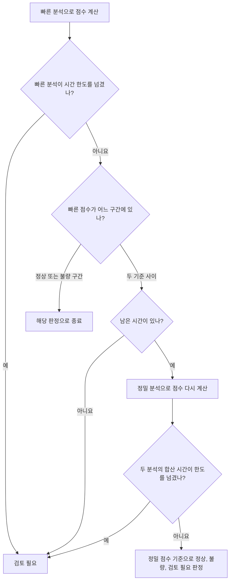
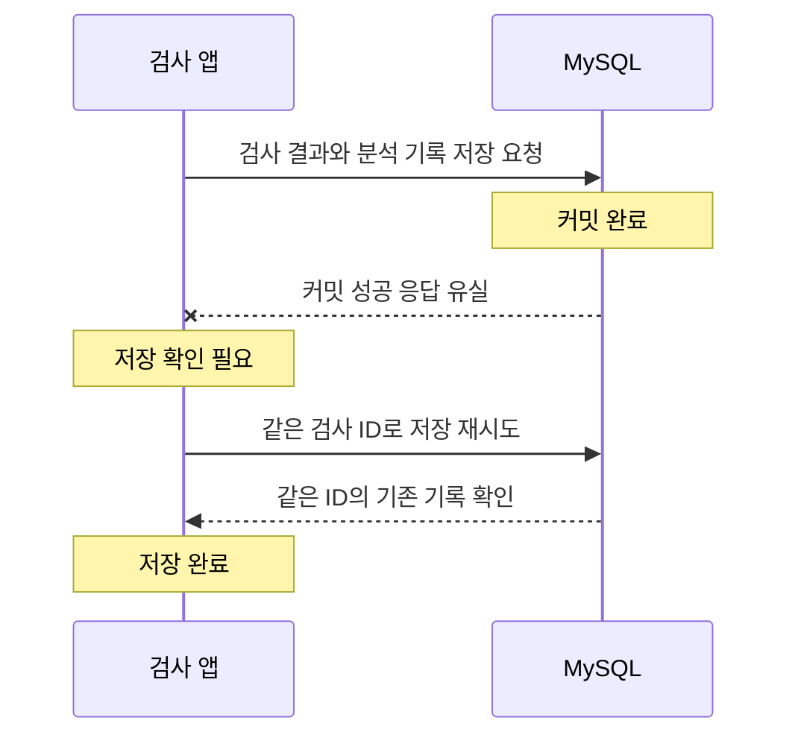
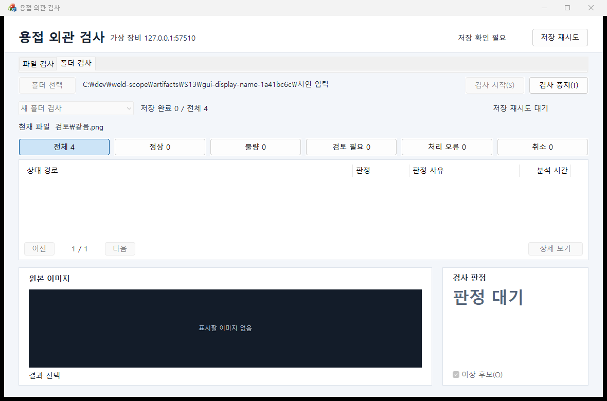
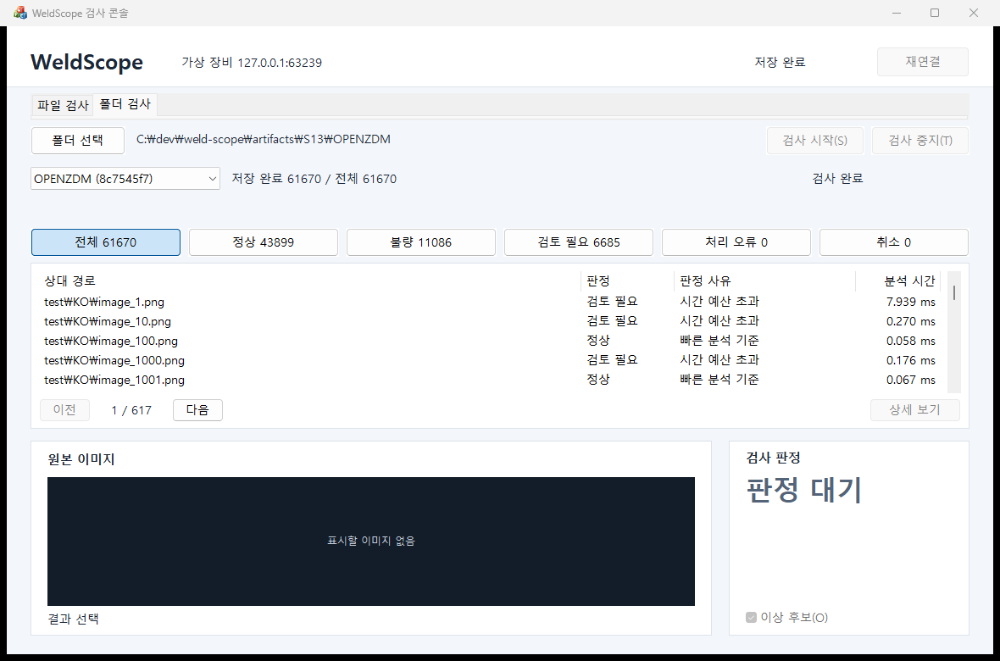

# 용접 외관 검사 기술 포트폴리오

현재 x64 앱은 파일과 폴더를 열면 **연속 보간** 모델로 검사합니다. 아래 개발 기록은 기준 검사에서 선택적 정밀 분석까지의 과정을 설명합니다. 이후 채택한 220개 나무 모델의 실제 앱 성능, 남은 불량 통과 사례와 촬영 조건의 한계는 연구 문서에서 확인할 수 있습니다. [최종 검사기의 실측과 원본 사진](../algorithms/openzdm-false-pass-eda.md) · [앱 실행 안내](../steps/S13-run-package.md)

## 1. 어두운 정상 용접부의 불량 오판 줄이기

공개 용접 데이터에서 정상으로 분류된 사진 `train/OK/image_10513.png`가 첫 검사에서 불량으로 나왔습니다. 첫 방식은 사진을 이루는 작은 점인 **픽셀**의 밝기를 0부터 255까지의 값으로 나타냈습니다. 밝기 범위의 중간쯤인 128 이하를 어둡다고 보고, 그런 점이 절반 이상이면 불량으로 판정했습니다. 이 사진에서는 8,451픽셀 중 5,075픽셀, 약 **60%**가 그 조건에 해당했습니다. 이후 방법이 이런 오판을 얼마나 줄이는지 비교하기 위해 첫 방법을 이 프로젝트에서 **기준 검사**라고 부르기로 했습니다. [기준 검사](../algorithms/global-dark-ratio.md) [영상별 측정값](../steps/S11-evidence/demo/comparison.json)

### 사진 전체의 어둠과 주변의 밝기 차 구분

어두운 곳에서 찍은 종이 사진도 연필 자국 근처를 보면 자국이 주변보다 짙습니다. 이처럼 가까운 곳끼리 밝기를 비교하는 방법을 **국소 대비**라고 합니다. 용접 사진에서도 주변과 밝기가 비슷한 어두운 배경은 비교값이 작게 나옵니다. [국소 대비 실험](../steps/S07-improved-inspection.md)

먼저 각 점의 밝기를 같은 줄의 가로 9픽셀 평균과 비교합니다. 주변보다 밝든 어둡든 차이가 12를 넘으면 **결함 후보**로 표시합니다. 사진 크기가 달라도 비교할 수 있도록 후보 수를 전체 픽셀 수로 나눠 점수를 냅니다. 이 프로젝트에서는 밝기를 한 범위에서만 비교하는 방식을 **빠른 분석**이라고 부르기로 했습니다. [후보 계산 코드](../../src/WeldScope.Core/LocalContrastInspection.cpp)

좁은 범위에서 찾기 어려운 밝기 변화도 살피기 위해 가로 31픽셀에서도 비교합니다. 두 범위에서 찾은 후보를 합친 뒤, 이어진 자국에 더 무게를 줍니다. 가로로 후보 영역을 줄였다가 다시 펴면 3픽셀보다 짧은 자국이 사라집니다. 이 연산을 **열기**라고 합니다. 열기 전후의 후보 비율을 평균하면 이어진 자국이 두 비율에 모두 반영됩니다. 넓은 범위의 밝기 차와 자국이 이어진 정도까지 보는 방식은 **정밀 분석**이라고 부르기로 했습니다. 가로 방향을 살피는 방식이라 짧은 세로 자국은 약하게 반영될 수 있습니다. [후보 계산 코드](../../src/WeldScope.Core/LocalContrastInspection.cpp) [분석별 실패 사례](../steps/S07-improved-inspection.md)

#### 같은 사진의 픽셀 수로 점수 계산

주변 밝기를 비교하는 두 방식은 아래 식으로 후보를 고릅니다. 점수는 후보가 전체 픽셀에서 차지하는 비율을 바탕으로 계산합니다.

$$
\text{밝기 차} = |\text{픽셀 밝기} - \text{주변 픽셀의 평균 밝기}|
$$

아래는 모두 같은 정상 사진 `image_10513.png`의 **8,451픽셀**로 계산한 값입니다.

| 검사 방식 | 점수 계산 | 계산값 |
|---|---|---:|
| 기준 검사 | 어두운 픽셀 5,075개 ÷ 8,451개 | 0.60052 |
| 빠른 분석 | 가로 9픽셀로 비교해 찾은 후보 2,468개 ÷ 8,451개 | 0.29204 |
| 정밀 분석 | (두 범위에서 찾은 후보 4,013개 ÷ 8,451개 + 열기 후 남은 후보 3,494개 ÷ 8,451개) ÷ 2 | 0.44415 |

정밀 분석에서 열기 후에도 남은 점은 두 비율에 모두 들어갑니다. 이 때문에 같은 수의 후보라도 가로로 이어진 자국이 많으면 점수가 더 높습니다. 각 방식의 점수는 해당 방식에 설정한 기준값으로 판정합니다. [같은 사진의 측정값](../steps/S11-evidence/demo/comparison.json) [점수와 시간 기준](../steps/S11-evidence/config/selective.json)

### 판정이 애매한 영상만 정밀 분석

가로 9픽셀만 비교해도 판정 기준을 충족하는 사진은 추가 계산을 생략합니다. 빠른 점수가 약 **0.2658 이하**면 정상, 약 **0.3083 이상**이면 불량입니다. 그 사이에 있고 시간이 남아 있을 때 정밀 분석을 시도합니다. 필요할 때만 두 번째 분석을 하는 이 방식을 **선택적 정밀 분석**이라고 부르기로 했습니다. 허용 시간은 별도 영상 모음에서 두 분석의 합산 시간을 재고, 빠른 순서로 95% 지점에 해당하는 값인 **132마이크로초**로 정했습니다. [판정 설정](../steps/S11-evidence/config/selective.json) [시간 한도 산정](../../tools/evaluate_s11.py#L434)

아래 흐름도는 영상 분석이 정상적으로 실행됐을 때의 판정 순서입니다. 시간은 각 분석이 끝난 뒤 확인합니다.



첫 사진의 빠른 점수는 **0.29204**였습니다. 두 경계 사이여서 정밀 분석을 시작했습니다. 빠른 분석 51마이크로초와 정밀 분석 154마이크로초를 더하면 **205마이크로초**입니다. 허용 시간을 넘겨 앱은 **검토 필요**를 저장했습니다. [화면 검증 기록](../steps/S11-evidence/gui/verification.json) [판정 규칙 테스트](../../tests/selective_inspection_policy_tests.cpp)


*그림 1. 정상 사진의 검사 화면. 오른쪽에 두 분석의 시간과 검토 사유인 ‘시간 예산 초과’가 표시됩니다.*

### 정상 오판은 줄고 불량 통과는 4장 증가

정밀 분석이 필요한 영상이 얼마나 줄고, 그 대가로 어떤 오류가 생기는지 비교했습니다. 기준값을 고르는 데 쓰지 않은 영상 **8,104장**을 시험에 사용했습니다. 설정을 고를 때 본 사진과 거의 같은 장면으로 성능이 높아 보이는 것을 막기 위해, 여러 집합에 걸쳐 발견된 유사 사진은 주 시험에서 제외했습니다. 촬영 대상이 같은 부품인지는 확인하지 못했습니다. [평가 절차](../steps/S11-algorithm-integration-evaluation.md)

| 첫 시험, 같은 8,104장 | 기준 검사 | 빠른 분석만 | 모든 영상 정밀 분석 | 선택적 정밀 분석 |
|---|---:|---:|---:|---:|
| 실제 정상 중 불량으로 판정 | 74.63% | 25.23% | 21.16% | **16.19%** |
| 실제 불량 중 정상으로 통과 | **47.80%** | 48.95% | 48.44% | 48.06% |
| 전체 중 검토 필요 | 0% | 0% | 0% | 10.08% |
| 전체 중 정밀 분석 호출 | 0% | 0% | 100% | **10.02%** |

정밀 분석은 전체의 **10.02%**에서 실행됐고, 정상 사진을 불량으로 판정한 비율은 **74.63%에서 16.19%**로 줄었습니다. 반면 불량 1,569장 중 **754장**이 통과했습니다. 기준 검사의 **750장**보다 4장 많았습니다. 정상 사진을 덜 걸러내는 데는 효과가 있었지만, 불량을 정상으로 통과시키는 문제는 남았습니다. [반복별 판정 집계](../steps/S11-evidence/compact-results.json)

정밀 분석 횟수만으로는 느린 영상의 처리 시간을 알기 어렵습니다. 같은 크기인 404×35 영상 38장을 따로 비교했습니다. 모든 영상에 정밀 분석을 적용했을 때보다 가운데 처리 시간은 **0.05733 → 0.02967ms**로 줄고, 95% 지점의 시간은 **0.06967 → 0.14125ms**로 늘었습니다. 두 분석을 모두 거치는 영상은 두 단계의 비용을 부담합니다. 시간 한도는 분석을 끝낸 뒤 판정에 반영하므로, 같은 사진도 실행 시간에 따라 보류될 수 있습니다. 두 번의 시험에서 주 시험 영상 72장의 판정이 달랐습니다. [시간 계약](../adr/0008-selective-inspection-policy.md) [크기별 시간표](../steps/S11-algorithm-integration-evaluation.md#시간-측정)

## 2. 장비 연결이 끊겼을 때 중복 저장 방지

장비가 검사 결과를 받기 전에 연결이 끊기면, 장비는 앱이 검사를 끝냈는지 알 수 없습니다. 업체에 전화로 택배를 접수하다가 확인 답변 전에 통화가 끊긴 상황과 같습니다. 새 접수로 처리하면 같은 상자를 두 번 보낼 수 있습니다. 그래서 장비는 처음 보낸 접수번호인 **요청 ID**를 그대로 다시 보냅니다. 이미 저장된 기록이 있으면 앱은 그때 발급한 **검사 ID**와 판정을 돌려줍니다.

### 줄바꿈으로 장비 요청 한 건 구분

장비와 앱은 데이터를 순서대로 전달하는 **TCP**로 연결했습니다. 요청 한 줄을 보내도 앱에는 `INS`와 나머지가 나뉘어 들어올 수 있습니다. 반대로 두 요청이 한꺼번에 들어올 수도 있습니다. 그래서 한 번에 받은 양으로 요청을 자르지 않고, 줄바꿈(LF)이 올 때까지 모읍니다. 요청은 탭(TAB)으로 나뉜 짧은 이름만 받으므로 줄바꿈을 끝 표시로 쓸 수 있습니다. 본문은 256바이트, 대기 시간은 2초로 제한해 끝이 없는 요청이 연결을 계속 차지하지 않게 했습니다. [TCP 표준 RFC 9293](https://www.rfc-editor.org/rfc/rfc9293.html#section-2.2) [요청을 읽는 코드](../../src/WeldScope.Device/Protocol.cpp) [수신 대기 코드](../../src/WeldScope.Device/LoopbackServer.cpp)

```text
INSPECT\treq-17\tweld-01\tbaseline-v1\n
```

위 요청은 앱에 미리 등록한 `weld-01` 영상을 `baseline-v1` 설정으로 검사하라는 뜻입니다. `req-17`은 장비가 붙인 요청 ID입니다. `\t`와 `\n`은 실제 탭과 줄바꿈을 읽을 수 있게 적은 표기입니다. [요청 문법](../adr/0006-virtual-device-protocol.md)

결과 응답(`RESULT`)은 저장이 확인된 뒤에만 보냅니다. 같은 요청 ID로 영상이나 설정을 바꾸면 충돌(`REQUEST_CONFLICT`)을 반환합니다. 이 규칙이 있어야 장비가 앞선 검사 결과를 다른 검사의 결과로 받아들이지 않습니다. 통신은 같은 PC의 가상 장비로 검증했습니다. EtherCAT, OPC UA, 실제 센서 연동은 검증 범위 밖입니다. [장비 응답 계약](../adr/0010-record-device-integration.md#tcp-계약)

### 저장이 끝났지만 성공 응답이 끊긴 경우

**검사 결과만 남고 그 결과를 설명할 분석 기록이 빠지는 일을 막아야 했습니다.** 그래서 검사 결과, 분석 기록, 폴더 내 순서를 한 번에 저장할 수 있는 데이터베이스(DB)인 **MySQL**을 사용했습니다. 변경을 묶는 단위가 **트랜잭션**입니다. 세 기록을 모두 쓴 뒤 저장을 확정하는 동작이 **커밋**입니다. 쓰기 도중 하나라도 실패하면 묶음 전체를 되돌립니다. 커밋은 끝났어도 성공 응답을 받지 못할 수 있습니다. 그때 앱은 같은 검사 ID로 저장을 재시도합니다. [MySQL 트랜잭션 문서](https://dev.mysql.com/doc/refman/8.4/en/innodb-autocommit-commit-rollback.html)



재시도에서 새 검사 번호를 만들면 한 건이 두 건으로 남을 수 있습니다. 그래서 처음 만든 검사 ID를 재사용하고, DB에도 같은 요청 번호를 한 번만 저장할 수 있는 규칙인 **고유키**를 뒀습니다. 이미 기록이 있으면 검사 내용과 폴더 내 순서를 비교합니다. 모두 같을 때만 이전 저장이 성공한 것으로 처리합니다. [저장 코드](../../src/WeldScope.Storage/InspectionHistory.cpp) [검사 테이블 정의](../../db/s05/schema.sql) [폴더 테이블 정의](../../db/s13/schema.sql)



*그림 2. DB는 첫 결과를 저장했지만 앱은 성공 응답을 받지 못했습니다. 앱은 ‘저장 확인 필요’를 표시합니다.*

장애를 재현할 때는 DB의 커밋을 확인한 뒤 앱으로 가는 성공 응답만 끊었습니다. **저장 재시도**를 눌러 검사를 마쳤고, 재시도한 파일의 기록이 한 건인지 확인했습니다. 앱을 재시작한 뒤에도 기존 이력과 TCP 결과를 다시 받았습니다. 아직 저장되지 않은 작업은 앱이 실행 중일 때 재시도할 수 있습니다. [재검수 기록](evidence/verification.json) [통합 검수 도구](../../tools/verify_folder_e2e.py) [저장 계약](../adr/0010-record-device-integration.md)

## 3. 폴더 검사 중 저장 진행률 표시

수만 장을 검사할 때마다 사진을 하나씩 고를 수는 없습니다. 기존 Windows 앱에서 폴더를 고르면 하위 폴더까지 검사하도록 바꿨습니다. 저장이 실패한 사진을 완료로 세지 않기 위해 진행률에는 **저장이 확인된 수**를 표시합니다. 결과는 정상, 불량, 검토 필요 등으로 좁혀 볼 수 있습니다. 기존 앱이 Windows 창을 만드는 C++ 라이브러리인 **MFC**를 썼기 때문에 같은 창에 기능을 추가했습니다. Visual Studio로 빌드했습니다. [폴더 검사 설계](../adr/0012-folder-inspection-monitoring.md) [Visual Studio 프로젝트](../../src/WeldScope.App/WeldScope.App.vcxproj)

화면이 검사와 저장을 직접 기다리면 그동안 클릭을 처리할 수 없습니다. 그래서 오래 걸리는 일은 별도 실행 흐름인 **백그라운드 스레드**에 맡기고, 화면은 일정 간격으로 완료 여부를 확인합니다. 이 방식에서는 ‘불량’을 누른 뒤 예전 ‘정상’ 조회 결과가 도착할 수 있습니다. 필터나 페이지를 바꿀 때마다 선택 번호를 올립니다. 조회를 시작했을 때와 현재의 번호가 같을 때만 화면을 갱신합니다. [화면과 조회 코드](../../src/WeldScope.App/WeldScope.AppDlg.cpp) [검사 작업 코드](../../src/WeldScope.App/IntegratedInspection.cpp)

여러 장을 동시에 처리하면 저장이 실패했을 때 어떤 파일부터 재시도할지 따로 관리해야 합니다. 이 앱은 한 장씩 검사하고 DB 저장이 확인된 뒤 다음 파일로 넘어갑니다. 그 덕분에 단일 검사에서 쓰던 취소와 재시도 규칙을 그대로 적용했습니다. 화면의 합계와 결과 목록은 DB의 같은 시점에서 읽습니다. 검사 중 새 행이 저장돼도 한 번의 화면 갱신 안에서 합계와 목록이 어긋나는 일을 피할 수 있습니다. [결과 목록 조회](../../src/WeldScope.Storage/InspectionHistory.cpp#L585) [순차 처리 설계](../adr/0012-folder-inspection-monitoring.md)


*그림 3. 검수용 영상 네 장의 결과입니다. 가운데 필터에 판정별 건수가 표시됩니다. 행을 선택하면 아래에 원본 영상과 판정 사유가 표시됩니다.*

### 61,670장 저장 후 누락과 중복 0건

완료 건수만 확인하면 한 파일이 두 번 들어가고 다른 파일이 빠져도 알아차리기 어렵습니다. 그래서 **61,670장**의 저장 기록을 원본 목록과 한 건씩 대조했습니다. 폴더 안의 파일 위치로 같은 이름의 다른 파일을 구분했습니다. 같은 위치에 내용이 바뀐 파일이 들어와도 잡을 수 있도록 파일 내용에서 계산한 지문(**SHA-256**)도 비교했습니다. 누락, 중복, 내용 불일치는 모두 0건이었습니다. 판정별 건수도 화면과 DB에서 일치했습니다. [전체 실행 환경과 절차](../steps/S13-folder-inspection-monitoring.md) [전체 실행 집계](../steps/S13-evidence/full-verification.json)



*그림 4. S13 전체 데이터 검수 당시의 실제 MFC 창. 표의 `test/KO/image_100.png`는 앱에서 정상으로 표시된 불량 라벨 입력의 예입니다.*

전체 검사와 저장에는 약 14분 31초가 걸렸습니다. Windows 11 ARM 가상 머신에서 x64 Release 실행 파일로 측정했습니다. 이 검수는 모든 파일의 처리 여부를 확인합니다. 알고리즘의 판정 품질은 1절의 시험 결과로 판단합니다. 그림 2와 3은 이후 빌드에서 검수용 네 장을 다시 처리한 화면입니다. [화면 재검수 기록](evidence/verification.json)

## 직접 시연하는 순서

1. 검수 ZIP을 풀고 `WeldScope-Start.cmd`를 더블클릭합니다. 필요한 런타임과 MySQL 위치는 [실행 안내](../steps/S13-run-package.md)에 있습니다.
2. **폴더 검사 → 폴더 선택 → 검사 시작**을 누릅니다. 저장 수를 확인한 뒤 정상, 불량, 검토 필요 중 하나를 선택합니다.
3. 결과 행을 열어 원본, 후보 및 판정 사유를 확인합니다. 앱을 다시 열면 검사 이력에서 앞선 실행을 선택할 수 있습니다.

**영상 출처**

OPENZDM, *2D image dataset for the presence or absence of aesthetical defects on EV battery welds.* 화면에서 영상 크기를 조정하고 후보를 덧그렸습니다. [Zenodo 원본](https://zenodo.org/records/14025630) [CC BY 4.0](https://creativecommons.org/licenses/by/4.0/)
