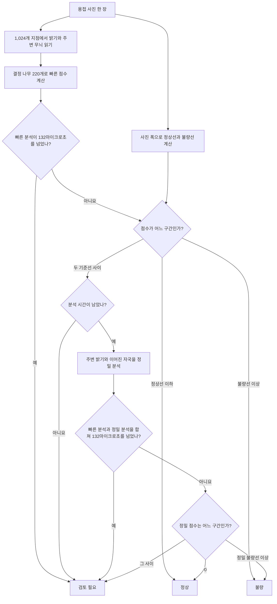
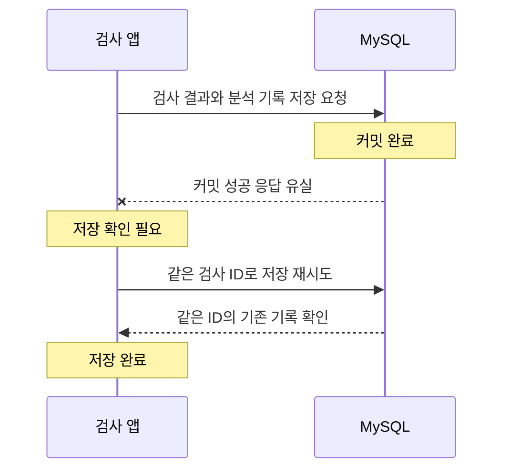

# 용접 외관 검사 기술 포트폴리오

WeldScope는 배터리 용접 사진을 **정상**, **불량**, **검토 필요**로 분류하는 Windows 앱입니다. 사진 한 장이나 폴더 전체를 검사하면 결과와 판정 이유를 **MySQL 데이터베이스**에 저장합니다. 정답이 붙은 사진에서 정상과 불량을 구별하는 규칙을 **LightGBM**이라는 도구로 학습했습니다. 앱은 학습해 둔 규칙으로 새 사진의 점수를 냅니다. [앱 실행 안내](../steps/S13-run-package.md)

같은 공개 사진 **8,104장**을 실제 앱으로 비교했을 때, 최종 배포본은 기존 앱보다 불량을 더 많이 잡았고 정상 사진을 잘못 탈락시키는 일도 줄였습니다. [연구 결과와 최종 검수](../algorithms/openzdm-false-pass-eda.md#실제-mfc-검수)


*그림 1. 현재 배포본의 파일 검사. 오른쪽에 판정과 이유가, 아래에 저장된 검사 이력이 표시됩니다.*

## 1. 불량이 어디에서 통과하는지 좁혀 가기

### 처음에는 왜 틀렸나

첫 검사기는 사진을 흑백으로 바꿔 각 점의 밝기를 0(검정)부터 255(흰색)까지 읽었습니다. 사진을 이루는 작은 점을 **픽셀**이라고 합니다. 밝기 128 이하인 점의 비율이 50% 이상이면 불량으로 판정했습니다.

$$
\text{어두운 점의 비율}
= \frac{\text{밝기 128 이하인 점의 수}}{\text{사진 전체의 점 수}}
= \frac{5{,}075}{8{,}451}
\approx 60\%
$$

수식에 넣은 사진은 실제로 정상입니다. 사진 전체가 어두워 비율이 50%를 넘었고, 앱은 불량으로 판정했습니다. [첫 검사기의 설정](../../config/baseline.json) · [실제 사진의 계산값](../steps/S11-evidence/demo/comparison.json)

### 사진 전체의 밝기에서 주변과의 밝기 차이로

다음 검사기는 각 점을 **가운데 점을 포함한 가로 9개 점의 평균 밝기**와 비교했습니다. 차이가 12보다 크면 이상이 의심되는 점으로 표시합니다. 가까운 곳끼리 밝기를 비교하는 방식이라 **국소 대비 검사**라고 합니다.

$$
\begin{aligned}
\text{밝기 차이} &= |\text{가운데 점의 밝기} - \text{가로 9개 점의 평균 밝기}| \\
                 &= |90-110| = 20 > 12
\end{aligned}
$$

이 예에서 가운데 점은 표시 대상입니다. 사진 전체에 같은 계산을 적용하고, 아래처럼 표시된 점의 비율을 빠른 점수로 썼습니다. [밝기 차이를 계산하는 코드](../../src/WeldScope.Core/LocalContrastInspection.cpp)

$$
\text{빠른 점수}=\frac{\text{표시된 점의 수}}{\text{사진 전체의 점 수}}
$$

이전 앱은 빠른 점수가 **약 0.266 이하**면 정상, **약 0.308 이상**이면 불량으로 판정했습니다. 그 사이에 있고 시간이 남으면 정밀 분석을 실행했습니다. 이때는 가로 31개 점의 평균과도 비교해, 두 범위 중 한 번이라도 표시된 점을 모두 모았습니다. 표시된 점 전체와 그중 가로로 3개 이상 이어진 점을 각각 **사진 전체에 대한 비율**로 구했습니다.

$$
\text{정밀 점수}
= \frac{\text{표시된 점의 비율} + \text{가로로 이어진 점의 비율}}{2}
= \frac{0.40 + 0.30}{2}
= 0.35
$$

정밀 점수는 0이면 정상, 약 0.550 이상이면 불량입니다. 예시의 0.35는 그 사이여서 **검토 필요**입니다. 합산 분석 시간이 **132마이크로초(0.132밀리초)**를 넘긴 경우도 검토 필요로 남깁니다. [이전 배포 앱의 판정 설정](../steps/S11-evidence/config/selective.json) · [판정 순서 코드](../../src/WeldScope.Core/SelectiveInspectionPolicy.cpp)

주변 밝기를 비교하자 어두운 정상 사진의 오판은 줄었습니다. 그래도 점수를 낼 때 표시한 점을 사진 전체 픽셀 수로 나누므로, 짧은 불량 자국은 묻힐 수 있었습니다. 실제 불량 사진 한 장에서 눈에 띄는 구간만 보면 표시된 점이 15%였지만 전체 검사 영역에서는 9%였고, 당시 연구 규칙을 통과했습니다. [원본 사진과 후보 비율](../algorithms/openzdm-false-pass-eda.md#동결-모델의-타당성-점검)

### 정밀 분석을 더 잘하면 해결될까

처음의 어두운 점 비율 검사와 애매한 사진만 정밀 분석하는 검사를 같은 사진에 적용했습니다. **정상을 불량으로 잘못 판정한 비율은 74.63%에서 16.19%로 줄었지만**, 불량이 정상으로 통과한 수는 **750장에서 754장으로 늘었습니다**. 빠른 단계에서 정상 판정이 끝난 사진은 정밀 분석을 거치지 않습니다. 다음 실험에서는 빠른 단계의 점수부터 살폈습니다. [초기 네 가지 검사 방식의 결과](../steps/S11-evidence/compact-results.json)

### 후보가 모인 위치도 중요한가

같은 사진을 여러 칸으로 나눠 밝기와 무늬를 읽었습니다. 한쪽은 각 칸을 원래 위치에 두고, 다른 쪽은 밝기순으로 재배열했습니다. 예를 들어 어두운 점이 세 개 있어도 한곳에 이어진 사진과 양끝에 흩어진 사진은 배치가 다릅니다. 검증 사진에서 **위치를 남긴 쪽은 불량 통과가 225장→196장, 정상 오판이 588장→529장**으로 줄었습니다. 그래서 빠른 점수에 위치별 정보를 넣었습니다. 이 정보를 쓰는 모델에도 남은 오류가 있었습니다. 시험에서 놓친 **236장 모두 첫 단계에서 정상으로 통과**했습니다. 라벨(사진에 붙은 정상·불량 정답)을 가리고 본 사진 중에는 정상과 불량이 모두 잔점이 많아 둘 다 불량으로 판정된 사례도 있었습니다. [위치 대조와 라벨을 가린 관찰](../algorithms/openzdm-false-pass-eda.md#동결-모델의-타당성-점검) · [위치별 모델의 단계별 오류](../algorithms/openzdm-false-pass-eda.md#s12와-폭별-48개-나무의-실측)

### 사진 폭에 따라 검사 결과가 달라진 이유

학습 자료를 폭별로 세어 보니, **385~415픽셀에서는 100장 중 약 43장이 불량**이었고 그 밖에서는 **약 4장**이었습니다. 폭 자체도 정답을 짐작하게 하는 단서였습니다. 폭마다 별도 모델을 두면 불량을 더 잘 잡는지 시험했지만, 전체 폭을 함께 학습한 모델과 비교해 불량 통과가 두 반복에서 각각 **1장 감소·2장 증가**했습니다. [폭별 데이터와 두 모델 비교](../algorithms/openzdm-false-pass-eda.md#폭별-모델과-단일-모델)

다음에는 모든 폭을 함께 학습한 **LightGBM 모델**을 시험했습니다. 이 모델은 “이 구간의 밝기 변화가 기준보다 큰가?”라는 질문처럼, 답에 따라 다음 질문으로 갈라지는 **결정 나무 400개**로 이루어졌습니다. 모든 폭에 같은 판정 기준을 적용하자 전체 불량 통과와 정상 오판은 줄었지만, **385~415픽셀 바깥에서 놓친 불량은 212장 중 48장→83장으로 늘었습니다.** 첫 실행에서는 검토 필요로 남긴 사진도 11.18%로 연구 기준인 10%를 넘었습니다. 이 후보를 보류하고 **폭 구간마다 두 오류를 따로 확인**하기 시작했습니다. 두 구간 모두 위치를 읽던 이전 모델보다 두 오류가 늘지 않고, 전체 검토 필요 비율과 정밀 분석 횟수도 연구 기준을 만족한 **220개 나무**를 골랐습니다. [400개 후보의 실패와 220개 후보의 선택](../algorithms/openzdm-false-pass-eda.md#첫-단계에서-무엇을-바꿨나)

### 같은 사진에서 폭 한 픽셀의 영향을 떼어 보기

220개 나무를 골라 놓고도 폭 구간을 넘는 순간 기준이 확 바뀌는 문제가 남았습니다. **같은 편집 사진 53장의 모델 점수를 고정**하고, 편집 전 폭과 편집 후 폭의 기준만 번갈아 적용했습니다. 계단식 기준에서는 21장의 판정이 달라졌고 2장은 통과와 탈락이 바로 뒤집혔습니다. 경계 주변에서 기준선을 직선으로 이은 뒤에는 **21장→5장**, 직접 뒤집힌 경우는 **2장→0장**이었습니다. 사진의 점수를 고정했기 때문에 폭에 따른 기준 변경의 영향만 확인할 수 있었습니다. [한 픽셀 편집 대조 결과](../algorithms/evidence/openzdm-pooled-model/boundary.json) · [연속 보간 적용과 재검증](../algorithms/openzdm-false-pass-eda.md#최종-220개-나무와-연속-폭-경계)

다음 예에서는 점수를 0.15로 고정했습니다. 사진 폭에 따라 정상으로 바로 통과할 수 있는 점수의 상한인 **정상선**이 조금씩 움직입니다.

| 가로 폭 | 연속 보간으로 구한 정상선 | 빠른 점수 0.15의 구간 |
|---|---:|---|
| 414픽셀 | 약 0.175 | 정상 |
| 415픽셀 | 약 0.160 | 정상 |
| 416픽셀 | 약 0.145 | 두 기준선 사이 |
| 417픽셀 | 약 0.129 | 두 기준선 사이 |

두 기준선 사이에서는 남은 시간이 있으면 정밀 분석으로 넘어갑니다. [배포 설정](../../config/pooled-smooth-220.json) · [폭별 기준 계산 코드](../../src/WeldScope.FileInspection/InterpolatedScoreBand.h)

### LightGBM으로 학습하고 C++로 판정하기

밝기와 주변 무늬를 숫자로 정리한 뒤, 사진마다 붙어 있는 **정상·불량 정답**을 함께 주어 LightGBM으로 모델을 학습했습니다. LightGBM은 **결정 나무**를 차례로 만들면서 앞의 나무들이 낸 예측의 오류를 다음 나무가 줄이도록 학습합니다. 예를 들어 어두운 배경에서 정상과 불량이 자주 섞이면, 이후 나무는 그 사진을 구분하는 데 도움이 되는 밝기 변화나 무늬를 찾을 수 있습니다. [LightGBM 학습 코드](../../tools/openzdm_boost/fit.cpp) · [후보 비교와 220개 나무 선택](../algorithms/openzdm-false-pass-eda.md#최종-220개-나무와-연속-폭-경계)

배포할 때는 최종 모델의 **결정 나무 220개**에서 비교 기준과 각 경로의 점수를 꺼내 `model-220.txt`에 저장합니다. Windows 앱은 이 파일을 **C++ 판독기**로 읽어 새 사진의 점수를 계산합니다. 앱을 실행하는 PC에서는 LightGBM 설치 없이 검사할 수 있습니다. [모델 변환 코드](../../tools/evaluate_openzdm_boost.py) · [배포 모델](../../config/model-220.txt) · [C++ 판독 코드](../../src/WeldScope.FileInspection/CompactBoostedTrees.h)

사진 한 장이 들어오면 다음 순서로 처리합니다.

1. **사진을 여러 곳에서 읽습니다.** 가로 64곳과 세로 16곳을 조합한 1,024개 지점에서 밝기와 주변 밝기 차이를 잽니다. 예를 들어 어두운 점 세 개가 가운데에 모인 사진과 양끝에 흩어진 사진은 후보 수가 같아도 위치별 입력값이 다릅니다. [밝기와 무늬 계산 코드](../../src/WeldScope.FileInspection/PooledTexture.h)
2. **학습한 질문으로 점수를 냅니다.** 결정 나무 한 개는 “이 구간의 밝기 변화가 기준보다 큰가?”처럼 숫자를 비교하는 질문을 따라갑니다. 220개 나무의 답을 합쳐 사진 한 장의 점수를 냅니다. 점수가 낮을수록 정상 쪽에 가깝습니다. [C++ 모델 코드](../../src/WeldScope.FileInspection/PooledSmoothModel.h)
3. **사진 폭에 맞춰 점수를 해석합니다.** 220개 나무는 모든 폭에서 동일하게 사용합니다. 모델이 점수를 낸 뒤, **연속 보간**으로 계산한 통과선·탈락선과 비교합니다. [보간 코드](../../src/WeldScope.FileInspection/InterpolatedScoreBand.h)

아래는 사진 읽기와 계산이 성공했을 때의 판정 순서입니다. 현재 앱은 첫 점수를 LightGBM 모델로 계산하고, 필요할 때 앞서 설명한 정밀 분석을 한 번 사용합니다.



예를 들어 **폭 400픽셀**에서는 정상선이 약 **0.244**, 불량선이 약 **0.334**입니다. 첫 분석이 시간 안에 끝났다면 **0.20**은 정상, **0.29**는 시간이 남을 때 정밀 분석, **0.40**은 불량입니다. 앱은 최종 판정과 시간을 화면과 DB에 남깁니다. [배포 설정](../../config/pooled-smooth-220.json) · [공용 분석과 시간 판정 코드](../../src/WeldScope.FileInspection/AnalysisPipeline.cpp)

앱을 열면 설정과 학습 파일의 내용으로 계산한 **디지털 지문(SHA-256)**을 검수한 값과 비교합니다. 파일이 빠지거나 내용이 바뀌면 설정 오류를 표시하고 해당 모델로 새 검사를 시작하지 않습니다. 저장된 이력에는 어떤 모델과 설정으로 검사했는지도 남습니다. [모델 로딩 코드](../../src/WeldScope.FileInspection/PooledSmoothModel.h) · [기본 검사기 채택 결정](../adr/0013-portfolio-default-inspection.md)

### 실제 배포 앱에서 얼마나 달라졌나

이전 **국소 대비 검사**와 현재 **LightGBM 검사**를 실제 Windows 앱에서 비교했습니다. 두 앱에 배터리 용접 공개 자료인 **OPENZDM의 같은 사진 8,104장**을 넣었습니다. 실제 정답은 불량 1,569장과 정상 6,535장이었습니다.

| 확인한 결과 | 이전 앱 · 주변 밝기 차이로 계산 | 현재 앱 · LightGBM으로 점수 계산 |
|---|---:|---:|
| 불량인데 정상으로 통과 | 695/1,569 (44.30%) | **172/1,569 (10.96%)** |
| 정상인데 불량으로 판정 | 1,024/6,535 (15.67%) | **619/6,535 (9.47%)** |
| 검토 필요 | 1,093/8,104 (13.49%) | **751/8,104 (9.27%)** |

배포본이 MySQL에 저장한 **8,104장의 첫 점수**는 C++ 연구 실행기와 모두 일치했습니다. 같은 사진을 다시 검사했을 때 시간 한도 때문에 일부 최종 판정은 달라졌습니다. 표는 최종 배포본의 한 실행을 보여 줍니다. [시험 사진 선정과 비교 기록](../algorithms/openzdm-false-pass-eda.md#실제-mfc-검수) · [배포본 검수 데이터](../algorithms/evidence/openzdm-pooled-model/portfolio-release.json)

다른 촬영 방식에서 나온 실제 용접 누락 사진은 새 모델도 두 번 모두 정상으로 통과시켰습니다. 이 사진의 빠른 점수는 약 **0.014**, 자동 통과선은 약 **0.061**이었습니다. 점수가 통과선보다 낮아 정밀 분석을 건너뛴 경로까지 확인했습니다. 당시 사진과 공개 라벨로는 촬영 조건과 결함 자체가 점수에 각각 얼마나 영향을 줬는지 구분할 수 없었습니다. OPENZDM에는 실제 부품과 촬영 배치를 구분할 식별자가 없어, 위 수치는 공개 사진에서 검증한 포트폴리오 성능으로 해석합니다. [외부 사진 검증과 적용 범위](../algorithms/openzdm-false-pass-eda.md#외부-사진과-실제-부품배치의-구분)

## 2. 장비 연결이 끊겼을 때 중복 저장 방지

장비가 검사 결과를 받기 전에 연결이 끊기면, 장비는 앱이 검사를 끝냈는지 알 수 없습니다. 업체에 전화로 택배를 접수하다가 확인 답변 전에 통화가 끊긴 상황과 같습니다. 새 접수로 처리하면 같은 상자를 두 번 보낼 수 있습니다. 그래서 장비는 처음 보낸 접수번호인 **요청 ID**를 그대로 다시 보냅니다. 이미 저장된 기록이 있으면 앱은 그때 발급한 **검사 ID**와 판정을 돌려줍니다.

### 줄바꿈으로 장비 요청 한 건 구분

장비와 앱은 데이터를 순서대로 전달하는 **TCP**로 연결했습니다. 요청 한 줄을 보내도 앱에는 `INS`와 나머지가 나뉘어 들어올 수 있습니다. 반대로 두 요청이 한꺼번에 들어올 수도 있습니다. 그래서 한 번에 받은 양으로 요청을 자르지 않고, 줄바꿈(LF)이 올 때까지 모읍니다. 요청은 탭(TAB)으로 나뉜 짧은 이름만 받으므로 줄바꿈을 끝 표시로 쓸 수 있습니다. 본문은 256바이트, 대기 시간은 2초로 제한해 끝이 없는 요청이 연결을 계속 차지하지 않게 했습니다. [TCP 표준 RFC 9293](https://www.rfc-editor.org/rfc/rfc9293.html#section-2.2) [요청을 읽는 코드](../../src/WeldScope.Device/Protocol.cpp) [수신 대기 코드](../../src/WeldScope.Device/LoopbackServer.cpp)

```text
INSPECT\treq-17\tweld-01\tpooled-smooth-220-v1\n
```

위 요청은 앱에 미리 등록한 `weld-01` 영상을 현재 파일·폴더 검사와 같은 모델로 검사하라는 뜻입니다. `req-17`은 장비가 붙인 요청 ID입니다. `\t`와 `\n`은 실제 탭과 줄바꿈을 읽을 수 있게 적은 표기입니다. [요청 문법](../adr/0006-virtual-device-protocol.md) · [현재 모델의 장비 설정](../adr/0013-portfolio-default-inspection.md)

결과 응답(`RESULT`)은 저장이 확인된 뒤에만 보냅니다. 같은 요청 ID로 영상이나 설정을 바꾸면 요청 번호가 충돌했다는 응답(`REQUEST_CONFLICT`)을 보냅니다. 이 규칙이 있어야 장비가 앞선 검사 결과를 다른 검사의 결과로 받아들이지 않습니다. 통신은 같은 PC에서 장비 역할을 하는 테스트 프로그램으로 검증했습니다. [장비 응답 계약](../adr/0010-record-device-integration.md#tcp-계약)

### 저장이 끝났지만 성공 응답이 끊긴 경우

**검사 결과만 남고 그 결과를 설명할 분석 기록이 빠지는 일을 막아야 했습니다.** 그래서 검사 결과, 분석 기록, 폴더 내 순서를 한 번에 저장할 수 있는 데이터베이스(DB)인 **MySQL**을 사용했습니다. 변경을 묶는 단위가 **트랜잭션**입니다. 세 기록을 모두 쓴 뒤 저장을 확정하는 동작이 **커밋**입니다. 쓰기 도중 하나라도 실패하면 묶음 전체를 되돌립니다. 커밋은 끝났어도 성공 응답을 받지 못할 수 있습니다. 그때 앱은 같은 검사 ID로 저장을 재시도합니다. [MySQL 트랜잭션 문서](https://dev.mysql.com/doc/refman/8.4/en/innodb-autocommit-commit-rollback.html)



재시도에서 새 검사 번호를 만들면 한 건이 두 건으로 남을 수 있습니다. 그래서 처음 만든 검사 ID를 재사용하고, DB에도 같은 요청 번호를 한 번만 저장할 수 있는 규칙인 **고유키**를 뒀습니다. 이미 기록이 있으면 검사 내용과 폴더 내 순서를 비교합니다. 모두 같을 때만 이전 저장이 성공한 것으로 처리합니다. [저장 코드](../../src/WeldScope.Storage/InspectionHistory.cpp) [검사 테이블 정의](../../db/s05/schema.sql) [폴더 테이블 정의](../../db/s13/schema.sql)


*그림 2. DB는 첫 결과를 저장했지만 앱은 성공 응답을 받지 못했습니다. 앱은 ‘저장 확인 필요’를 표시합니다.*

장애를 재현할 때는 DB의 커밋을 확인한 뒤 앱으로 가는 성공 응답만 끊었습니다. **저장 재시도**를 눌러 검사를 마쳤고, 재시도한 파일의 기록이 한 건인지 확인했습니다. 앱을 재시작한 뒤에도 기존 이력과 TCP 결과를 다시 받았습니다. 아직 저장되지 않은 작업은 앱이 실행 중일 때 재시도할 수 있습니다. [재검수 기록](evidence/verification.json) [통합 검수 도구](../../tools/verify_folder_e2e.py) [저장 계약](../adr/0010-record-device-integration.md)

## 3. 폴더 검사 중 저장 진행률 표시

수만 장을 검사할 때마다 사진을 하나씩 고를 수는 없습니다. 기존 Windows 앱에서 폴더를 고르면 하위 폴더까지 검사하도록 바꿨습니다. 저장이 실패한 사진을 완료로 세지 않기 위해 진행률에는 **저장이 확인된 수**를 표시합니다. 결과는 정상, 불량, 검토 필요 등으로 좁혀 볼 수 있습니다. 기존 앱이 Windows 창을 만드는 C++ 라이브러리인 **MFC**를 썼기 때문에 같은 창에 기능을 추가했습니다. Visual Studio로 빌드했습니다. [폴더 검사 설계](../adr/0012-folder-inspection-monitoring.md) [Visual Studio 프로젝트](../../src/WeldScope.App/WeldScope.App.vcxproj)

화면이 검사와 저장을 직접 기다리면 그동안 클릭을 처리할 수 없습니다. 그래서 오래 걸리는 일은 별도 실행 흐름인 **백그라운드 스레드**에 맡기고, 화면은 일정 간격으로 완료 여부를 확인합니다. 이 방식에서는 ‘불량’을 누른 뒤 예전 ‘정상’ 조회 결과가 도착할 수 있습니다. 필터나 페이지를 바꿀 때마다 선택 번호를 올립니다. 조회를 시작했을 때와 현재의 번호가 같을 때만 화면을 갱신합니다. [화면과 조회 코드](../../src/WeldScope.App/WeldScope.AppDlg.cpp) [검사 작업 코드](../../src/WeldScope.App/IntegratedInspection.cpp)

여러 장을 동시에 처리하면 저장이 실패했을 때 어떤 파일부터 재시도할지 따로 관리해야 합니다. 이 앱은 한 장씩 검사하고 DB 저장이 확인된 뒤 다음 파일로 넘어갑니다. 그 덕분에 단일 검사에서 쓰던 취소와 재시도 규칙을 그대로 적용했습니다. 화면의 합계와 결과 목록은 DB의 같은 시점에서 읽습니다. 검사 중 새 행이 저장돼도 한 번의 화면 갱신 안에서 합계와 목록이 어긋나는 일을 피할 수 있습니다. [결과 목록 조회](../../src/WeldScope.Storage/InspectionHistory.cpp#L585) [순차 처리 설계](../adr/0012-folder-inspection-monitoring.md)


*그림 3. 검수용 영상 네 장의 결과입니다. 가운데 필터에 판정별 건수가 표시됩니다. 행을 선택하면 아래에 원본 영상과 판정 사유가 표시됩니다.*

### 폴더 검사 기능에서 61,670장 대조

완료 건수만 확인하면 한 파일이 두 번 들어가고 다른 파일이 빠져도 알아차리기 어렵습니다. 그래서 **61,670장**의 저장 기록을 원본 목록과 한 건씩 대조했습니다. 폴더 안의 파일 위치로 같은 이름의 다른 파일을 구분했습니다. 같은 위치에 내용이 바뀐 파일이 들어와도 잡을 수 있도록 파일 내용에서 계산한 지문(**SHA-256**)도 비교했습니다. 누락, 중복, 내용 불일치는 모두 0건이었습니다. 판정별 건수도 화면과 DB에서 일치했습니다. [전체 실행 환경과 절차](../steps/S13-folder-inspection-monitoring.md) [전체 실행 집계](../steps/S13-evidence/full-verification.json)


*그림 4. 국소 대비 검사기로 전체 사진을 처리했을 때의 화면. 표의 `test/KO/image_100.png`는 실제 불량이지만 앱이 정상으로 표시한 사진입니다.*

전체 폴더 실험은 **이전 국소 대비 검사기**를 Windows 11 가상 환경에서 실행한 기록입니다. 검사와 저장에는 약 14분 31초가 걸렸습니다. 그림 2와 3에는 당시 폴더 기능을 네 장으로 다시 확인했을 때의 화면을 실었습니다. 현재 배포본에서는 1절의 8,104장 검수와 별도로 저장 재시도, 원하는 판정만 골라 보기, 검사 중지, 이력 조회를 다시 확인했습니다. [폴더 기능 재검수 기록](evidence/verification.json) · [현재 배포본 검수 기록](../algorithms/evidence/openzdm-pooled-model/portfolio-release.json)

## 직접 시연하는 순서

1. 검수 ZIP을 풀고 `WeldScope-Start.cmd`를 더블클릭합니다. 필요한 런타임과 MySQL 위치는 [실행 안내](../steps/S13-run-package.md)에 있습니다.
2. 한 장부터 보려면 **파일 검사 → 이미지 선택 → 검사 시작**을 누릅니다. 화면에서 **연속 보간** 모델과 점수, 판정 사유를 확인합니다.
3. 여러 장을 보려면 **폴더 검사 → 폴더 선택 → 검사 시작**을 누릅니다. 저장 수와 판정별 건수를 확인하고, 결과 행을 열어 원본과 판정 사유를 확인합니다.
4. 앱을 다시 열고 **검사 이력**에서 앞선 실행을 조회합니다.

**영상 출처**

OPENZDM, *2D image dataset for the presence or absence of aesthetical defects on EV battery welds.* 화면에서 영상 크기를 조정하고 후보를 덧그렸습니다. [Zenodo 원본](https://zenodo.org/records/14025630) [CC BY 4.0](https://creativecommons.org/licenses/by/4.0/)
