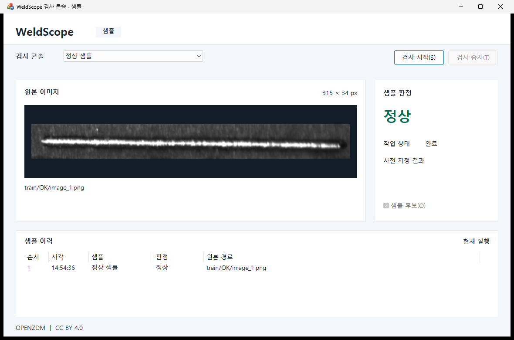
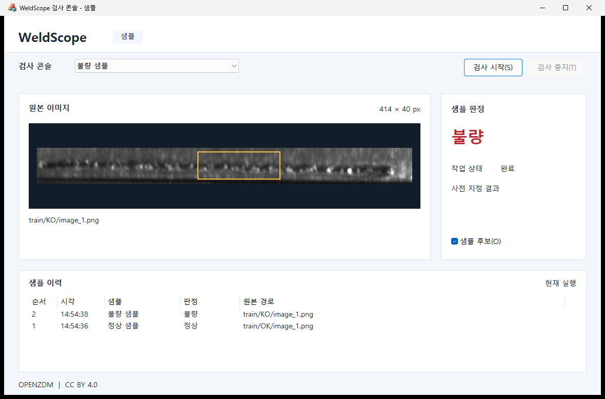
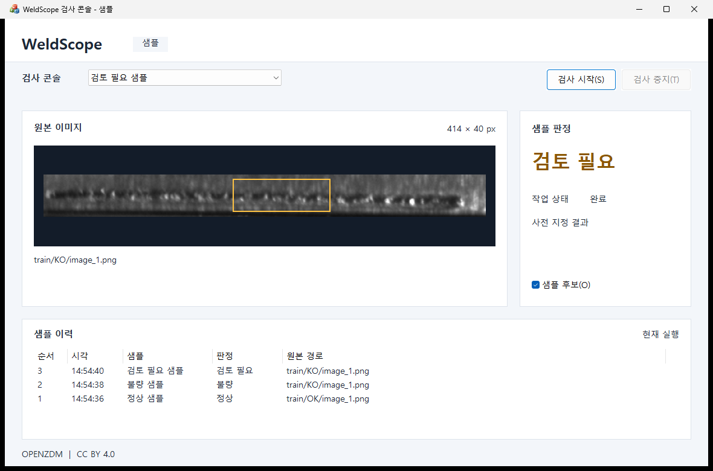
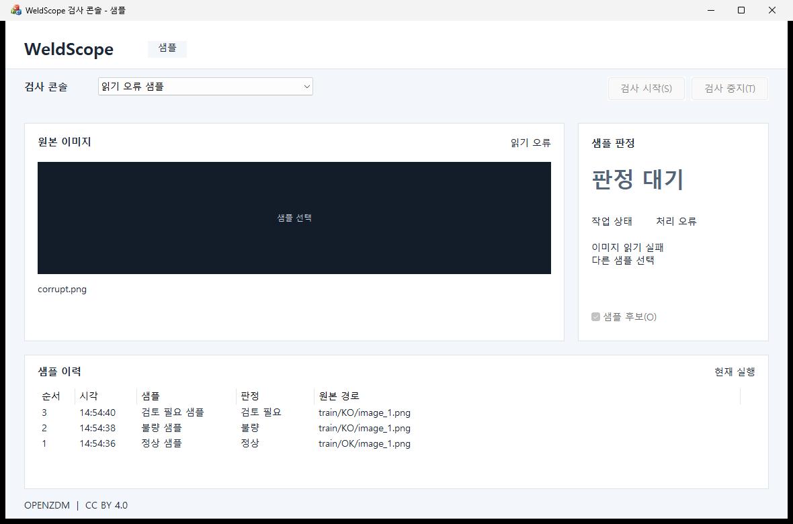
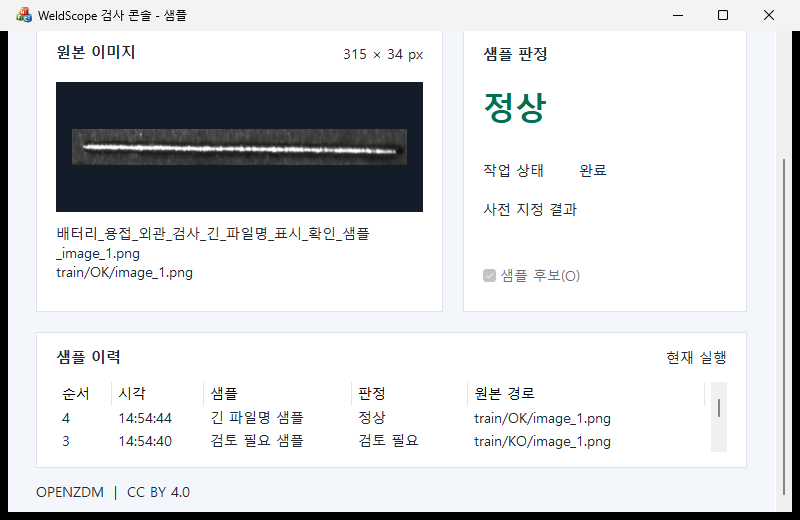

# S03 검사 콘솔 시제품

상태: 사용자 승인. 2026-11-18 계획 수락 후 구현과 검증을 수행했고, 사용자가 결과를 확인한 뒤 main 병합과 S04 계획을 요청했다. 다른 실제 DPI 배율의 미검증 제한은 유지한다. 아래 사진은 실행한 MFC 앱의 창을 직접 캡처한 것이다.

## 왜: 검사 화면의 사용 흐름 확인

알고리즘이 좋은 결과를 내더라도 어떤 사진의 결과인지, 아직 검사 중인지, 다시 확인해야 하는지 알아보기 어려우면 검사 프로그램으로 쓰기 어렵다. 그래서 실제 분석을 연결하기 전에 **이미지 선택 → 검사 시작 → 결과 확인 → 이력 확인**이 자연스러운지 확인할 수 있는 화면을 만들었다.

이번 단계의 목적은 화면과 조작 흐름의 검수다. 실제 불량 검출, DB 저장, 장비 통신은 다음 담당 단계의 작업이다. S02의 평가 사용 보류 정책도 그대로 유지한다.

## 어떻게: 기존 MFC 앱에 작은 책임 세 개

별도 웹 시제품 대신 기존 C++ MFC 프로젝트에서 실행되는 화면을 구성했다. Windows 제목 표시줄, 버튼, 선택 목록, 체크박스와 이력 목록을 사용해 키보드와 창 조작을 함께 확인한다. 이미지 표시는 MFC와 함께 설치된 ATL `CImage`를 사용한다. 새 외부 패키지는 추가하지 않았다.

| 구성 | 맡은 일 | 이렇게 나눈 이유 |
|---|---|---|
| `SampleSession` | 준비, 실행, 완료, 중지, 오류와 샘플 판정 관리 | 화면을 다시 그려도 작업 규칙 유지 |
| `SampleImageView` | 이미지 표시, 원본 비율 유지, 샘플 후보 사각형 표시 | 화면 크기가 바뀌어도 이미지 찌그러짐 방지 |
| MFC 대화 상자 | 사용자 조작, 화면 배치, 실행 중 이력 표시 | 화면 이벤트와 상태 규칙 구분 |

이 구분은 S03 화면 안의 구성이다. 이후 실제 검사 엔진의 인터페이스를 미리 확정한 것은 아니다. 장기 의존성이나 외부 계약을 바꾸지 않아 새 ADR은 만들지 않았다. 기존 [개발 환경 ADR](../adr/0002-development-environment.md)과 [데이터 ADR](../adr/0003-dataset-preparation.md)을 따른다.

디자인에는 `visualize` 스킬의 `mockups.md`와 [UI UX 원칙](../standards/ui-ux.md)을 적용했다. 제품과 무관한 통계 패널을 추가하지 않고 이미지와 판정을 크게 배치했다. 판정은 색상과 한국어를 함께 사용하고, 버튼과 상태는 짧은 명사형으로 작성했다. 작은 창에서는 전체 화면의 세로 스크롤로 아래쪽 이력에 접근한다. Tab으로 화면 밖 컨트롤에 이동할 때도 해당 위치로 스크롤한다.

### 샘플과 실제 판정의 구분

S02에서 확인한 train 이미지 두 장을 원본 바이트 그대로 실행 파일에 포함했다. ZIP, Python과 인터넷 연결 없이 화면 시연을 실행할 수 있다. 원본 경로와 SHA-256은 [샘플 출처](../../src/WeldScope.App/res/samples/provenance.json)에 있다.

| 선택 | 이미지 | 시연 결과 |
|---|---|---|
| 정상 샘플 | `train/OK/image_1.png`, 315×34 | 정상 |
| 불량 샘플 | `train/KO/image_1.png`, 414×40 | 불량 |
| 검토 필요 샘플 | 같은 KO 이미지 | 검토 필요 |
| 읽기 오류 샘플 | 직접 만든 비이미지 파일 | 처리 오류 |
| 긴 파일명 샘플 | 같은 OK 이미지에 긴 표시명 부여 | 정상 |

검토 필요는 데이터셋의 새로운 정답 라벨이 아니다. 세 가지 결과를 화면에서 비교하기 위한 사전 지정 시연이다. 긴 표시명은 원본 경로와 별도로 표시하며 이력에는 실제 원본 경로를 남긴다. 노란 후보 사각형도 미리 정한 위치다. 화면에 `샘플`, `샘플 판정`, `사전 지정 결과`를 표시한다.

검사 시작 후 약 1.2초의 타이머로 실행 중 상태를 보여 준다. 이 시간은 실제 분석 시간이나 성능 측정값이 아니다. 대기 중에도 창 조작과 중지가 가능하고, 중지하면 판정과 이력을 추가하지 않는다. 각 실행의 타이머 ID를 구분해 이전 실행의 늦은 이벤트가 새 실행을 완료시키지 못하게 했다.

## 무엇을: 동작하는 화면과 관찰 결과

### 정상과 불량

위쪽에서 샘플을 선택하고 검사 시작을 누르면 원본 비율을 유지한 이미지와 결과를 확인한다. 작업 상태와 판정을 따로 표시하고, 완료한 실행만 아래 이력에 추가한다. 이력은 현재 앱을 실행한 동안만 유지된다.





불량 화면의 노란 사각형은 `샘플 후보` 체크박스로 끄고 켤 수 있다. 실제 검출 위치를 뜻하지 않는다.

### 검토 필요와 오류 복구

판정이 검토 필요인 경우에도 정상·불량과 같은 읽기 순서를 유지한다. 이미지 읽기에 실패하면 `처리 오류`와 `다른 샘플 선택`을 표시하고 검사 시작을 막는다. 다른 정상 샘플을 선택하면 복구된다. 새 이미지를 선택하거나 실행을 중지하면 이전 판정을 제거한다.





### 작은 창과 긴 파일명

긴 표시명과 실제 원본 경로를 분리하고, 원본 이미지는 가로세로 비율을 유지한다. 최소 창 크기는 760×420 DIP다. 세로 공간이 부족하면 전체 화면과 이력 목록을 각각 스크롤할 수 있다. 아래는 100% 배율의 작은 창에서 아래쪽으로 스크롤한 실제 화면이다.



### 실제 검증

| 검증 | 관찰 결과 |
|---|---|
| ARM64 Release / Debug 빌드 | 두 구성 성공, 경고를 오류로 처리 |
| C++ 상태 전이 검사 | 빈 입력 차단, 세 결과, 실행 중 입력 변경 차단, 중지 후 늦은 완료 차단, 오류 복구 통과 |
| 기존 Python 회귀 검사 | S02 자동 검사 19개 통과 |
| 실제 Release 앱 조작 | 세 결과, 후보 표시 전환, 중지, 손상 입력, 복구와 이력 수량 확인 |
| 실제 창과 키보드 | 제목 표시줄, Tab 순서, 작은 창 스크롤, 초점에 따른 자동 스크롤, 안내 문구와 체크박스의 비중첩 확인 |
| 화면 확인 | 실제 캡처에서 이미지 비율, 판정 문구, 원본 식별자와 배치 확인 |

검증 기록: [GUI 검사와 환경](S03-evidence/verification.json), [C++ 검사](S03-evidence/cpp-tests.txt), [Python 검사](S03-evidence/python-tests.txt), [Release 빌드](S03-evidence/build-release.txt), [Debug 빌드](S03-evidence/build-debug.txt), [실행 환경](S03-evidence/environment.json).

별도 읽기 전용 코드 검토에서 제목 표시줄, 원본 경로, 작은 창 접근성 문제를 발견해 반영했다. 안내 영역 겹침은 실제 GUI 검사에서 실패를 재현한 후 수정했다. 최종 변경의 성공 여부는 위의 실행 결과로 확인했다. 별도 검토자가 GUI 검사를 독립 실행한 것은 아니다.

### 재현 절차

프로젝트 루트의 PowerShell에서 실행한다. Visual Studio의 C++ ARM64 도구, ARM64 MFC와 Windows SDK가 설치된 현재 환경에서 확인했다.

```powershell
powershell -NoProfile -ExecutionPolicy Bypass -File tools/build-s03.ps1
powershell -NoProfile -ExecutionPolicy Bypass -File tools/build-s03.ps1 -Configuration Debug
.\artifacts\S03\ARM64\Release\WeldScope.App.exe
```

1. 정상 샘플 선택 → 검사 시작 → 정상과 이력 확인.
2. 불량 샘플 선택 → 검사 시작 → 불량과 샘플 후보 확인, 후보 표시 전환.
3. 검토 필요 샘플 선택 → 검사 시작 → 검토 필요 확인.
4. 실행 중 검사 중지 → 판정 대기와 중지 확인. 중지한 실행의 이력 추가 없음.
5. 읽기 오류 샘플 선택 → 처리 오류 확인 → 정상 샘플 선택으로 복구.
6. 긴 파일명 샘플과 작은 창 확인. Tab, Alt+S, Alt+T와 스크롤 확인.

자동 검사와 캡처의 재실행 명령이다. Python은 기존 S02 환경과 Pillow를 사용하며, 앱 자체 실행에는 Python이 필요 없다.

```powershell
cmd /c tools\test-s03.cmd
.tools/python/python.exe -W error -m unittest discover -s tests -v
.tools/python/python.exe tools/verify_s03.py --output artifacts/S03/ui-final
```

### 남은 확인과 사용자 검수

- 실제 GUI 검증은 Windows ARM64, 96 DPI(100%)에서 수행했다. 960×680, 800×520, 760×420 창 크기를 확인했다. PerMonitorV2 선언과 배율에 따른 좌표·글꼴 재계산을 구현했지만 다른 실제 배율과 모니터 간 이동은 미검증이다.
- x64, Win32, 다른 Windows 환경과 새 PC의 런타임 설치는 미검증이다.
- 자동 판정 정확도, 실제 처리시간, 실제 후보 위치, 영구 이력 저장과 장비 연결은 이번 결과에 포함하지 않는다.
- 사용자 확인 항목은 이미지와 판정의 읽기 순서, 정상·불량·검토 필요의 구분, 제어와 이력 접근성이었다. 결과 확인과 main 병합 후 S04 계획 요청을 받았다. 위 미검증 항목까지 검증된 것으로 해석하지 않는다.

데이터 출처: OPENZDM, *2D image dataset for the presence or absence of aesthetical defects on EV battery welds.*, [Zenodo](https://zenodo.org/records/14025630), DOI 10.5281/zenodo.14025630, [CC BY 4.0](https://creativecommons.org/licenses/by/4.0/). 사진 안의 원본은 비율을 유지해 확대 표시했고 후보 사각형을 겹쳤다. 앱 창 캡처는 실제 실행 화면이며 생성 이미지가 아니다.
