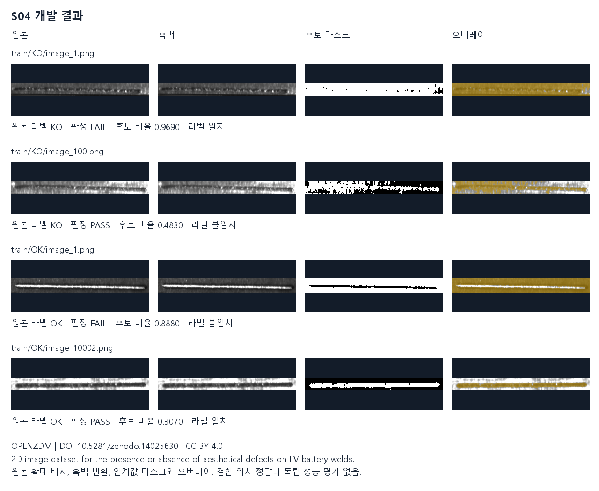

# S04 C++ 기준 검사

상태: 구현과 검증 완료, 사용자 검수 대기. 2026-11-18 사용자가 S04 계획과 ADR 0004 설명 후 “진행해.”로 실행을 승인했다. 아래 결과는 실제 C++ 실행이며 **train 개발 자료에 대한 집계**다. 독립 평가 사용 보류는 유지한다.

## 왜: 비교할 수 있는 첫 실제 검사

S03은 화면 흐름을 확인하기 위해 미리 지정한 판정을 표시했다. S04에서는 이미지의 픽셀을 실제로 계산하고, 같은 입력을 다시 실행해 결과를 비교할 수 있는 기준 검사를 만들었다.

처음부터 복잡한 특징이나 학습 모델을 넣으면 무엇 때문에 좋아지거나 나빠졌는지 설명하기 어렵다. 그래서 가장 단순한 밝기 기준으로 출발해 **정상 영상을 잘못 막는 경우와 불량 영상을 통과시키는 경우를 함께 기록**했다. 좋은 성능이 나올 때까지 설정을 몰래 바꾸지 않았다.

## 어떻게: 표준 연산과 작은 책임

기존 OpenCV 연산을 재사용했다. OpenCV 4.13.0을 ARM64 Release로 빌드했으며 `core`, `imgproc`, `imgcodecs`와 필요한 PNG·압축·ARM 연산 의존성만 사용한다. 소스 ZIP의 SHA-256을 설치 스크립트에 고정했다. 기존 MFC와 같은 `/MD` C++ 런타임을 쓰는 정적 라이브러리 구성이다.

| 구성 | 맡은 일 |
|---|---|
| `WeldScope.Core` | 흑백 변환, 후보 마스크, 후보 비율과 판정 |
| `WeldScope.Cli` | 파일·설정 읽기, 해시 확인, 단일·일괄 실행, 결과 저장 |
| Python 보조 도구 | 검증된 train 입력 준비, 결과 집계와 설명 그림 |

엔진은 파일명, 정답 라벨, MFC, DB와 소켓을 알지 못한다. CLI가 정답 라벨을 보고서에 붙이며 판정 함수에는 전달하지 않는다. 상속 계층, 알고리즘 팩토리, 범용 파이프라인과 새 JSON 라이브러리는 추가하지 않았다. 설정·목록은 OpenCV FileStorage, 해시는 Windows BCrypt, 입력 준비는 기존 S02 검증과 Python 표준 라이브러리를 사용한다. C++ 검사 실행 파일은 Python을 호출하지 않는다.

관련 경계와 데이터 사용 승인은 [ADR 0004](../adr/0004-baseline-inspection.md), 원본 보존은 [ADR 0003](../adr/0003-dataset-preparation.md)을 따른다. MFC와 연결하는 작업은 S09 범위다.

### 실제 계산

1. 원본 크기의 8비트 BGR 영상을 흑백으로 변환한다.
2. 밝기가 **128 이하**인 픽셀을 후보 마스크에 표시한다.
3. 후보 픽셀 수를 전체 픽셀 수로 나눈다.
4. 후보 비율이 **0.5 이상**이면 FAIL, 작으면 PASS다.

128과 0.5는 전체 train 실행 전에 고정한 최초 해석 가능한 기준이며 성능을 최대화한 값이 아니다. 선택 근거는 [설정 설명](../../config/README.md), 실행에 사용한 바이트는 [baseline.json](../../config/baseline.json)과 증거의 설정 해시로 확인한다. score는 확률이나 실제 결함 면적이 아니다.

원본 ZIP과 추출 파일의 해시를 검증하고 원본 크기를 유지한다. 입력은 8비트 3채널 PNG, 최대 파일 16MiB·1,600만 픽셀이다. PNG 서명과 IHDR 크기를 **디코딩 전에** 검사하며 깊이·채널은 엔진 경계에서도 검사한다. 손상·누락·해시 불일치는 ERROR로 남기고 가짜 점수를 만들지 않는다.

### 입력 준비와 오류 복구

공식 train만 추출한다. 임시 디렉터리에서 해시와 manifest 기록을 마친 뒤 최종 입력 디렉터리로 옮겨 실패한 준비 결과가 완성본처럼 남지 않게 했다. 기존 출력은 덮어쓰지 않는다. 재사용하는 입력 목록도 S02의 예상 경로·라벨·해시·수량과 다시 비교한다. 따라서 16장 캐시를 전체 train 실행으로 잘못 집계하지 않는다.

경로 이탈, 같은 파일의 중복 표기, 정렬되지 않은 목록과 train 외 split을 거절한다. 한글 경로는 `std::filesystem` 파일 I/O와 메모리 디코딩·인코딩으로 확인했다. 임의의 단일 파일 실행은 출처 미지정으로 기록하고, 실제 S02 원본 경로·해시와 대조되지 않은 그림에 OPENZDM 라이선스를 붙이지 않는다.

## 무엇을: 실제 산출물과 결과

### 원본부터 판정까지

아래 그림은 실제 C++ 출력 PNG를 비율에 맞게 배치한 것이다. `visualize`의 정적 그림 제작 지침과 UI UX 원칙을 적용해 원본 식별자, 후보 마스크, 판정과 라벨 비교를 함께 표시했다. 생성 이미지나 미리 지정한 판정이 아니다. 라벨 비교는 이미지 단위이며 픽셀 위치의 정답을 뜻하지 않는다.



- 첫 행: KO를 FAIL로 낸 사례.
- 둘째 행: KO를 PASS로 낸 실패 사례.
- 셋째 행: OK를 FAIL로 낸 실패 사례. 어두운 배경까지 후보로 잡는 한계가 드러난다.
- 넷째 행: OK를 PASS로 낸 사례.

네 가지 사례는 고정 16장 안에서 각 라벨·판정 조합의 첫 사례를 선택했다. 이 그림만으로 전체 성능을 추정하지 않도록 전체 train 집계를 별도로 공개한다. 원본 PNG가 있으므로 불필요한 화면 캡처는 추가하지 않았다.

### 전체 train 집계

| 원본 라벨 | PASS | FAIL | ERROR | 합계 |
|---|---:|---:|---:|---:|
| KO | 4,350 | 3,903 | 0 | 8,253 |
| OK | 9,151 | 25,765 | 0 | 34,916 |
| 전체 | 13,501 | 29,668 | 0 | 43,169 |

KO의 PASS 비율은 4,350/8,253 = 약 52.71%, OK의 FAIL 비율은 25,765/34,916 = 약 73.79%다. 오류율 0%, 자동 판정 비율 100%와 함께 봐야 한다. **이 기준은 실사용 판정 수준에 도달하지 못했다.** 전역 밝기와 어두운 픽셀의 면적만으로는 용접 결함과 정상 배경을 구별하지 못한다는 비교 기준을 확보했다.

이 집계는 개발에 쓰는 train에 다시 실행한 기술 통계다. validation/test를 사용하거나 독립 정확도·부품 단위 일반화 성능을 검증한 것이 아니다. S02의 크기·모드 설명 차이, 분할 간 유사 후보와 제품 그룹 미확인 문제는 여전히 남아 있다.

### 시간 측정과 재현

`load_ms`는 파일 읽기, SHA-256 계산·대조와 디코딩을 포함한다. `analysis_ms`는 흑백·임계값·후보 수·판정이다. PNG 저장은 `artifact_ms`로 분리하며 CSV 저장과 목록 사전 검증은 분석 시간에 포함하지 않는다.

Windows 11 ARM64 build 26300, QEMU VM의 4 vCPU·약 8GiB 메모리, MSVC v145, OpenCV 4.13.0 Release, OpenCV 스레드 1에서 측정했다. 각 실행은 입력당 1회이며 동일 전체 입력을 두 번 실행했다. VM 개발 환경에서 관찰한 값이므로 생산 장비의 처리시간 목표로 사용하지 않는다.

두 번째 전체 실행의 예시다. 서로 다른 크기를 합친 단일 속도로 표현하지 않는다.

| 원본 크기 | 표본 수 | 읽기 p50 / p95 (ms) | 분석 p50 / p95 (ms) |
|---|---:|---:|---:|
| 404×33 | 168 | 0.3129 / 0.9713 | 0.0076 / 0.0220 |
| 403×34 | 162 | 0.3550 / 0.9616 | 0.0077 / 0.0119 |
| 405×36 | 152 | 0.3823 / 1.2017 | 0.0081 / 0.0160 |

2,988개 원본 크기별 표본 수와 p50/p95는 [전체 개발 요약](S04-evidence/development-summary.json)에 있다. 표본 수가 작은 크기의 분위수는 안정된 성능 추정으로 해석하지 않는다.

두 번의 전체 실행에서 시간 항목을 제외한 43,169개 결과 행이 일치했다. 점수 허용 오차는 이번 실행에서 0이었고, 지정한 16개 입력의 중간 PNG 64개도 바이트 단위로 일치했다. [재현 비교](S04-evidence/reproducibility.json)에 CSV 해시와 범위를 남겼다. 전체 CSV는 로컬 `artifacts/S04/train-run-01`, `train-run-02`에 있으며 중복 대용량 파일을 Git에 추가하지 않았다.

### 기준 실행 당시 검증 증거

- [ARM64 빌드와 CTest](S04-evidence/build-tests.txt): 경고를 오류로 처리한 제품 코드 빌드, 엔진 검사와 실제 CLI 통합 검사 4개 통과.
- [Python 회귀](S04-evidence/python-tests.txt): S02 19개, S04 준비 5개, 보고서 2개 통과. CLI 4개는 이 명령에서 건너뛰고 위 CTest에서 실제 실행한다.
- [S03 상태 회귀](S04-evidence/s03-state-tests.txt): 기존 샘플 상태 전이 검사 통과. MFC 코드를 변경하지 않아 GUI 재캡처는 수행하지 않았다.
- [실제 시연 경로 검사](S04-evidence/workflow-checks.json): ERROR가 있는 실행도 보고서 생성 후 코드 2 반환, 잘못된 전체 입력 캐시 차단, 단일 파일 출처 미지정 유지.
- [고정 16장 결과 CSV](S04-evidence/sample-results.csv), [샘플 실행 요약](S04-evidence/sample-summary.json), [실행 환경](S04-evidence/environment.json), [OpenCV 원본 정보](S04-evidence/opencv-source.json).

별도 읽기 전용 코드 검토의 여섯 지적을 회귀 검사와 실제 시연으로 확인해 반영했다. 유효한 대형 PNG 상한, 중복 경로, 준비 실패 후 재시도, 오류 포함 보고서, 전체 입력 수 검증과 출처 표기를 수정했다. 수정 후 별도 검토자의 재검토를 수행한 것으로 보고하지 않는다.

### 후속 코드 리뷰 수정

사용자가 알고리즘·유지보수·코드 품질 리뷰 후 추가 세 항목의 수정을 요청했다. 기준 알고리즘과 설정은 유지했다.

- 정수는 OpenCV의 64비트 값으로 읽어 `int` 범위를 확인한 뒤 변환한다. 밝기 임계값·schema·debug의 큰 값이 작은 정상값으로 바뀌는 문제를 막았다. 양수·음수 범위 초과를 실제 CLI로 검사한다.
- Python 선택은 `tools/python-s04.ps1`에 모았다. 명시한 `-Python` 경로, `.venv`, 기존 `.tools`와 PATH 순으로 선택한다. 빌드·입력 준비·보고서가 같은 실행 파일을 사용한다. `.venv` 우선 선택과 잘못된 명시 경로 차단을 검사했고, 실제 설치된 Python을 명시한 전체 시연도 통과했다. 새 PC 전체 설치는 아직 검증하지 않았다.
- 1×1000과 1000×1 PNG도 최소 1픽셀의 표시 크기를 보장한다. 보고서는 임시 디렉터리에서 완성한 뒤 최종 이름으로 옮겨, 그림 생성 실패 후 재시도가 가능하다. 완료된 기존 보고서는 덮어쓰지 않는다. 파일 누락으로 실패시킨 뒤 복구·재시도와 완료본 보존을 실제 파일로 검사했다.

수정 후 [ARM64 빌드·엔진·CLI 검사](S04-evidence/review-fix-build-tests.txt), [Python 회귀](S04-evidence/review-fix-python-tests.txt), [실제 시연 경로 검사](S04-evidence/review-fix-workflow-checks.json)가 통과했다. Python은 30개 통과, CLI 5개는 discovery에서 건너뛰고 CTest에서 실제 실행했다. 고정 16장의 시간 외 결과와 PNG 64개가 수정 전과 동일했다. [수정 검증 요약](S04-evidence/review-fixes.json)에 현재 실행 파일 해시를 기록했다. 앞의 43,169장 측정과 `environment.json`은 기준 실행 당시 증거로 보존했으며 이번 국소 수정 후 전체 train을 다시 실행한 것으로 보고하지 않는다.

## 직접 실행

Windows 가상머신의 PowerShell에서 프로젝트 루트로 이동한다. 현재 로컬 환경에는 의존성과 원본 ZIP이 준비돼 있다.

```powershell
cd C:\dev\weld-scope
powershell -NoProfile -ExecutionPolicy Bypass -File tools/demo-s04.ps1 -Output artifacts/S04/my-demo
```

이 명령은 빌드와 검사, 16장 입력 확인, 실제 C++ 실행과 보고서 생성을 이어 수행한다. 완료 후 `artifacts/S04/my-demo/report/examples.png`를 열면 된다. 같은 출력 이름은 덮어쓰지 않으므로 재실행할 때는 새 이름을 사용한다.

전체 train은 다음 명령이다.

```powershell
powershell -NoProfile -ExecutionPolicy Bypass -File tools/demo-s04.ps1 -FullTrain -Output artifacts/S04/my-train
```

실행 파일만 직접 호출할 수도 있다. 이 경로는 Python 없이 실행된다.

```powershell
.\artifacts\S04\build\Release\weldscope_inspect.exe --image .\src\WeldScope.App\res\samples\normal.png --config .\config\baseline.json --output .\artifacts\S04\my-single
```

새 환경에서는 Visual Studio 18의 ARM64 C++·CMake 도구와 S02의 Python/Pillow 준비 환경이 필요하다. `tools/setup-opencv-s04.ps1`은 공식 소스를 다운로드하고 체크섬을 확인해 OpenCV를 빌드한다. 데이터 준비에는 S02의 검증된 ZIP이 필요하다. OpenCV와 실행 파일의 구성은 Release만 검증했다. 새 PC의 런타임 설치와 배포 패키지는 S12 검수 대상이다.

S02 안내대로 만든 `.venv`가 있으면 자동 선택한다. 선택한 Python에 `tools/requirements-s02.txt`의 Pillow가 설치돼 있어야 한다. 다른 실행 파일을 쓰려면 빌드와 시연 스크립트에 `-Python` 경로를 전달한다. 현재 로컬에서 검증한 명시 경로 예시는 다음과 같다.

```powershell
powershell -NoProfile -ExecutionPolicy Bypass -File tools/demo-s04.ps1 -Python .\.tools\python\python.exe -Output artifacts/S04/my-explicit-demo
```

보고서 생성만 실패한 경우에는 원본 결과를 유지하고 선택한 Python으로 `tools/report_s04.py --run 실행결과디렉터리`를 다시 실행할 수 있다. 완료된 `report`가 있으면 기존 자료를 보존하기 위해 거절한다.

의존성 구성에는 OpenCV 원본이 지정하는 CMake OLD 정책 CMP0146·CMP0148의 폐기 예정 경고가 남는다. 경고를 숨기거나 OpenCV 원본을 임의 수정하지 않았으며 실제 빌드 성공과 별도로 [OpenCV 구성 로그](S04-evidence/opencv-build.txt)에 공개한다. 제품 C++ 코드는 `/W4 /WX`로 빌드했다.

종료 코드 0은 요청 처리 성공, 1은 설정·목록·출력 등 실행 실패, 2는 입력 처리를 끝냈지만 이미지별 ERROR 존재다. 출력 실패 시에는 부분 CSV가 남을 수 있고 완료 summary가 없으므로 완료된 실행처럼 사용하지 않는다. ERROR 포함 실행에서는 점수가 비어 있는 행과 보고서를 함께 확인한다.

## 남은 검수

사용자는 네 단계 그림, 재현 명령, 오류 처리와 기준의 실패 사례를 확인한다. S04의 최종 사용자 검수는 아직 대기다. 이번 결과로 독립 평가 보류를 해제하거나 새로운 목표 정확도를 확정하지 않았다. 목표 지표와 후속 개선의 비교 조건은 이 측정을 근거로 별도 검수한다.

출처: OPENZDM, *2D image dataset for the presence or absence of aesthetical defects on EV battery welds.*, [Zenodo](https://zenodo.org/records/14025630), DOI 10.5281/zenodo.14025630, [CC BY 4.0](https://creativecommons.org/licenses/by/4.0/). 원본 그림을 비율에 맞게 배치하고 흑백 변환·임계값 마스크·오버레이를 추가했다. OpenCV의 원본 라이선스는 [공식 LICENSE](https://github.com/opencv/opencv/blob/4.13.0/LICENSE)를 따른다.
