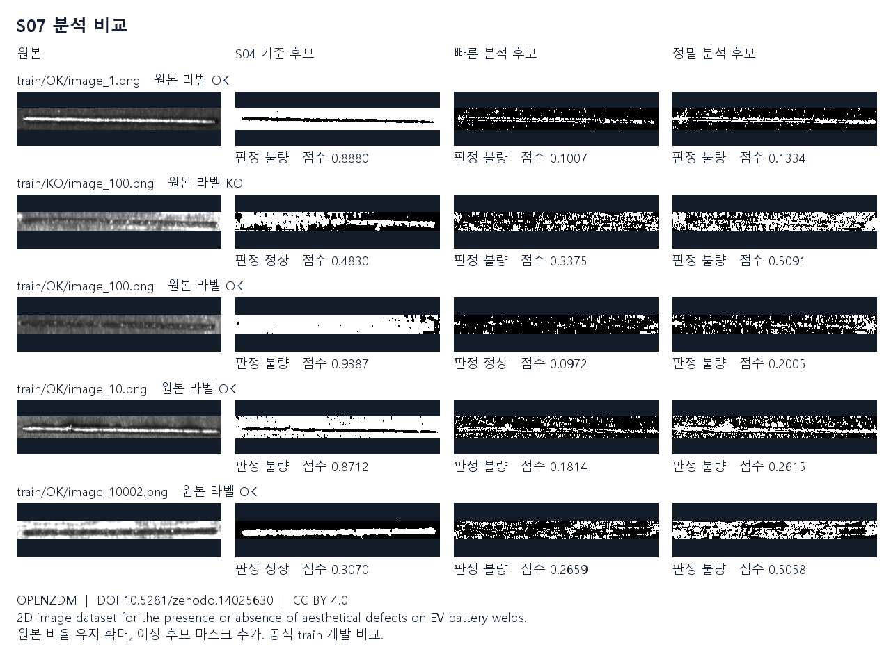

# S07 개선 알고리즘

상태는 **사용자 결과 검수 대기**다. 사용자가 승인한 [ADR 0007](../adr/0007-local-contrast-inspection.md)에 따라 S04 기준, 빠른 분석, 정밀 분석을 같은 OPENZDM 공식 train에서 비교했다.

## 검사 방식

S04는 영상 전체의 어두운 면적 비율을 사용한다. S07은 같은 행의 이웃보다 밝거나 어두운 위치를 표시한다. 넓고 균일하게 어두운 정상 배경의 영향을 줄이고, 전체 면적이 작은 밝기 변화도 후보로 잡기 위해서다. 수평으로 오래 이어져 주변과 밝기 차가 작거나 수직 방향의 대비만 있는 경우에는 신호가 약할 수 있다.

| 경로 | 후보와 정규화 |
|---|---|
| S04 기준 | [전역 어두운 픽셀 비율](../algorithms/global-dark-ratio.md) |
| 빠른 분석 | 8비트 흑백 원본과 9×1 수평 평균의 절대 차가 `contrast_threshold`보다 큰 픽셀을 후보로 삼는다. 후보 수를 원본 전체 픽셀 수로 나눈다. |
| 정밀 분석 | 9×1과 31×1 수평 평균에서 나온 후보를 합친다. 합친 마스크에 3×1 수평 열기 연산을 적용해 연속 후보를 구한다. 합집합 비율과 연속 후보 비율의 산술평균을 점수로 쓴다. 두 비율의 분모는 원본 전체 픽셀 수다. 저장하는 마스크와 후보 수는 합집합 기준이다. |

흑백 영상의 평균은 영상 경계를 복제하고, 열기 연산은 경계 외부를 0으로 처리한다. 두 경로 모두 점수가 `fail_ratio` 이상이면 FAIL이다. 실제 실행값은 [local-contrast.json](../../config/local-contrast.json)에 있다. 인접한 밝고 어두운 패턴이 정상에도 나타나므로, 점수와 마스크는 이미지 단위 판정을 설명하는 이상 후보다. OPENZDM의 정답은 이미지 단위 OK/KO다.

`WeldScope.Core`는 영상과 설정에서 후보를 계산한다. CLI는 S04의 파일 검증, 디코딩, 오류 경계, 시간 측정과 결과 저장을 공유한다. 동일 원본에 세 경로를 각각 호출한다. 자동 경로 선택은 S08의 정책 검수 범위다.

## 전체 train 비교

세 경로는 같은 **43,169장**을 두 번 처리했다. 각 실행에서 KO 8,253장과 OK 34,916장을 비교했으며 세 경로 모두 처리 오류 0건이었다.

| 경로 | 불량 유출률 (KO 중 PASS) | 정상 오판률 (OK 중 FAIL) |
|---|---:|---:|
| S04 기준 | 4,350 / 8,253 (52.71%) | 25,765 / 34,916 (73.79%) |
| 빠른 분석 | 499 / 8,253 (6.05%) | 19,982 / 34,916 (57.23%) |
| 정밀 분석 | 223 / 8,253 (2.70%) | 29,792 / 34,916 (85.33%) |

고정 설정에서 빠른 분석은 두 지표가 모두 개선됐지만 정상 오판이 여전히 57.23%였다. 정밀 분석은 빠른 분석보다 불량 유출이 276건 줄었고 정상 오판은 9,810건 늘었다.

| 기준 대비 판정 전환 | 빠른 분석 | 정밀 분석 |
|---|---:|---:|
| KO PASS → FAIL | 4,326 | 4,349 |
| KO FAIL → PASS | 475 | 222 |
| OK FAIL → PASS | 12,370 | 5,047 |
| OK PASS → FAIL | 6,587 | 9,074 |

점수 자체도 비교했다. 기록된 점수와 0·1 중에서 S04 고정 설정의 KO 유출 4,350건을 넘지 않는 가장 높은 임계값을 경로마다 택했다. 세 경로의 KO 유출이 모두 4,350건일 때 OK 오판은 기준 25,762건, 빠른 분석 8,034건, 정밀 분석 6,763건이었다. 정밀 점수는 이 train 조건에서 빠른 점수보다 정상 오판이 1,271건 적었다. 이 계산에는 공식 train을 다시 사용했으며 실행 설정의 0.10은 그대로다. 독립 평가와 적용 임계값 동결은 S11 범위다. [집계와 임계값 증거](S07-evidence/development-comparison.json)

## 실패 사례

아래는 고정 train 16장 중 대표 사례의 실제 C++ 마스크다. 원본 비율과 텍스트 판정을 유지하고 Visualize의 정적 그림 지침과 프로젝트 UI UX 원칙을 적용했다.



| 영상 | 관찰과 판정 변화 |
|---|---|
| `train/OK/image_1.png` | 기준은 어두운 배경 대부분을 후보에 넣었다. 국소 대비는 후보를 밝은 용접선 주변으로 줄였지만 빠른 점수 0.1007과 정밀 점수 0.1334가 모두 고정 기준을 넘어 오판이 유지됐다. |
| `train/KO/image_100.png` | 기준 후보 비율은 0.4830으로 PASS였다. 두 국소 경로에서 같은 영상의 밝기 변화가 후보로 잡혔고 둘 다 FAIL로 교정됐다. |
| `train/OK/image_100.png` | 기준은 어두운 영역 대부분을 골랐다. 빠른 경로가 후보를 줄여 PASS로 교정했으며, 넓은 스케일을 포함한 정밀 경로에서는 후보가 늘어 FAIL이 유지됐다. |
| `train/OK/image_10002.png` | 기준은 PASS였다. 두 국소 경로가 밝고 어두운 경계에 반응해 이 정상 영상을 FAIL로 판정했다. |

## 분석 비용과 재현

Windows 11 ARM64 build 26300, QEMU VM 4 vCPU·약 8 GiB, ARM64 Release, OpenCV 4.13.0 1스레드 조건이다. 입력당 경로별 분석은 한 실행에서 1회 수행했다. 두 번째 실행은 정밀 → 빠른 → 기준 순서로 바꿨다.

두 번째 실행의 표본 수 상위 세 원본 크기에서 측정한 `analysis_ms` p50 / p95다. 분석 시간은 흑백 변환부터 후보·점수·판정까지의 구간이다. 파일 읽기·해시·디코딩은 `load_ms`, 시연 PNG 저장은 `artifact_ms`에 따로 기록했다.

| 원본 크기 | 표본 수 | S04 기준 (ms) | 빠른 분석 (ms) | 정밀 분석 (ms) |
|---|---:|---:|---:|---:|
| 404×33 | 168 | 0.00667 / 0.00909 | 0.01492 / 0.01905 | 0.03065 / 0.04348 |
| 403×34 | 162 | 0.00692 / 0.00950 | 0.01521 / 0.01927 | 0.03125 / 0.04239 |
| 405×36 | 152 | 0.00717 / 0.01269 | 0.01602 / 0.01873 | 0.03300 / 0.05765 |

위 크기에서 정밀 분석의 p50은 빠른 분석의 약 2배였다. 로컬 두 보고서에는 전체 원본 크기별 표본 수와 분위수가 있다. VM 측정은 비교 비용으로 사용한다.

두 실행의 경로당 43,169행이 시간 필드를 제외하고 정확히 일치했다. 설정과 완료 요약, 고정 16장의 경로별 PNG 64개씩 총 192개도 바이트 단위로 일치했다. 시간 외 전체 행, PNG, 비교 임계값은 검토 수정 전의 S07 결과와 일치했다. S07 기준 경로는 과거 S04 고정 16장의 시간 외 행과 PNG 64개에도 일치했다. [재현 요약과 실행 해시](S07-evidence/development-comparison.json)

## 재현 절차

프로젝트 루트에서 PowerShell로 실행한다. S04의 ARM64 OpenCV 구성과 Python/Pillow, OPENZDM 입력 준비를 재사용한다. 기본 임시 디렉터리에서 누락 파일 검사가 접근 거부를 반환하는 실행 환경에서는 작업공간 안의 디렉터리를 `TEMP`와 `TMP`로 지정한다.

```powershell
powershell -NoProfile -ExecutionPolicy Bypass -File tools/demo-s07.ps1 -Output artifacts/S07/my-demo
powershell -NoProfile -ExecutionPolicy Bypass -File tools/demo-s07.ps1 -FullTrain -Output artifacts/S07/my-train-01
powershell -NoProfile -ExecutionPolicy Bypass -File tools/demo-s07.ps1 -FullTrain -ReverseOrder -Reference artifacts/S07/my-train-01 -Output artifacts/S07/my-train-02
```

출력에는 `baseline`, `fast`, `precise`별 CSV와 설정이 있고, `report`에 세 경로의 `comparison.csv`, 집계 `development-summary.json`, 시연 그림 `examples.png`가 있다. `run-context.json`에는 실행 시작 시 기록한 실행 파일·manifest 해시, 실행 순서와 환경이 있다. 시연 스크립트는 세 경로가 끝난 뒤 입력 목록과 실행 파일의 해시를 확인하고 이 기록을 확정한다. 검토 수정 후 전체 결과는 로컬 `artifacts/S07/review-train-01`, `review-train-02`, 고정 16장 시연은 `artifacts/S07/review-demo`에 있다. 완료 출력은 새 경로로 다시 실행한다.

원시 결과와 실행 기록이 저장된 뒤 보고서만 실패했다면 다음 명령으로 보고서를 재생성할 수 있다. 실행 기록이 없는 과거 출력도 단독 집계할 수 있다. 반복 검증과 실행 파일·순서·환경 표시는 실행 기록이 있는 출력에서 제공한다.

```powershell
.tools/python/python.exe -m tools.report_s07 --run artifacts/S07/my-train-02 --manifest artifacts/S04/inputs/manifest.json --reference artifacts/S07/my-train-01
```

## 검증과 사용자 확인

- ARM64 Release `/W4 /WX` 빌드와 CTest 3개가 통과했다. CTest에는 기준 엔진, 국소 대비 엔진과 실제 CLI 검사 7건이 포함된다. Python 별도 실행에서 44개가 통과했고 CLI 7개는 CTest에서 실행했다.
- 코드 검토 후 보고서는 실행 시 기록을 사용하며, 각 후보 폴더를 manifest 내 입력의 순번에 연결한다. 후보 수·연속 후보 비율·점수 계산식과 실제 PNG 목록을 검증한다. 임계값 탐색은 정렬된 KO 점수의 순서로 계산하며, CLI는 공통 결과 값으로 세 경로의 출력을 구성한다.
- S07 검수 항목은 고정 16장 그림, 정상·불량 오판의 전환, 크기별 추가 비용이다. 독립 정확도와 부품 단위 일반화는 [S02 독립 평가 보류 조건](S02-data-preparation.md#검증과-남은-제한)을 따른다.

OPENZDM의 *2D image dataset for the presence or absence of aesthetical defects on EV battery welds.*를 사용했다. 시연에서 원본을 비율에 맞춰 배치하고 계산된 후보 마스크를 추가했다. [Zenodo 원본](https://zenodo.org/records/14025630) · [CC BY 4.0](https://creativecommons.org/licenses/by/4.0/)
