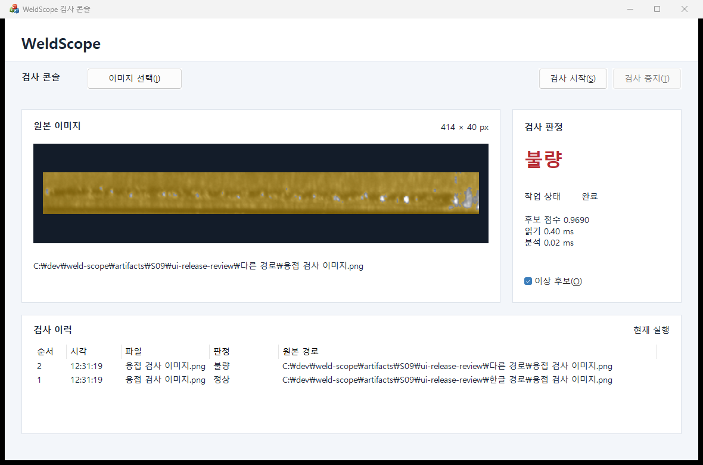

# S09 파일 검사 통합

**상태**　사용자 결과 검수 대기

MFC에서 단일 로컬 PNG를 선택해 S04 기준 엔진으로 검사한다. 원본과 후보 오버레이, 판정과 후보 점수, 읽기·분석 시간, 현재 실행 이력을 한 창에서 확인할 수 있다. [로드맵](../ROADMAP.md) · [ADR 0009](../adr/0009-mfc-file-inspection.md) · [PRD F01·F02·F06·F10](https://chatgpt.com/space/page_b35b9c74caac81918226ccdc9e38769e)

## 구성과 동작

- **공용 검사.** CLI와 MFC는 PNG 검증·SHA-256·설정 스키마 검증·후보 오버레이와 `inspect_baseline`의 소스를 공유한다. PNG의 마지막 청크는 길이가 0인 `IEND`여야 하며 CRC가 유효해야 한다. 파일은 한 번 읽어 같은 바이트에서 해시·원본·결과를 얻는다. GUI는 실행 파일 옆의 `baseline.json`을 읽는다. 읽기 시간에는 파일 읽기·해시·디코딩을 포함하고, 분석 시간은 기준 엔진 호출을 잰다.
- **작업 수명.** 백그라운드 실행 슬롯은 1개이며 대기열은 0개다. 재진입은 거절한다. 중지하면 UI에서 즉시 결과 수락을 끊고, 작업 스레드는 읽기·디코딩·분석 사이에서 취소를 확인한다. UI 타이머는 준비된 future만 꺼내고, 작업 ID가 무효화됐으면 결과를 버린다. 중지 후 다른 파일을 선택할 수 있으며 이전 작업이 슬롯을 비우면 재시작할 수 있다. 창 닫기와 Esc도 취소 후 슬롯을 회수하고 종료한다.
- **화면.** Visualize의 구성과 직접 라벨 원칙, [UI UX 원칙](../standards/ui-ux.md)을 적용해 S03의 입력·원본·판정·이력 순서를 유지했다. 짧은 텍스트 라벨로 작업과 결과를 구분한다. 파일을 바꾸면 이전 원본·판정·후보 표시가 초기화된다. 후보 오버레이는 실제 마스크이며, 이력에는 완료된 실제 작업만 추가한다. 영구 이력과 장비 연결은 S10, 선택적 정밀 분석은 S11 범위다.

## 실제 실행 결과

같은 이름의 한글 파일 두 개를 다른 폴더에 두고 네이티브 파일 대화상자로 선택했다. CLI와 동일한 설정을 사용했으며, 화면 크기·점수·판정이 아래 결과와 일치했다. [Release·Debug 검사 기록과 입력 해시](S09-evidence/verification.json)

| 고정 입력 | 원본 크기 | 점수 | 판정 |
|---|---:|---:|---|
| OPENZDM `train/OK/image_10002.png` | 405×35 | 0.3070 | 정상 |
| OPENZDM `train/KO/image_1.png` | 414×40 | 0.9690 | 불량 |
| `IEND` CRC가 손상된 PNG |  |  | 처리 오류, 판정·이력 없음 |



[정상](S09-evidence/01-pass.png) · [후보 끔](S09-evidence/03-original.png) · [손상 처리](S09-evidence/04-error.png) · [검사 중지](S09-evidence/05-cancelled.png) · [작은 창의 이력](S09-evidence/06-small.png)

Windows ARM64 Release와 Debug에서 동일한 24개 GUI 검사를 통과했다. 후보를 켜고 끈 화면을 CLI의 `overlay.png`와 `original.png`에 각각 대조했다. 두 이미지를 뒤바꾼 빌드는 이 검사에서 실패했다. 파일 접근 실패, 픽셀 한도 초과, PNG 손상, 미지원 형식은 각각 다른 복구 문구를 표시했고 판정과 완료 이력에 반영되지 않았다.

4,000×4,000 PNG 검사 중 800×520으로 창이 바뀌고 제한 시간 있는 창 메시지에도 응답했다. 중지한 작업은 이력에 추가되지 않았고 이어서 선택한 파일의 검사는 완료됐다. 작업 중 창을 닫으면 슬롯을 회수한 뒤 코드 0으로 종료했다. Tab 이동, 파일 대화상자 취소와 760×420 창에서의 이력 스크롤도 확인했다. 실제 GUI는 96 DPI에서 실행했다.

CTest 6개가 통과했다. 제어된 작업으로 중지 뒤 늦은 성공·오류 결과를 폐기하는 경로와 창 닫기 중의 결과 폐기를 검증했다. 별도 Python 테스트는 44개 통과했고 실제 CLI 8개는 CTest에서 실행했다. S07 고정 16장을 세 모드로 다시 실행해 점수·판정과 PNG 192개가 기존 증거와 일치함을 확인했다. 전체 학습 입력 43,169장의 기준 모드 결과도 기존 기록과 일치했다. x64·Win32와 다른 실제 DPI의 실행 검증은 남아 있다.

## 빌드와 시연

Windows ARM64, Visual Studio의 ARM64 C++·MFC 도구와 Windows SDK를 사용한다. S04의 OpenCV 설치가 준비되면 프로젝트 루트에서 실행한다. `weld-scope.slnx`에서도 동일한 MFC 프로젝트를 빌드할 수 있다.

```powershell
powershell -NoProfile -ExecutionPolicy Bypass -File tools/build-s09.ps1
.\artifacts\S09\ARM64\Release\WeldScope.App.exe
```

Debug는 먼저 `tools/setup-opencv-s04.ps1 -Configuration Debug`로 별도 `install-arm64-debug`를 준비한 뒤 `tools/build-s09.ps1 -Configuration Debug`로 빌드한다. 두 설치 경로를 분리해 같은 이름의 Debug와 Release 보조 라이브러리 충돌을 방지한다. 각 빌드는 실행 파일 옆에 기준 설정을 배치한다.

고정 입력은 [S04 입력 준비](S04-baseline-inspection.md#직접-실행)를 따른다. S04 실행 파일과 `artifacts/S04/sample-inputs`가 준비된 상태에서 GUI를 다시 검증할 수 있다. 완료된 결과를 보관하려면 새 출력 이름을 사용한다.

```powershell
.tools/python/python.exe tools/verify_s09.py --output artifacts/S09/my-ui-release
.tools/python/python.exe tools/verify_s09.py --exe artifacts/S09/ARM64/Debug/WeldScope.App.exe --output artifacts/S09/my-ui-debug
```

검수 항목은 CLI와 판정·원본·후보 이미지의 일치, 입력 오류별 복구 문구, 검사 중 창 응답과 취소한 파일의 이력 차단이다.

공개 시연 영상은 OPENZDM의 *2D image dataset for the presence or absence of aesthetical defects on EV battery welds.*에서 가져왔다. 원본 파일 바이트를 보존했고 화면에서 크기 조정과 후보 오버레이를 적용했다. [Zenodo 원본](https://zenodo.org/records/14025630) · [CC BY 4.0](https://creativecommons.org/licenses/by/4.0/)
