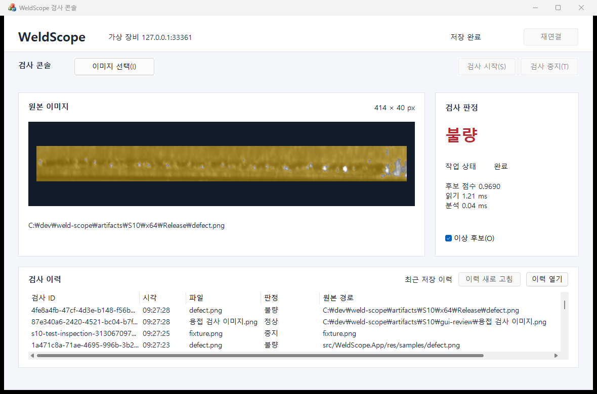

# S10 기록과 장비 통합

**상태**　사용자가 main에 병합

MFC에서 고른 PNG와 가상 장비 TCP 요청을 같은 기준 검사로 처리한다. 판정과 분석 시도는 MySQL에 저장하고 앱에서 다시 열 수 있다. [로드맵](../ROADMAP.md) · [ADR 0010](../adr/0010-record-device-integration.md) · [PRD F07·F08·F10](https://chatgpt.com/space/page_b35b9c74caac81918226ccdc9e38769e)

## 구성

- x64 MFC 프로세스에서 기준 검사, MySQL 저장 어댑터와 Winsock 루프백 서버를 사용한다. 한 실행 슬롯이 분석부터 저장까지 맡는다. 새 요청은 포화 시 `BUSY`를 받고, 진행 중인 같은 요청은 기존 검사 ID와 `IN_PROGRESS`를 받는다. 가상 장비는 `127.0.0.1:33361`에서 시연한다.
- 검사와 저장 상태를 별도로 표시한다. DB 준비에 실패하면 검사 시작이 제한된다. 운영 중 저장에 실패하면 새 검사는 대기하고, 기존 판정·점수·ID는 저장 재시도에 사용된다. 커밋 확인 뒤 TCP `RESULT`를 반환한다. 프로세스 종료 전까지 미저장 로컬 상태를 재시도할 수 있다.
- 최근 저장 이력 50건은 한 번의 요약 조회로 표시한다. 선택한 건을 열 때 분석 시도와 원본 해시를 조회한다. 경로를 찾을 수 없거나 바이트가 달라지면 `원본 누락` 또는 `원본 변경`과 보존된 판정을 표시한다.
- Visualize의 직접 라벨과 기존 창 구성 원칙을 적용했다. 과거 이력의 판정과 작업 상태는 같은 저장 건에서 표시한다. 사용자가 새 파일을 선택하면 그 경로와 판정 대기 화면을 유지하고, 동시에 완료된 TCP 작업은 저장 이력에 추가한다. TCP 작업의 저장이 실패하면 그 판정과 저장 재시도를 표시한다. 저장이 확인되면 선택해 둔 파일 화면으로 돌아간다. 통합 검수는 S04 기준 알고리즘에 한한다.

## 실제 실행 결과

Windows ARM VM에서 Release x64 MFC 실행 파일과 x64 MySQL C 클라이언트를 사용했다. 테스트 DB는 MySQL 8.4.13 전용 루프백 인스턴스였다.



[파일 검사](S10-evidence/01-file-stored.png) · [이력 재조회](S10-evidence/03-history-opened.png) · [미저장](S10-evidence/04-save-error.png) · [커밋 확인 필요](S10-evidence/05-save-error.png)

| 상황 | 관찰 결과 |
|---|---|
| MFC 파일 선택 | OPENZDM `train/OK/image_10002.png` 정상. 검사 1행과 기준 분석 시도 1행 저장 |
| TCP 등록 입력 | OPENZDM `train/KO/image_1.png` 불량. 요청은 동일 검사 ID로 `IN_PROGRESS`에서 `RESULT`로 전환 |
| MySQL 저장 대기 중 재전송·포화 | 동일 요청은 같은 ID로 진행 표시. 새 요청은 `BUSY`, 변경된 입력·설정은 `REQUEST_CONFLICT`. 거절 요청은 저장되지 않음 |
| 연결 및 프로세스 재시작 | 완료된 같은 요청은 DB에서 같은 검사 ID와 판정을 반환 |
| 커밋 전 연결 단절 | MFC에서 `미저장`과 불량 유지. 재시도 전 검사·시도 0행, 재시도 후 각 1행 |
| 서버 커밋 뒤 응답 유실 | MFC에서 `저장 확인 필요`와 불량 유지. 기존 각 1행을 재시도로 확인 |
| DB 미준비·읽기 전용 계정 | 검사 시작 차단 |
| 손상·취소·원본 변경 | 손상은 `ERROR`. 판정 전에 취소된 작업은 `CANCELLED`와 NULL 판정. 저장 중 취소는 계산된 불량 보존. 원본 누락 또는 변경 상태에서 저장 판정 재조회 |
| 기존 DB | S05에서 이미 저장한 행을 S10 마이그레이션 후 같은 ID로 재전송해 `replay` 확인 |
| 쓰기 잠금으로 저장 건 조회 지연 | 새 TCP 요청 두 건 모두 `BUSY`. 두 응답까지 약 0.17초 |
| 커밋 확인 재시도 중 다시 단절 | 같은 검사 ID와 `저장 확인 필요` 유지. 검사·시도 각 1행 |
| 이전 정상 이력과 최신 처리 오류, 파일 선택 중 TCP 완료 | 정상 이력의 작업 상태는 `완료`. TCP 완료 뒤 새 파일 경로와 판정 대기 상태 유지 |

## 재현과 검수

1. Visual Studio의 x64 C++ MFC 구성 요소, 저장소의 [MySQL 8.4.13](S05-storage-history.md) 배치와 [S09 정상 입력](S09-file-inspection-integration.md)을 준비한다. 시험용 MySQL 인스턴스는 S05 절차로 실행한다. 이번 검증에서는 DB 포트 `33360`과 시험용 SELECT·INSERT 계정을 썼다. 새 DB에는 `db/s05/schema.sql`, 기존 S05 DB에는 [마이그레이션](../../db/s10/migrate-from-s05.sql)을 한 번 적용한다.
2. S05의 접속 환경 변수에 전용 DB 호스트, 포트, DB 이름, 사용자와 비밀번호를 지정한다. 그 상태에서 저장소 루트에서 아래 명령을 실행한다.

```powershell
powershell -NoProfile -ExecutionPolicy Bypass -File tools/setup-opencv-s04.ps1 -Platform x64
powershell -NoProfile -ExecutionPolicy Bypass -File tools/build-s10.ps1
.\artifacts\S10\x64\Release\WeldScope.App.exe
```

현재 VM의 Release 검증에서는 IDE 설치를 기다리는 대신, 설치 카탈로그에 있는 Microsoft x64 ATL·MFC 패키지를 SHA-256 확인 후 `artifacts/S10/vs-x64`에 준비했다. 같은 작업 폴더에서는 빌드 명령에 `-StagedMfc artifacts/S10/vs-x64`를 붙여 재현할 수 있다. [Visual Studio Arm 개발 환경](https://learn.microsoft.com/en-us/visualstudio/install/visual-studio-on-arm-devices?view=visualstudio)

3. `DB 연결`을 확인하고 S09 정상 PNG를 선택하여 `검사 시작`을 누른다. 다음 명령을 다른 PowerShell에서 실행하면 등록된 불량 PNG에 새 TCP 요청을 보내고 같은 요청으로 결과를 확인한다. `검사 이력`에서 해당 ID를 골라 `이력 열기`를 눌러 본다.

```powershell
.tools/python/python.exe -c "from tools.verify_s10_integration import request, wait_until; import uuid; req='review-'+uuid.uuid4().hex; print(request(33361, req)); print(wait_until(lambda: request(33361, req), lambda frame: frame[0]=='RESULT'))"
```

4. 전용 루프백 MySQL과 동일한 접속 환경에서 자동 검사를 실행할 수 있다. 장애 및 테이블 잠금을 재현하는 검사는 S05와 같은 전용 루프백 관리자 계정을 사용한다.

```powershell
$mysql = (Resolve-Path .tools/mysql-8.4.13-winx64).Path
$opencv = (Resolve-Path .tools/opencv/install-x64/x64/vc18/staticlib).Path
$python = (Resolve-Path .tools/python/python.exe).Path
cmake -S . -B artifacts/S10/integration-build -G 'Visual Studio 18 2026' -A x64 -DWELDSCOPE_S10_TESTS=ON "-DMYSQL_ROOT=$mysql" "-DOpenCV_DIR=$opencv" "-DPython3_EXECUTABLE=$python"
cmake --build artifacts/S10/integration-build --config Release
ctest --test-dir artifacts/S10/integration-build -C Release --output-on-failure
& $python -m tools.verify_s10_integration artifacts/S10/integration-build/Release/s10_integration_host.exe "$mysql/bin/mysql.exe"
& $python -m tools.verify_s10_gui artifacts/S10/x64/Release/WeldScope.App.exe artifacts/S10/gui-evidence
```

S10 검수 범위는 Windows ARM VM에서 실행한 x64 Release와 로컬 가상 장비다. x64 Debug, 다른 실제 DPI와 원격 장비는 실행 검증 범위 밖이다. [ADR 0010의 계약과 제약](../adr/0010-record-device-integration.md)

기존 회귀 검사에서 CTest 6건과 S05 MySQL 장애 검사, S06 TCP 루프백 시연, S09 ARM64 Release 실제 창 검사 24건이 통과했다. Python 검사 52건 중 CLI 전용 8건은 위 CTest에서 실행했다.
