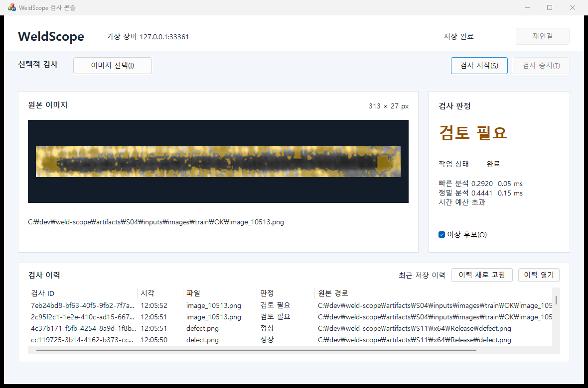

# S11 알고리즘 통합과 평가

**상태**　main 병합

S04 기준 검사와 S07 국소 대비를 S08 선택 정책에 연결했다. CLI, MFC 파일 처리, TCP가 같은 C++ 분석 호출을 사용한다. 실행 시작점은 S10을 병합한 `e4824b0`이다. [로드맵](../ROADMAP.md) · [ADR 0011](../adr/0011-algorithm-integration-evaluation.md)

## 평가 집합과 정책 동결

OPENZDM 원본 ZIP의 SHA-256을 검증했다. S02의 동일 dHash와 해밍 거리 5 이하 관계를 연결한 뒤, 여러 분할에 걸친 그룹을 주 검증·시험 집합에서 제외했다. 공식 시험 전체는 같은 결과 행에서 민감도 비교용으로 집계했다. 원본 해상도와 공식 분할을 보존했다. 부품 단위 독립성은 미확인이다. [S02 점검](S02-data-preparation.md) · [집합별 행 수와 해시](S11-evidence/inputs.json)

| 집합 | 정상 OK | 불량 KO | 합계 |
|---|---:|---:|---:|
| 정책 동결에 사용한 검증 | 6,626 | 1,584 | 8,210 |
| 주 시험 | 6,535 | 1,569 | 8,104 |
| 공식 시험 전체 | 7,482 | 1,769 | 9,251 |

검증 쌍 8,210개의 합산 분석 시간으로 **132µs** 예산을 정했다. 고정 관측에서 제약에 맞았던 696개 후보 중 첫 후보는 실제 검증에서 자동 판정률 90%에 미달했고, 두 번째 후보는 불량 자동 통과 상한을 넘었다. 세 번째 후보는 자동 판정 7,390/8,210 (90.01%), 정밀 분석 819/8,210 (9.98%), 불량 자동 통과 754/1,584로 검증 기준 762/1,584 이내였다. 이 설정과 검증·시험 manifest 및 실행 파일의 해시를 기록한 뒤 시험 영상을 추출했다. 두 시험 실행에서 설정은 동일했다. [동결 기록](S11-evidence/freeze.json) · [후보와 비교 데이터](S11-evidence/compact-results.json)

## 시험 결과

커밋 `ea015e2`의 동결 실행 파일로 측정한 주 시험 8,104장의 첫 실행 결과다. 불량 유출률은 KO 중 PASS, 정상 오판률은 OK 중 FAIL이다. 보류율, 오류율, 자동 판정률, 정밀 호출률은 전체 8,104장이 분모다. 자동 판정 표본의 오류율과 원시 혼동 집계는 비교 데이터에 있다.

| 경로 | 불량 유출률 | 정상 오판률 | 보류율 | 자동 판정률 | 정밀 호출률 |
|---|---:|---:|---:|---:|---:|
| S04 기준 | 47.80% | 74.63% | 0% | 100% | 0% |
| 빠른 분석만 | 48.95% | 25.23% | 0% | 100% | 0% |
| 전 영상 정밀 분석 | 48.44% | 21.16% | 0% | 100% | 100% |
| 선택적 정밀 분석 | 48.06% | 16.19% | 10.08% | 89.92% | 10.02% |

- 주 시험과 공식 시험 전체의 모든 경로에서 ERROR는 0건이었다. 선택적 정밀 분석의 주 시험 보류 817건은 OK 611건과 KO 206건이었다. 두 번째 실행에서는 OK 647건과 KO 204건이 보류됐다.
- 반대 순서로 실행한 두 번째 주 시험에서 선택적 정밀 분석의 불량 유출률은 47.93%, 정상 오판률은 16.10%, 자동 판정률은 89.50%, 정밀 호출률은 9.97%였다. 두 실행 사이에 주 시험 72건과 공식 시험 81건이 시간 예산에 따른 REVIEW를 거쳐 판정이 달라졌다. 다른 세 경로의 판정은 일치했다.
- 주 시험에서 선택적 경로의 KO 자동 통과는 754건과 752건으로 S04의 750건보다 많았다. 자동 판정률도 두 번 모두 검증 목표인 90% 아래였다. 공식 시험 전체에서는 선택적 경로의 KO 자동 통과가 두 번 모두 927/1,769, S04는 929/1,769였다. 데이터 범위에 따라 S04 대비 유출 차이의 방향이 달랐다. 선택적 경로는 보류를 포함하고 세 비교 경로는 모든 입력에 자동 판정을 내렸으므로 비용과 오류 수치는 해당 자동 판정 범위와 함께 해석한다. [두 시험 집합과 반복별 비교](S11-evidence/compact-results.json)

## 시간 측정

Windows 11 ARM QEMU VM의 x64 Release 실행 파일, 4 vCPU, OpenCV 4.13.0 1스레드를 사용했다. 경로 순서는 1회 기준→빠른→전수 정밀→선택적, 2회 반대 순서였다. 아래는 두 번째 주 시험의 표본 수 상위 원본 크기에서 측정한 분석 시간 p50 / p95(ms)다. 원본 로드·해시·디코딩과 산출물 저장 시간은 분석 시간과 따로 기록했다.

| 원본 크기 | 표본 수 | 기준 | 빠른 | 전수 정밀 | 선택적 정밀 |
|---|---:|---:|---:|---:|---:|
| 404×35 | 38 | 0.01125 / 0.01813 | 0.02792 / 0.03338 | 0.05733 / 0.06967 | 0.02967 / 0.14125 |
| 405×35 | 36 | 0.01125 / 0.02400 | 0.02767 / 0.03217 | 0.05829 / 0.07663 | 0.02925 / 0.08954 |
| 406×36 | 36 | 0.01188 / 0.02188 | 0.02913 / 0.03721 | 0.06033 / 0.14896 | 0.03008 / 0.16138 |

세 크기에서 선택적 경로의 중앙값은 전수 정밀보다 낮았고 p95는 높았다. 분석 시간 예산은 호출이 반환된 뒤 확인한다. [정책 시간 계약](../adr/0008-selective-inspection-policy.md)

## 같은 PNG의 네 경로 시연

OPENZDM(CC BY 4.0) train의 `OK/image_10513.png` 한 장을 각 경로에서 비교했다. 각 실행은 동일한 train 워밍업 영상 8장 뒤에 대상 PNG를 분석했다. 그림에는 단계별 후보를 색으로 합성했다. 아래 시간은 비교 시연의 한 번 측정값이다. [데이터 출처](S02-data-preparation.md) · [원본 식별자와 단계별 측정값](S11-evidence/demo/comparison.json)

| 경로 | 점수 | 판정 | 분석 시간(ms) |
|---|---:|---|---:|
| [기준 후보](S11-evidence/demo/baseline.png) | 0.60052 | FAIL | 0.02908 |
| [빠른 후보](S11-evidence/demo/fast.png) | 0.29204 | FAIL | 0.03883 |
| [전수 정밀 후보](S11-evidence/demo/precise.png) | 0.44415 | PASS | 0.08742 |
| [선택적 정밀 후보](S11-evidence/demo/selective.png) | 빠른 0.29204 / 정밀 0.44415 | REVIEW | 0.17658 |

선택적 경로는 두 단계를 실행했다. 합산 시간이 132µs를 넘어 REVIEW를 반환했다. 같은 설정에서 프로세스의 첫 호출도 초기화 비용으로 예산을 넘을 수 있다. 이 경우에도 S08과 같은 시간 예산 판정을 사용한다.

## 실제 MFC·TCP·MySQL 검수



- 등록된 `weld-01` PNG로 파일과 TCP 검사를 두 번 짝지어 실행했다. 빠른 점수는 모두 0.11570048이었다. 첫 비교의 파일은 187µs로 REVIEW, TCP는 73µs로 PASS였다. 두 번째는 파일 110µs와 TCP 66µs로 모두 PASS였다. 결과의 차이는 실제 분석 시간과 동결 예산으로 설명됐다.
- 별도 train PNG `image_10513.png`는 첫 번째 시도에서 빠른 분석의 예산을 초과했다. 두 번째 시도는 빠른 분석 51µs와 정밀 분석 154µs를 실행하고 REVIEW로 저장했다. UI와 이력에서 실행한 단계와 판정 사유를 확인했다.
- `baseline-v1`과 동결 해시에 고정된 `selective-v1`의 기존 요청은 재시작 후 같은 검사 ID와 결과를 반환했다. 설정을 지우거나 다른 유효 설정으로 바꾼 배치에서는 기존 요청의 결과를 재전송했고 새 `selective-v1` 요청을 거절했다.
- 고정 시연에서 TCP는 최초 요청부터 결과 폴링까지 91.01ms, MySQL 저장은 연결과 커밋을 포함해 6.17ms였다. 두 값은 별도 단일 관측이다. [MFC 검증과 원시 수치](S11-evidence/gui/verification.json) · [TCP 화면](S11-evidence/gui/02-selective-tcp.png) · [이력 화면](S11-evidence/gui/03-selective-history.png)

## 실행과 검수

Visual Studio x64 C++ 도구, [S10 MySQL 준비](S10-record-device-integration.md), OpenCV x64 정적 설치와 S02 검증 ZIP을 사용한다. 저장소 루트의 PowerShell에서 실행한다.

```powershell
$python = (Resolve-Path .tools/python/python.exe).Path
$opencv = (Resolve-Path .tools/opencv/install-x64/x64/vc18/staticlib).Path
$mysql = (Resolve-Path .tools/mysql-8.4.13-winx64).Path
cmake -S . -B artifacts/S11/build -G 'Visual Studio 18 2026' -A x64 -DWELDSCOPE_S10_TESTS=ON "-DMYSQL_ROOT=$mysql" "-DOpenCV_DIR=$opencv" "-DPython3_EXECUTABLE=$python"
cmake --build artifacts/S11/build --config Release
ctest --test-dir artifacts/S11/build -C Release --output-on-failure

$bin = 'artifacts/S11/build/Release'
$run = 'artifacts/S11/evaluation-new'
& $python -m tools.evaluate_s11 prepare --output $run
& $python -m tools.evaluate_s11 validate --output $run --inspect "$bin/weldscope_inspect.exe" --calibrator "$bin/weldscope_calibrate_s11.exe"
& $python -m tools.evaluate_s11 test --output $run --inspect "$bin/weldscope_inspect.exe"
```

`validate`가 실제 기준을 충족한 설정을 동결하면 `test`를 실행한다. `validation/evaluation.json`을 기록한 뒤 중단된 검증은 같은 입력과 실행 파일을 지정하고 `validate`에 `--resume-validation`을 추가해 재개한다. 시험은 두 반복과 집계가 모두 끝난 뒤 결과 폴더를 게시한다. 중단된 시험은 같은 명령으로 다시 실행한다.

동결 기록과 일치하는 실행 파일로 시험을 반복할 때는 `--test-output <새 결과 폴더>`를 지정한다. 위 시험 결과의 원시 CSV, 시간 분포, 동결 파일은 `artifacts/S11/evaluation`에 있다. 시간 경계 수정 후의 실행 파일은 새 평가 경로에서 검증과 동결을 거친다. 새 실행에서는 단계별 나노초로 예산을 비교한다. 측정 환경이 달라지면 검증 선택 결과가 바뀔 수 있다.

같은 train PNG의 네 경로 시연은 `tools.evaluate_s11 demo`로 실행한다. [S04 전체 train 입력](S04-baseline-inspection.md)을 준비한 뒤 아직 시연 결과가 없는 평가 경로를 지정한다.

```powershell
& $python -m tools.evaluate_s11 demo --output $run --inspect "$bin/weldscope_inspect.exe"
```

TCP의 `selective-v1`을 검수할 MFC 빌드에는 S11에 등록된 아래 동결 설정을 전달한다. 현재 Windows VM은 S10에서 확인한 스테이징 경로를 사용했다. 다른 환경의 Visual Studio 설치에 x64 MFC가 있으면 `-StagedMfc` 인자를 생략한다.

```powershell
powershell -NoProfile -ExecutionPolicy Bypass -File tools/build-s10.ps1 -StagedMfc artifacts/S10/vs-x64 -SelectiveFreeze docs/steps/S11-evidence/freeze.json
.\artifacts\S11\x64\Release\WeldScope.App.exe
```

전용 테스트 MySQL이 준비된 상태에서 실제 창 회귀 검사를 실행한다. `image_10513.png`는 S04에서 추출한 train 원본이다. `--two-stage-source`를 지정하면 다섯 번의 시도 안에 정밀 분석 단계가 관찰돼야 검증이 통과한다.

```powershell
& $python -m tools.verify_s11_gui artifacts/S11/x64/Release/WeldScope.App.exe artifacts/S11/gui-new --two-stage-source artifacts/S04/inputs/images/train/OK/image_10513.png --integration-host "$bin/s10_integration_host.exe"
```

최초 S11 검수에서는 x64 CTest 7건, S06 코덱과 TCP 시연, S09 ARM64 실제 창 검사 24건(96 DPI), S10 기준 모드 실제 창과 저장 장애 복구 검사, Python 일반 검사 52건이 통과했다. Python 발견 검사에서 건너뛴 CLI 11건은 CTest에서 통과했다. 기존 S07 고정 train 16장은 기준·빠른·정밀 경로의 시간 외 CSV와 PNG 192개가 기존 증거와 일치했다. S11 앱은 Windows ARM VM의 x64 Release에서 검증했다.

코드 리뷰 반영 후에는 x64 CTest 7건과 Python 일반 검사 58건이 통과했다. train PNG 한 장으로 시험 입력 누락 후 재시도와 별도 결과 폴더 게시를 확인했다. 같은 Windows VM의 x64 MFC와 전용 MySQL에서 파일·TCP 검사, 이력 재조회, 재시작 후 재전송, 두 단계 분석을 다시 확인했다. 공식 시험 수치는 최초 동결 실행의 기록이다.
